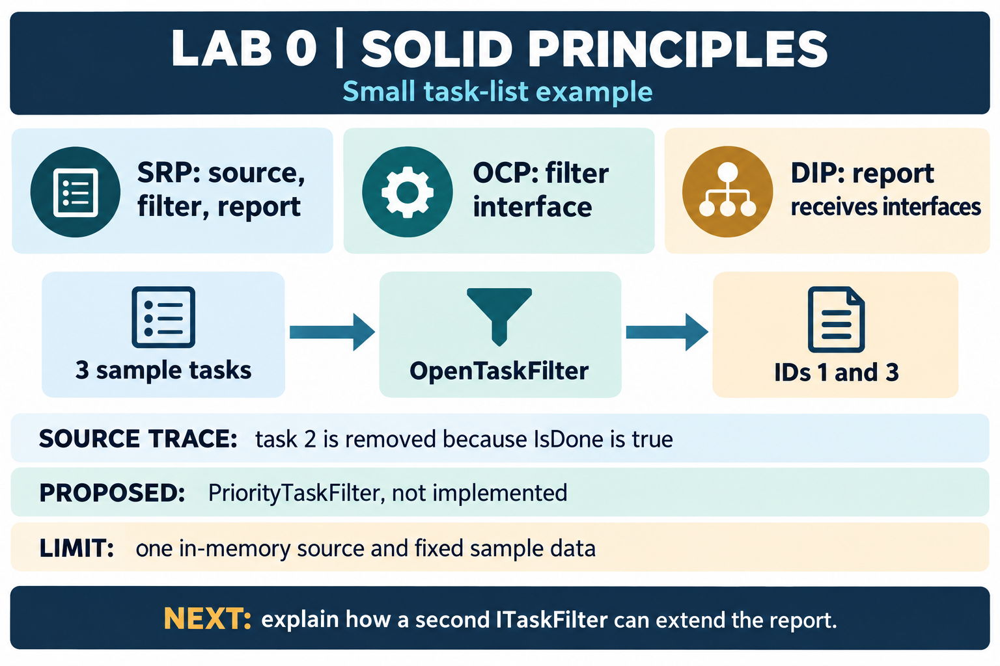
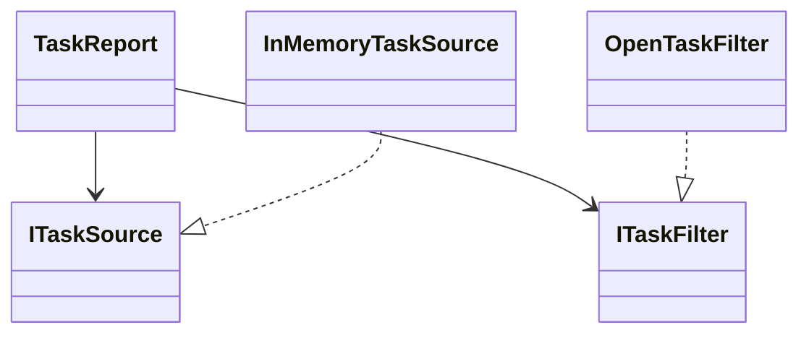

# Lab 0: Three SOLID principles

## Local study report

[Open the formatted study report (PDF)](study-report.pdf) or its [LaTeX source](report.tex). The report traces the current `Program.cs` and includes the full source in an appendix.



## Files

- [Program.cs](Program.cs): the task-list example explained in the report.
- [TMPSLab00.csproj](TMPSLab00.csproj): the .NET 10 console project.
- [report.tex](report.tex) and [study-report.pdf](study-report.pdf): editable report source and formatted study report.
- `utmreport.cls` and `utm-logo.jpeg`: local copies used to compile the report independently.

## Brief

The [ELSE brief](https://else.fcim.utm.md/mod/assign/view.php?id=38256) says: “Implement 3 SOLID letters in a simple project.” This example selects Single Responsibility, Open/Closed, and Dependency Inversion and follows those principles through one task-list flow.

The example selects Single Responsibility, Open/Closed, and Dependency Inversion and uses a small task list. It is a learning example, not a claim that it was submitted.

## Build and run

Prerequisite: .NET 10. From this directory:

```powershell
dotnet build .\TMPSLab00.csproj
dotnet run --project .\TMPSLab00.csproj
```

Trace-derived output (not a newly recorded run):

```text
Open tasks: 2
1: Read the brief (priority 2)
3: Prepare questions (priority 1)
```

## How the code demonstrates the principles

- **Single Responsibility:** the source returns tasks, the filter selects open tasks, and the report prints them. Each class has one reason to change.
- **Open/Closed:** a new `ITaskFilter` can add a selection rule without editing `TaskReport`.
- **Dependency Inversion:** `TaskReport` receives `ITaskSource` and `ITaskFilter`. It does not depend on the in-memory source or the open-task filter directly.



## Tiny trace

The source returns three tasks. `OpenTaskFilter` keeps tasks 1 and 3 because their `IsDone` value is false. `TaskReport` prints those two rows. If the data later comes from a file, add another `ITaskSource`; the report can keep the same constructor and printing logic.

## Oral questions

1. **What changes when the source changes from memory to a file?** Add a file-backed `ITaskSource`; the report still asks the interface for tasks.
2. **How can another filter be added without rewriting `TaskReport`?** Implement `ITaskFilter` and pass that implementation from `Main`.
3. **Why are there separate source, filter, and report classes?** Data access, selection, and presentation have different reasons to change.
