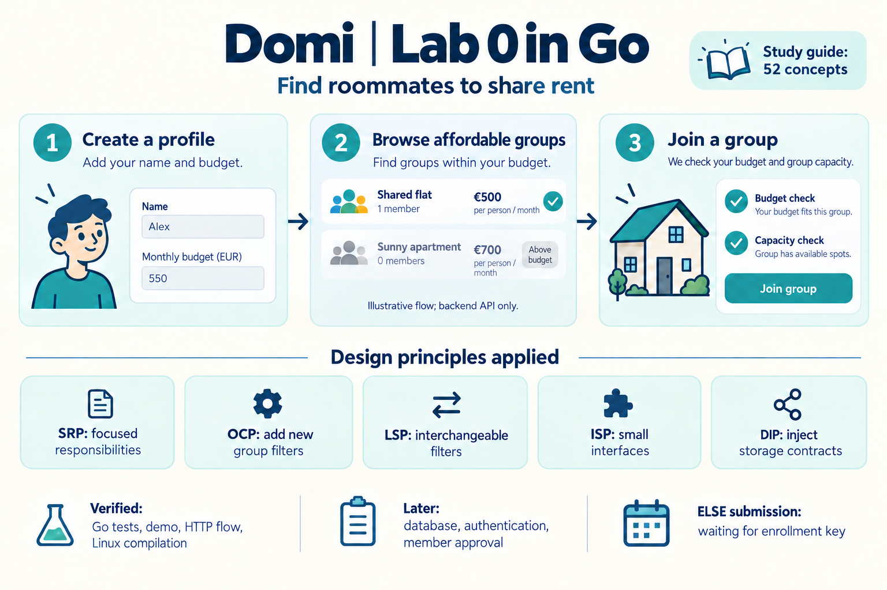

# Lab 0: Domi backend and SOLID

Domi helps people find roommates to share rent. This lab implements a small Go backend: create a profile, create or browse affordable groups, inspect members, and join when budget and capacity permit.

Implementation and report revision: **15 October 2026**.

## Read and run

Read the four OOP pillars and SOLID sections in [learn.md](learn.md), run the demo, and follow [report.md](report.md) through the exact source, UML diagrams, input/output, and presentation questions. The guide explains all 52 requested concepts; the implementation demonstrates all five SOLID principles.

Use a supported Go SDK. Go 1.22 introduced the routing syntax used here; the verified workstation has Go 1.27.1.

```powershell
go run . --demo
go run . --addr localhost:8080
```

The demo creates Alex with budget 550 and two groups costing 700 and 500. It joins Alex to the 500 group and prints JSON with the affordable group and its membership.

## HTTP example

In a second PowerShell terminal while the server runs:

```powershell
$api = 'http://localhost:8080'
$profile = Invoke-RestMethod -Method Post -Uri "$api/profiles" -ContentType 'application/json' -Body '{"name":"Ana","monthlyBudget":550}'
$group = Invoke-RestMethod -Method Post -Uri "$api/groups" -ContentType 'application/json' -Body '{"name":"Shared flat","maxMonthlyCost":500,"capacity":2}'
Invoke-RestMethod -Uri "$api/groups?budget=550"
$joinBody = @{ profileId = $profile.id } | ConvertTo-Json
Invoke-RestMethod -Method Post -Uri "$api/groups/$($group.id)/join" -ContentType 'application/json' -Body $joinBody
Invoke-RestMethod -Uri "$api/groups/$($group.id)"
```

| Route | Input | Result |
|---|---|---|
| `POST /profiles` | name, monthlyBudget | Profile ID and name, 201 |
| `POST /groups` | name, maxMonthlyCost, capacity | Group summary, 201 |
| `GET /groups` | optional budget query | Matching group summaries, 200 |
| `GET /groups/{id}` | group ID | Group and members, 200 |
| `POST /groups/{id}/join` | profileId | Updated group and members, 200 |

Amounts are illustrative whole EUR per person per month. Capacity is 1 to 20. Invalid input returns 400, unknown records 404, a full group 409, and insufficient budget 422. Repeated joins succeed without adding another member. Member responses omit the person's budget.

## Source and verification

| File | Responsibility |
|---|---|
| [domain.go](domain.go) | Entities, validation, membership rules, safe views |
| [service.go](service.go) | Small contracts, services, interchangeable filters |
| [store.go](store.go) | In-memory storage and atomic membership changes |
| [http.go](http.go) | Routes, JSON input/output, error mapping |
| [main.go](main.go) | Construct dependencies, start server, run demo |
| [service_test.go](service_test.go) | Business rules, filter contracts, concurrent joins, HTTP behavior |

`go test ./...`, the demo, and a live HTTP scenario passed. The concurrent test lets 30 profiles compete for three places and checks exactly three successful joins. The final focused test passed after adding the capacity limit and server timeouts. Linux amd64 cross-compilation passed; the binary has not been deployed or executed on a Linux server.

For Linux compilation in PowerShell, preserve your environment variables:

```powershell
$previousGoOS = $env:GOOS
$previousGoArch = $env:GOARCH
try {
    $env:GOOS = 'linux'
    $env:GOARCH = 'amd64'
    go build -o (Join-Path $env:TEMP 'domi-linux-amd64') .
} finally {
    $env:GOOS = $previousGoOS
    $env:GOARCH = $previousGoArch
}
```

## Scope and hand-in

This is a local, in-memory coursework prototype, separate from the [existing Domi frontend](https://trydomi.vercel.app). Data disappears when the process stops. Authentication, durable storage, approval of join requests, and frontend integration are later work.

The [course repository](https://github.com/Lucian-Adrian/sem5-software-design) contains the source, report, and guide. This folder follows ELSE numbering: Lab 0 covers SOLID, Lab 1 covers creational patterns, and Lab 2 covers structural patterns. Submission remains blocked by the enrollment key. Historical ELSE dates from 2025 do not establish the current deadline.

Prepared hand-in text:

> Domi backend in Go: first SOLID lab, demonstrating SRP, OCP, LSP, ISP and DIP. Source, run instructions, Markdown report and UML diagrams: https://github.com/Lucian-Adrian/sem5-software-design/tree/main/lab-00

The code and explanations were prepared with AI assistance. Review them, practice the trace and live changes, and follow the instructor's rules for assessed work.


