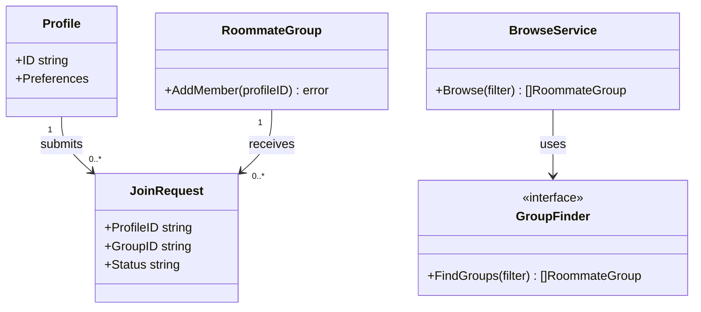
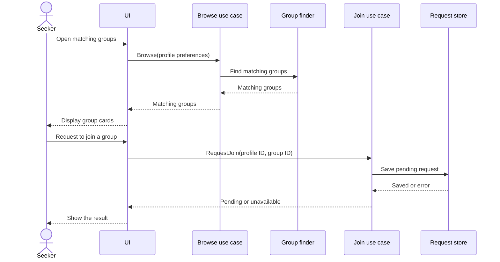

# Learn object-oriented design through Go and Domi

This guide starts with one user journey, then builds the design ideas needed to explain it. The Go examples are isolated teaching snippets. They illustrate language mechanisms and are not claims about existing Domi source files. Match names to the implementation in the lab report after the code is in place.

The implemented Lab 0 demonstrates all five SOLID principles. Its current scope is profiles with a name and budget, groups with a cost and capacity of 1 to 20, affordability filtering, and direct joining. City, preferences, join requests, and approval in the broader story below are future features. See [the report](report.md) for the exact source and current behavior.

The GoF patterns below are a roadmap for later labs. Explaining a pattern here does not mean the current implementation uses it.

## 1. Start with the Domi user story

Imagine a person looking for compatible roommates:

1. They create a profile with the details needed for matching, such as a city, budget, move-in date, and living preferences.
2. They browse roommate groups that fit their profile and inspect a group's details.
3. They ask to join one group. Domi checks that the profile and group exist and that the request is allowed.
4. The system records the request and shows its result. If the group needs to approve requests, the request stays pending until a member accepts or declines it. The exact acceptance rule is a product decision, so keep it separate from the basic browse flow.

A small domain model for reasoning is `Profile`, `RoommateGroup`, and `JoinRequest`. The profile owns a person's matching preferences. A group owns its membership rules and capacity. A join request connects one profile to one group and records its status. The user journey tells us what the system must do before we decide which types or patterns to create.

When explaining a design choice, answer four questions: What user need triggers it? Which type owns the relevant rule or data? What changes might need to vary? What cost does the extra abstraction add?

## 2. The four OOP pillars, expressed in Go

Go supports object-oriented design through types, methods, interfaces, and composition. It has no `class` declaration or class-based superclass and subclass hierarchy. A method is a function with a receiver. Interfaces specify behavior, and a type satisfies an interface implicitly by having the required methods. Struct embedding promotes fields and methods, but does not make the outer struct a subtype of the embedded type.

### Encapsulation

Encapsulation keeps state and the rules for changing it together. In Go, lowercase package-level names are unexported outside their package. A method can guard an invariant before it changes private fields.

In Domi, capacity and duplicate-member checks belong with the group membership operation. A screen should not edit a public member list and hope every caller remembers the same checks.

```go
package main

import "errors"

type RoommateGroup struct {
	members  map[string]struct{}
	capacity int
}

func NewRoommateGroup(capacity int) (*RoommateGroup, error) {
	if capacity < 1 {
		return nil, errors.New("capacity must be positive")
	}
	return &RoommateGroup{
		members:  make(map[string]struct{}),
		capacity: capacity,
	}, nil
}

func (group *RoommateGroup) AddMember(profileID string) error {
	if profileID == "" {
		return errors.New("profile ID is required")
	}
	if _, exists := group.members[profileID]; exists {
		return errors.New("profile is already a member")
	}
	if len(group.members) >= group.capacity {
		return errors.New("group is full")
	}
	group.members[profileID] = struct{}{}
	return nil
}

func (group *RoommateGroup) MemberCount() int {
	return len(group.members)
}
```

The receiver is a pointer because `AddMember` changes the group. A value receiver is useful when a method only reads a small value and copying it is acceptable. This snippet models the membership invariant; a pending request can be a separate record that is accepted before `AddMember` runs.

### Abstraction

Abstraction gives a caller the behavior it needs while hiding irrelevant details. A person browsing groups needs a list of matching groups. They do not need to know whether those records came from a database, a test fixture, or a cache.

An interface can name just the behavior the browsing use case needs:

```go
package main

type Filter struct {
	City string
}

type RoommateGroup struct {
	ID   string
	City string
}

type GroupFinder interface {
	FindGroups(filter Filter) []RoommateGroup
}

type BrowseService struct {
	finder GroupFinder
}

func (service BrowseService) Browse(filter Filter) []RoommateGroup {
	return service.finder.FindGroups(filter)
}
```

The snippet defines the boundary, not a database API. Any value with the matching `FindGroups` method can be used by `BrowseService`. Add this seam when the caller benefits from replacing or testing the data source; skip it when direct code is already simple and unlikely to vary.

### Inheritance, translated rather than copied

In a class-based language, one might write `GroupCard extends LocationCard` and inherit its implementation. Go has no equivalent subtype declaration. A Go struct may embed another type, which promotes its fields and methods for convenient access. The embedded value remains a field, and the outer type does not become assignable to the embedded type.

```go
package main

type Area struct {
	City string
}

func (area Area) CityName() string {
	return area.City
}

type GroupCard struct {
	Area
	Title string
}

type CityNamed interface {
	CityName() string
}

func ShowCity(value CityNamed) string {
	return value.CityName()
}

var _ CityNamed = GroupCard{}
```

`GroupCard` can call `CityName` through embedding, and it satisfies `CityNamed` because the method is in its method set. It is not an `Area` subclass. Prefer a named field when the relationship is ordinary composition; use embedding when promoting the embedded behavior makes the API clearer.

### Polymorphism

Polymorphism means the same operation can work with different concrete values that share a behavior. In the `GroupFinder` example, `BrowseService` can use any implementation that has the required method. No `implements` declaration is needed. This lets a small fake finder stand in during a test or a different finder serve another environment, without teaching the browse logic their internal details.

## 3. SOLID in the same user journey

SOLID is a set of design checks, not a requirement to create five layers or five interfaces. Apply a principle when it improves the user flow's ability to change, explain, or test.

### Single Responsibility Principle

Give a module one focused responsibility and one main reason to change. `RoommateGroup` can protect membership rules. A browsing use case can coordinate search. A persistence component can store data. If one type both renders cards, validates requests, and writes records, unrelated changes will make it harder to understand and test.

### Open/Closed Principle

Keep stable logic open to supported extensions without editing it for every new rule. For example, a common filter loop can accept a budget or city rule as a function:

```go
package main

type RoommateGroup struct {
	City        string
	MonthlyCost int
}

type GroupRule func(RoommateGroup) bool

func FilterGroups(groups []RoommateGroup, rule GroupRule) []RoommateGroup {
	matching := make([]RoommateGroup, 0, len(groups))
	for _, group := range groups {
		if rule(group) {
			matching = append(matching, group)
		}
	}
	return matching
}

func UnderBudget(limit int) GroupRule {
	return func(group RoommateGroup) bool {
		return group.MonthlyCost <= limit
	}
}
```

Here a rule is a small Strategy passed as a function. Add an extension point when multiple real rules must vary. For one fixed check, a direct `if` statement may be easier to explain.

### Liskov Substitution Principle

Any implementation used through a contract must honor that contract's promises. A `GroupFinder` should return groups matching the requested filter, whether it reads memory or a database. It should not silently ignore the city or return invalid results. Go's interfaces let you express behavioral contracts, but the compiler checks method signatures, not whether those promises are true.

### Interface Segregation Principle

Keep interfaces small enough that each caller depends only on the behavior it needs. A browse flow needs to read groups; a join flow needs to save requests. Giving each flow a narrow interface avoids making the browsing code depend on write operations it never uses.

```go
package main

type RoommateGroup struct {
	ID string
}

type GroupReader interface {
	FindGroups(city string) []RoommateGroup
}

type PendingRequestWriter interface {
	SavePending(profileID, groupID string) error
}

type GroupBrowseService struct {
	reader GroupReader
}

func (service GroupBrowseService) Browse(city string) []RoommateGroup {
	return service.reader.FindGroups(city)
}

type JoinService struct {
	writer PendingRequestWriter
}

func (service JoinService) Request(profileID, groupID string) error {
	return service.writer.SavePending(profileID, groupID)
}
```

Define an interface for a real consumer need. Creating an interface for every struct adds names and indirection without automatically improving the design.

### Dependency Inversion Principle and dependency injection

High-level rules should depend on a stable behavior, not on low-level storage details. In Go, the caller often defines a small interface that describes the operation it needs. A constructor can receive an implementation, which is dependency injection. A framework or container is optional.

```go
package main

type JoinRequest struct {
	ProfileID string
	GroupID   string
	Status    string
}

type JoinRequestStore interface {
	Save(request JoinRequest) error
}

type JoinService struct {
	store JoinRequestStore
}

func NewJoinService(store JoinRequestStore) JoinService {
	return JoinService{store: store}
}

func (service JoinService) Request(profileID, groupID string) error {
	request := JoinRequest{
		ProfileID: profileID,
		GroupID:   groupID,
		Status:    "pending",
	}
	return service.store.Save(request)
}
```

The service controls the use-case rule and asks an interface to persist the request. Supplying the store when constructing the service is dependency injection. This makes a test store possible and keeps database choices out of the use case.

## 4. Concept map: the 52 group-chat terms

Use the map as a speaking checklist. Each Domi example is a possible design choice, not a claim that the current code already contains it.

### Principles and object-oriented vocabulary

| No.  | Concept                      | Meaning and Domi connection                                                                                                                                                                                                                                                                                                                                                                                                                                                                                                                                                                                                                                                                                                                                                                                                              |
| ---: | ---------------------------- | ---------------------------------------------------------------------------------------------------------------------------------------------------------------------------------------------------------------------------------------------------------------------------------------------------------------------------------------------------------------------------------------------------------------------------------------------------------------------------------------------------------------------------------------------------------------------------------------------------------------------------------------------------------------------------------------------------------------------------------------------------------------------------------------------------------------------------------------- |
| 1    | SOLID                        | Five checks for maintainable object-oriented design. In Domi, use them to reason about profile, browse, and join changes; avoid adding abstractions just to tick names.                                                                                                                                                                                                                                                                                                                                                                                                                                                                                                                                                                                                                                                                  |
| 2    | SRP                          | One focused responsibility. Keep a group's membership rule with membership behavior; keep screen rendering elsewhere.                                                                                                                                                                                                                                                                                                                                                                                                                                                                                                                                                                                                                                                                                                                    |
| 3    | OCP                          | Extend a stable behavior through a seam instead of editing it for each variant. Add an optional ranking rule without rewriting the browse flow when ranking actually varies.                                                                                                                                                                                                                                                                                                                                                                                                                                                                                                                                                                                                                                                             |
| 4    | LSP                          | A replacement must keep the behavior its callers rely on. A test group finder should honor the same filter expectations as a real one.                                                                                                                                                                                                                                                                                                                                                                                                                                                                                                                                                                                                                                                                                                   |
| 5    | ISP                          | A caller should not depend on methods it does not use. Browsing reads group data; requesting to join writes a request.                                                                                                                                                                                                                                                                                                                                                                                                                                                                                                                                                                                                                                                                                                                   |
| 6    | DIP                          | Important policy depends on an abstraction, while storage or other details implement it. A join service uses `JoinRequestStore`, not a particular database type.                                                                                                                                                                                                                                                                                                                                                                                                                                                                                                                                                                                                                                                                         |
| 7    | DRY                          | Keep one authoritative copy of a rule or fact. Share the capacity rule if several callers must follow it; do not merge unrelated code just because two lines look similar.                                                                                                                                                                                                                                                                                                                                                                                                                                                                                                                                                                                                                                                               |
| 8    | KISS                         | Prefer the easiest design that correctly serves the current journey. A simple filter function can beat a configurable matching framework.                                                                                                                                                                                                                                                                                                                                                                                                                                                                                                                                                                                                                                                                                                |
| 9    | YAGNI                        | Do not build speculative features. Skip a plugin system until Domi has real alternative matching policies to support.                                                                                                                                                                                                                                                                                                                                                                                                                                                                                                                                                                                                                                                                                                                    |
| 10   | Encapsulation                | Hide internal state and expose safe operations. Keep membership changes behind a method that checks duplicates and capacity.                                                                                                                                                                                                                                                                                                                                                                                                                                                                                                                                                                                                                                                                                                             |
| 11   | Abstraction                  | Expose the needed behavior while hiding implementation details. The browse use case asks for matching groups, not SQL statements.                                                                                                                                                                                                                                                                                                                                                                                                                                                                                                                                                                                                                                                                                                        |
| 12   | Inheritance                  | In class languages, a subclass inherits or overrides a superclass's behavior. Go has no class inheritance; use interfaces for behavior contracts and struct composition for reused data or methods.                                                                                                                                                                                                                                                                                                                                                                                                                                                                                                                                                                                                                                      |
| 13   | Polymorphism                 | One caller works with different values through the same behavior. `BrowseService` can use any valid `GroupFinder`.                                                                                                                                                                                                                                                                                                                                                                                                                                                                                                                                                                                                                                                                                                                       |
| 14   | Coupling                     | How much one part knows about another. If the join flow names every database detail, a storage change affects business logic.                                                                                                                                                                                                                                                                                                                                                                                                                                                                                                                                                                                                                                                                                                            |
| 15   | Loose Coupling               | Keep dependencies limited to the needed contract. Injecting a small request-store interface lets the join flow ignore storage mechanics, with a small cost in indirection.                                                                                                                                                                                                                                                                                                                                                                                                                                                                                                                                                                                                                                                               |
| 16   | Cohesion                     | How strongly a type's data and operations belong together. A group membership rule belongs with group membership state.                                                                                                                                                                                                                                                                                                                                                                                                                                                                                                                                                                                                                                                                                                                  |
| 17   | High Cohesion                | Keep each module focused on closely related work. A profile type should manage profile data rather than send notifications.                                                                                                                                                                                                                                                                                                                                                                                                                                                                                                                                                                                                                                                                                                              |
| 18   | Composition over Inheritance | Build behavior from contained values and collaborators. A group card can contain location data and use a formatter rather than depend on a subclass chain.                                                                                                                                                                                                                                                                                                                                                                                                                                                                                                                                                                                                                                                                               |
| 19   | GRASP                        | Nine responsibility-assignment guidelines. **Information Expert:** the group checks its own capacity. **Creator:** the component that owns a request collection may create join requests. **Controller:** a join use case receives the UI's request and coordinates the steps. **Low Coupling:** that use case depends on a small store interface. **High Cohesion:** profile rules stay with profile behavior. **Polymorphism:** alternative ranking rules share one contract. **Pure Fabrication:** a notification sender may be a service created to keep delivery work out of domain types. **Indirection:** a small interface separates join logic from storage. **Protected Variations:** keep a boundary around a change-prone database or ranking policy. These are lenses for discussing responsibility, not mandatory classes. |

### Pattern vocabulary and GoF families

| No.  | Concept         | Meaning and Domi connection                                                                                                                                                                                                                                                                  |
| ---: | --------------- | -------------------------------------------------------------------------------------------------------------------------------------------------------------------------------------------------------------------------------------------------------------------------------------------- |
| 20   | Design Patterns | Named approaches to recurring design problems, with known trade-offs. A matching strategy can help when ranking rules genuinely vary; a pattern name alone is not a reason to add code.                                                                                                      |
| 21   | GoF             | The Gang of Four catalog describes 23 classic patterns. This checklist names 22 individual patterns and omits Interpreter, which evaluates a small language such as user-authored filter expressions. It is useful vocabulary for later coursework, not a checklist for the first Domi flow. |
| 22   | Creational      | Patterns about choosing or coordinating object creation. A Domi group setup may need a creation policy if groups have several validated forms.                                                                                                                                               |
| 23   | Structural      | Patterns about how parts are composed. An adapter can connect an existing search client to Domi's group-search contract.                                                                                                                                                                     |
| 24   | Behavioral      | Patterns about communication and changing behavior. A strategy could rank groups by rent or location.                                                                                                                                                                                        |

### The 23 GoF patterns

The first three rows below explain GoF categories; these rows cover the remaining individual pattern names. All examples are possible future Domi uses.

| No.  | Pattern                 | Mechanism, Domi example, and trade-off                                                                                                                                                                                                                                                                 |
| ---: | ----------------------- | ------------------------------------------------------------------------------------------------------------------------------------------------------------------------------------------------------------------------------------------------------------------------------------------------------ |
| 25   | Singleton               | Keep one shared instance. A process-wide read-only configuration could be shared, but a global store hides dependencies and makes tests harder.                                                                                                                                                        |
| 26   | Factory Method          | In GoF form, a creator superclass defines a creation operation and subclasses override which product is made. A Go constructor-like function is not this pattern. Go has no superclass override mechanism, so use an interface plus a supplied function or factory value if creation genuinely varies. |
| 27   | Abstract Factory        | Create a matching family of related objects. Domi could pair a profile store and group store from the same in-memory or database setup; the extra family abstraction only helps if several products must stay compatible.                                                                              |
| 28   | Builder                 | Assemble a complex object step by step. It could construct a validated search query from optional city, budget, and move-in filters; a builder is too much for a simple struct literal.                                                                                                                |
| 29   | Prototype               | Create a new object by copying a configured example. A group owner might start from a saved group template; copying nested mutable values needs care.                                                                                                                                                  |
| 30   | Adapter                 | Translate one interface into another. Wrap an existing housing-search client so it satisfies `GroupFinder`; this isolates incompatible method names or data formats.                                                                                                                                   |
| 31   | Bridge                  | Separate a high-level operation from an implementation that can vary independently. Domi might vary search behavior and storage backend as separate axes; this adds indirection and is unnecessary if only one axis varies.                                                                            |
| 32   | Composite               | Treat one item and a tree of items through the same interface. A housing community could contain nested roommate groups; avoid the tree if Domi only lists flat groups.                                                                                                                                |
| 33   | Decorator               | Wrap an object to add behavior while keeping the same interface. A group finder can be wrapped with caching or logging; multiple wrappers can make the call path harder to follow.                                                                                                                     |
| 34   | Facade                  | Offer a simpler operation over several collaborators. A `RequestToJoin` use case could coordinate validation, saving, and notification; keep it focused so it does not become a catch-all service.                                                                                                     |
| 35   | Flyweight               | Share common immutable data instead of repeating it. Many profiles could refer to shared city metadata; measure memory pressure before adding this complexity.                                                                                                                                         |
| 36   | Proxy                   | Stand in for another object to control access or defer work. A lazy remote group finder might fetch details on demand; the extra hop can complicate failures and debugging.                                                                                                                            |
| 37   | Strategy                | Make one part of an algorithm replaceable. Choose a rent-first or compatibility-first group ranking rule; pass a small function or interface only when rules need to vary.                                                                                                                             |
| 38   | Observer                | Notify interested listeners when an event occurs. A group may notify its owner when someone requests to join; event ordering and duplicate delivery need clear handling.                                                                                                                               |
| 39   | Command                 | Represent an action as a value with an execution method. A `JoinCommand` can carry profile and group IDs so the request can be queued or logged; direct method calls are simpler without those needs.                                                                                                  |
| 40   | State                   | Change behavior based on an object's current state. A join request can be pending, accepted, or declined; an enum and a few checks may be enough before separate state types are justified.                                                                                                            |
| 41   | Template Method         | A superclass fixes an algorithm outline and lets subclasses override steps. Go has no class inheritance for that mechanism. Use a plain function with injected steps or compose helpers when useful; do not disguise a function call as a literal GoF implementation.                                  |
| 42   | Iterator                | Visit elements without exposing how they are stored. Go slices already work with `for range`; a custom iterator is useful for lazy or paginated results.                                                                                                                                               |
| 43   | Chain of Responsibility | Pass a request through ordered handlers until one handles or rejects it. Join checks could be separated into ordered policies, but a simple sequence of validation calls is easier until policies need independent assembly.                                                                           |
| 44   | Mediator                | Coordinate several components through one collaborator. A join use case can coordinate group lookup, request storage, and notification; keep its job narrow to avoid a god object.                                                                                                                     |
| 45   | Memento                 | Save a snapshot that can later restore prior state. A user could restore earlier search filters; protect any personal data included in the snapshot.                                                                                                                                                   |
| 46   | Visitor                 | Add operations over a stable family of element types without putting every operation on those types. Domi might calculate export summaries for several group variants; adding a new variant makes visitors harder to maintain.                                                                         |

### Implementation, diagrams, and code health

| No.  | Concept              | Meaning and Domi connection                                                                                                                                                                              |
| ---: | -------------------- | -------------------------------------------------------------------------------------------------------------------------------------------------------------------------------------------------------- |
| 47   | Dependency Injection | Supply a collaborator from outside instead of constructing a concrete dependency inside a use case. Pass a `JoinRequestStore` when making a join service; a constructor parameter is often enough in Go. |
| 48   | UML                  | A visual notation for communicating a design. Use a class diagram for types and relationships, and a sequence diagram for messages during the profile-to-request journey.                                |
| 49   | UML Class            | Shows static types, fields, operations, and associations. A Domi diagram can show that a join request refers to one profile and one group.                                                               |
| 50   | UML Sequence         | Shows participants and calls in time order. Draw the user browsing results, selecting a group, and submitting a join request.                                                                            |
| 51   | Refactoring          | Change internal structure while keeping externally observable behavior. Extract a duplicated group-capacity rule, then check that the same requests still succeed or fail.                               |
| 52   | AntiPatterns         | Common designs that look convenient but cause recurring trouble. A god service that browses, validates, stores, and notifies makes the Domi flow hard to test and explain.                               |

## 5. Go pattern mechanisms in small examples

### A factory function is useful, but not GoF Factory Method

A Go function can make a valid request and hide the initial status rule:

```go
package main

import "errors"

type JoinRequest struct {
	ProfileID string
	GroupID   string
	Status    string
}

func NewJoinRequest(profileID, groupID string) (JoinRequest, error) {
	if profileID == "" || groupID == "" {
		return JoinRequest{}, errors.New("profile ID and group ID are required")
	}
	return JoinRequest{
		ProfileID: profileID,
		GroupID:   groupID,
		Status:    "pending",
	}, nil
}
```

This is an ordinary factory function. It does not require inheritance or a subclass overriding a creator method. The GoF Factory Method has that creator/subclass structure in class-based languages. In Go, a function value or interface-based creator may express the same need to vary creation, but explain the language-specific mechanism accurately.

### A Command can carry the join action

```go
package main

type JoinRequester interface {
	RequestJoin(profileID, groupID string) error
}

type Command interface {
	Execute() error
}

type JoinCommand struct {
	requester JoinRequester
	profileID string
	groupID   string
}

func (command JoinCommand) Execute() error {
	return command.requester.RequestJoin(command.profileID, command.groupID)
}
```

The command stores the values needed to perform the operation and exposes one execution method. That can help with queues or audit logs. For a normal immediate call from a handler, invoking `RequestJoin` directly is simpler.

## 6. UML for the journey

These are conceptual diagrams. They show possible responsibilities, not exact project files or final class names.

### Class diagram



Read the arrows as relationships to discuss. `BrowseService` depends on the search behavior it needs. Each request refers to a profile and a group. The diagram does not decide whether joining is automatic or requires owner approval.

### Sequence diagram



The sequence diagram emphasizes call order and results. Add an owner-approval step only if the selected Domi requirement includes it.

## 7. How to explain the lab boundary

For Lab 0, trace one real path through the implementation and connect each of the five SOLID principles to an actual type, function, or dependency in that code. Use the report to name those real code points once they are settled. Keep pattern names in the report only where the implementation genuinely uses the mechanism.

Later labs can introduce selected GoF patterns where the next requirement benefits from them. A normal Go constructor function is not proof of the GoF Factory Method; embedding is not class inheritance; a function passed as behavior may be an idiomatic Strategy, while GoF Template Method's subclass override structure is absent. These distinctions make an oral explanation more accurate.

## 8. Oral questions and short coding exercises

Try answering aloud before reading notes. Use a small example from the snippets rather than a memorized definition.

1. Tell the Domi user story from profile creation through a join request. What information does each step need?
2. Which invariant does `RoommateGroup.AddMember` protect? What happens if a profile is already present or the group is full?
3. Why are the membership map and capacity fields unexported? Why does `AddMember` use a pointer receiver?
4. What does the `GroupFinder` interface let `BrowseService` ignore? What does Go's compiler verify, and what behavior must a human still verify?
5. What would break if the group browse service also had to write join requests? Which SOLID idea suggests splitting those needs?
6. Explain dependency inversion and injection using `JoinService`. Which dependency is supplied from outside?
7. How does `GroupCard` get `CityName`? Why does embedding not make it a subclass of `Area`?
8. How is `NewJoinRequest` different from the GoF Factory Method?
9. When would a passed ranking function help? When would a simple conditional be clearer?
10. What information does the UML sequence diagram show that the class diagram does not?

Short coding tasks:

- Trace three `AddMember` calls: a valid ID, the same ID again, then another ID after capacity is reached. State the result and resulting count after each call.
- Add an `UnderBudget` rule to a group list and explain which part of the filtering loop stays unchanged.
- Sketch a second type that satisfies `GroupFinder`. Explain how the interface signature alone is not enough to prove it returns correct results.
- Pass a small in-memory implementation of `JoinRequestStore` into `NewJoinService`. Explain why the service does not need to know the storage details.
- Draw the class and sequence diagrams from memory. Mark which relationship represents a method contract and which arrows show runtime calls.

## Go references

- [A Tour of Go: Methods and interfaces](https://go.dev/tour/methods)
- [Go language specification: struct types, embedding, and method sets](https://go.dev/ref/spec#Struct_types)
- [Effective Go: embedding](https://go.dev/doc/effective_go#embedding)
- [Go FAQ: why there is no type inheritance](https://go.dev/doc/faq#Why_is_there_no_type_inheritance)

## Lab 0 preparation using the implemented source

### Oral questions and live changes

1. Explain the project without naming a pattern. People create profiles, find affordable roommate groups and join one.
2. Why split `http.go`, `service.go` and `store.go`? Transport, use-case coordination and storage change for different reasons.
3. Why does `AffordableGroups` implement `GroupFilter` without an `implements` keyword? Go interfaces are satisfied implicitly by method sets.
4. Does OCP prevent editing `main.go` to choose a new filter? No. The existing filtering algorithm remains unchanged; composition still chooses a collaborator.
5. Does LSP mean all filters must return the same groups? No. They preserve the inclusion-predicate contract while varying the rule.
6. What does the interface buy over passing `MemoryStore` directly? The service depends on the required operations and can accept another conforming implementation.
7. What prevents concurrent requests from taking the last place twice? One store lock covers both checking and appending membership.
8. Why is a duplicate join checked before capacity? Existing membership should remain idempotent even when the group has since become full.
9. Does private budget omission prove the backend is secure? No. It limits response data, while authentication and authorization remain future work.
10. What changes to use PostgreSQL? Implement the contracts with transactions, migrations and comparable error semantics; wire that store in the composition point.

Practice these small changes:

- Add `OpenPlaces` with `Matches(group GroupView) bool { return group.MemberCount < group.Capacity }`, then pass it to `ListGroups`.
- Add a `NamedGroups` filter using `strings.Contains` and explain why the selection loop stays unchanged.
- Add a maximum profile-name length at validated construction and explain its error response.
- Extend the repeated-join test to confirm membership remains unchanged after the group becomes full.

### Paper-exam outline

Practice writing this from memory: product purpose; one input/output example; the five SOLID names and one actual source role for each; a small class diagram showing the service, its interface and concrete store; a sequence diagram for joining; one limitation; one justified future extension. Use the compact source examples above rather than attempting to reproduce the whole server.
