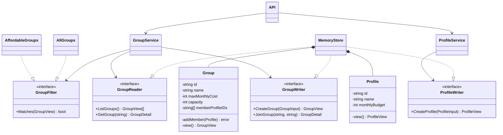
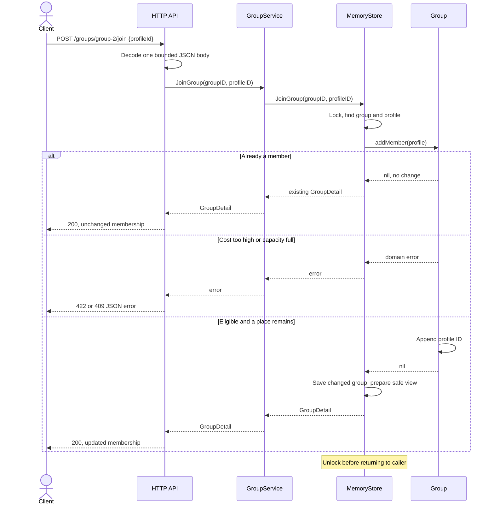

# Lab 0: SOLID in the Domi roommate-group backend

Student: Lucian-Adrian Gavril, FAF-241. Language: Go. Implementation/report revision: 15 October 2026.

## Introduction and condition

Domi helps people find roommates and form groups to rent a home together. This lab implements a small HTTP backend for creating profiles and groups, browsing affordable groups and joining one. It gives the design principles a visible user purpose and supplies JSON input/output for demonstration.

The [ELSE SOLID assignment](https://else.fcim.utm.md/mod/assign/view.php?id=38256) requires a simple project demonstrating three SOLID principles. This implementation demonstrates all five using a single roommate-group workflow.

Go supports object-oriented design through structs, methods, interfaces and composition. It has no class-based inheritance. The following explanation uses the actual Go mechanisms rather than inventing a superclass/subclass hierarchy. [Go FAQ](https://go.dev/doc/faq#Is_Go_an_object-oriented_language).

## Tasks and work completed

- Define profiles with a name and monthly budget, and groups with a name, maximum per-person monthly cost, capacity and member IDs.
- Create valid records and expose safe response views.
- List all groups or only affordable groups through interchangeable filters.
- Join a group only when the profile exists, its budget covers the advertised cost and a place remains.
- Keep repeated joins idempotent and prevent simultaneous joins from exceeding capacity.
- Provide HTTP routes, a deterministic CLI demo, tests and source-level explanations.

Amounts are illustrative whole EUR per person per month. Groups have capacity 1 through 20. This stage joins immediately; pending requests and owner approval are planned behavior for a later lab. The API is local, in-memory and separate from the deployed [Domi frontend](https://trydomi.vercel.app).

## One small example

Ana has a monthly budget of 550. Two illustrative groups cost at most 500 and 700. `AffordableGroups{MonthlyBudget: 550}` accepts only the 500 group. Joining it checks the stored profile and group, changes membership once and returns a response with member count 1. A repeated request returns the same membership. Ana's personal budget is absent from the member response.

Actual demo values use the profile name Alex and groups `Sunny apartment` and `Shared flat` in [main.go](main.go). The 700 group receives `group-1`; the 500 group receives `group-2`. The demo prints only `group-2` in `affordableGroups`, followed by the joined group containing `profile-1` and member count 1. These are synthetic example values, not real housing data.

## The five SOLID principles

### SRP: single responsibility

**Each component has a focused reason to change.** [domain.go](domain.go) changes when membership rules change; [store.go](store.go) changes when storage changes; [http.go](http.go) changes when transport or JSON presentation changes. The application service connects the use case through contracts, while [main.go](main.go) constructs concrete collaborators once.

For example, a new capacity rule belongs in `Group.addMember` or validated construction. It should not be copied into every HTTP handler. A new JSON field should not require rewriting the group-filter algorithm.

### OCP: open for extension, closed for modification

**A new group selection rule can be added without editing the selection loop.** [service.go](service.go) defines the required behavior:

```go
type GroupFilter interface {
    Matches(group GroupView) bool
}
```

`GroupService.ListGroups` calls `filter.Matches(group)`. `AllGroups` accepts every group. `AffordableGroups` compares its budget with the group's maximum cost. Adding an `OpenPlaces` filter implements the same contract; the existing service loop remains unchanged. The client still needs to choose the new filter, so OCP does not mean no file can ever be edited.

### LSP: Liskov substitution

**Each implementation must preserve the expectations of the interface's caller.** Here the filter contract is: accept a `GroupView`, decide whether to include it, and return a boolean for any valid group. It does not require every filter to select identical groups. Both existing filters can be supplied to the same `ListGroups` call without a type check or special case.

```go
func (AllGroups) Matches(GroupView) bool { return true }

func (filter AffordableGroups) Matches(group GroupView) bool {
    return group.MaxMonthlyCost <= filter.MonthlyBudget
}
```

A new filter that panics for a valid zero-member group would violate the stated contract. Matching the method signature alone is insufficient. `TestGroupFiltersCanBeUsedThroughOneContract` exercises both current implementations through one service. A future PostgreSQL repository must also preserve the reader/writer contracts, including error meanings and atomic capacity enforcement; its existence is not claimed here.

### ISP: interface segregation

**Clients should request only the capabilities they use.** `GroupReader` has group listing and lookup; `GroupWriter` has creation and membership mutation; `ProfileWriter` has profile creation. `ProfileService` receives only a profile writer, rather than a large interface containing unrelated group operations.

```go
type ProfileWriter interface {
    CreateProfile(input ProfileInput) (ProfileView, error)
}

type ProfileService struct {
    writer ProfileWriter
}
```

The group service uses both reading and writing, so its constructor requests both. Small interfaces are useful boundaries; adding an interface for every trivial function would create needless indirection.

### DIP: dependency inversion

**The use-case service depends on storage behavior rather than constructing a concrete memory map.** `NewGroupService` receives `GroupReader` and `GroupWriter`. The composition point chooses `MemoryStore`:

```go
store := NewMemoryStore()
groups := NewGroupService(store, store)
profiles := NewProfileService(store)
```

Supplying those values through constructors is dependency injection. Depending on the small interfaces is the dependency-inversion decision. A future database implementation can satisfy those contracts while the service retains its workflow. The database implementation still needs validation and integration tests; changing a constructor argument alone does not make storage production-ready.

## OOP in the actual source

| Idea          | Source-level example                                                                                                        |
| ------------- | --------------------------------------------------------------------------------------------------------------------------- |
| Encapsulation | `Group` has unexported fields; `addMember` guards changes. Go's privacy boundary is the package, not the individual struct. |
| Abstraction   | Services ask for reader/writer operations without knowing map layout or mutex details.                                      |
| Polymorphism  | `AllGroups` and `AffordableGroups` are values used through `GroupFilter`.                                                   |
| Composition   | Services hold collaborators as fields; a store is passed into the service. There is no artificial inheritance tree.         |

Response views contain public data rather than the mutable stored group. Profile views omit personal budgets. This is a limited exposure decision; authenticated access control is still absent.

## UML class diagram

These UML classes represent Go structs; the realization arrows represent implicit interface implementation. There are no superclass arrows. `MemoryStore` contains stored groups and profiles, while services depend on its contracts.



For readability, repository method labels omit their additional Go `error` result in the diagram. The exact signatures are in `service.go`.

## UML sequence diagram: joining a group

The sequence traces [http.go](http.go), [service.go](service.go), [store.go](store.go) and [domain.go](domain.go). One memory-store lock covers lookup, validation and mutation. The lock is released on every return through `defer`.



Unknown group/profile IDs fail during lookup with 404, before `addMember`. All branches return the same explicit JSON transport format. The prototype checks an illustrative numeric budget rule; it does not calculate a compatibility percentage or establish that a real lease can be signed.

## Run, input/output and verification

The full reproducible request sequence is in [README.md](README.md). From this folder:

```sh
go run . --demo
go run . --addr localhost:8080
go test ./...
```

`POST /profiles` and `POST /groups` return 201; list/details and successful or repeated joins return 200. Invalid data returns 400, missing records 404, full groups 409 and insufficient budgets 422. Example error output is:

```json
{"error":"group_full","message":"group is full"}
```

On 15 October 2026, the tests, CLI demo and live HTTP scenario passed. The concurrent test runs 30 eligible profiles against a capacity of 3 and checks exactly three successful memberships plus 27 full-group errors. Rejoining a successful profile leaves that count unchanged. Another test checks that returned member views omit the private budget. The focused capacity-limit test rejects capacity 21. These are measured test results for synthetic input; there are no throughput benchmarks or production-user claims.

## Conclusion

Lab 0 provides one understandable Domi workflow and shows all five SOLID principles using Go's structs, methods and interfaces. The design keeps transport, storage and domain rules separate, makes listing rules replaceable, and protects the membership invariant in one place. Later labs can extend this same backend as requirements appear.

This is an in-memory learning prototype. PostgreSQL, authenticated identity, owner approval, external notifications and frontend integration are not implemented. The report and code were prepared with AI assistance.
