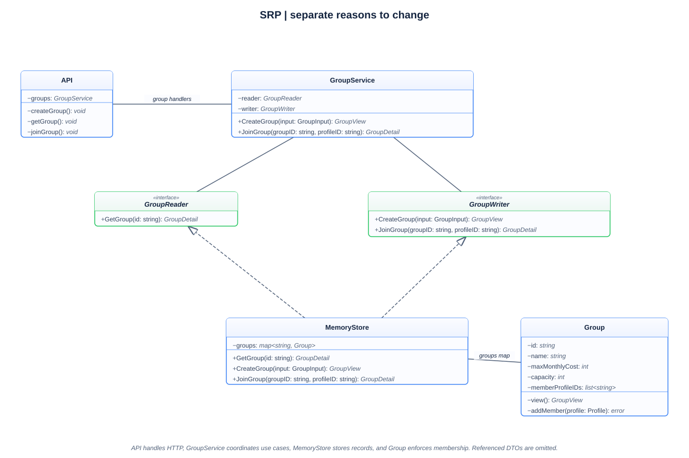
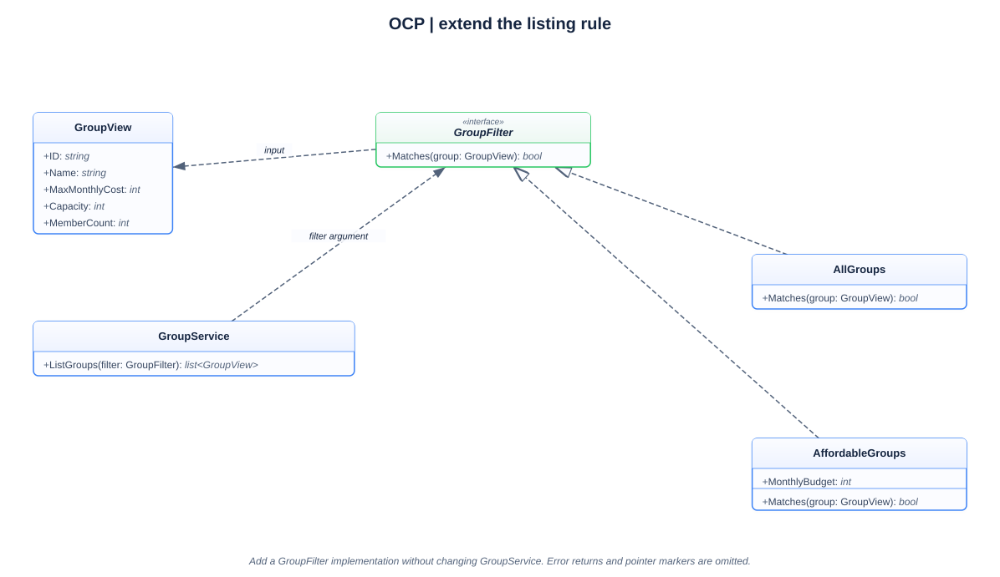
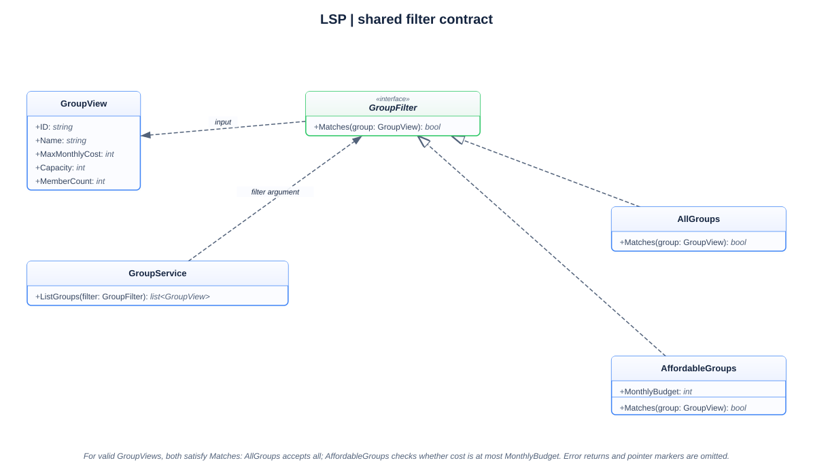
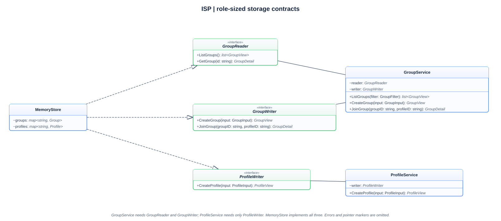
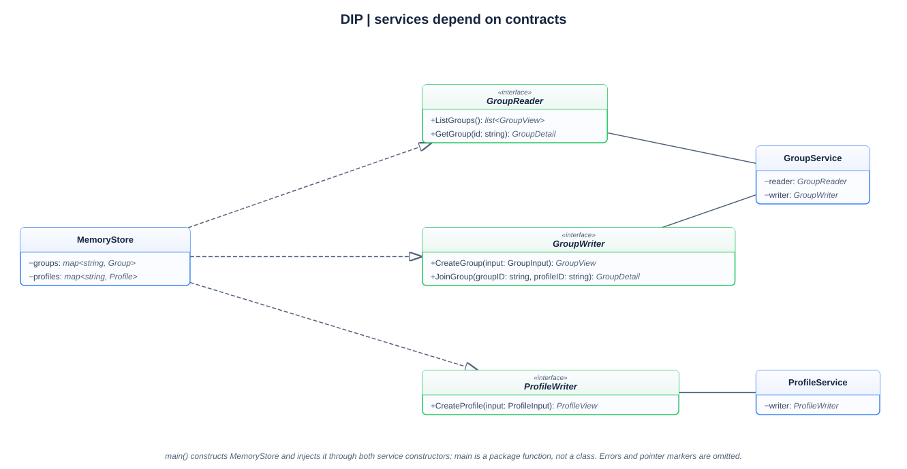
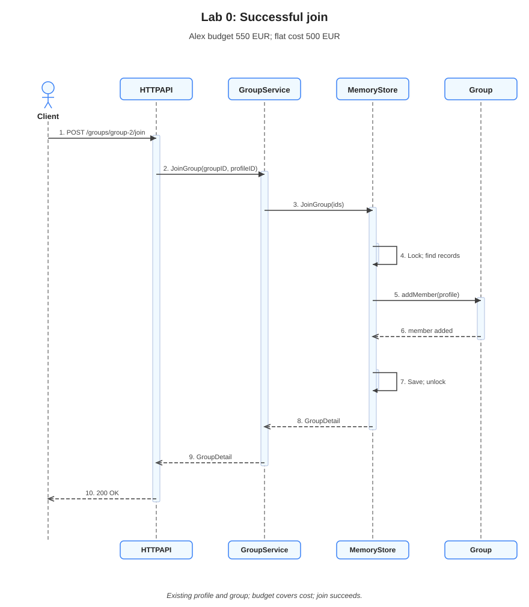

# Lab 0: SOLID principles in the Domi backend

**Student:** Lucian-Adrian Gavril, FAF-241

**Language:** Go

**Revision:** 7 October 2026

## Introduction

Domi helps people find roommates to share rent. The backend developed for this laboratory lets a person create a profile, browse roommate groups within their budget, and join a group that still has a free place.

The [laboratory assignment](https://else.fcim.utm.md/mod/assign/view.php?id=38256) requires a simple application demonstrating at least three SOLID principles. This implementation demonstrates all five. The purpose is to separate the application's responsibilities so that changing a membership rule, a listing rule, or the way data is stored does not require rewriting the whole backend.

Go expresses these ideas through structs, methods, and interfaces. A struct holds data, a method defines behavior for a type, and an interface describes the methods a caller needs. A type satisfies an interface by providing those methods. This allows the application to use polymorphism and composition without a class inheritance hierarchy.

## Requirements and application behavior

The application supports creating profiles and groups, listing groups, viewing a group's members, and joining a group. A profile contains a name and monthly budget. A group contains a name, a maximum monthly cost per person, a capacity, and the IDs of its members. Amounts in the examples are whole EUR per person per month.

Names must not be blank, group costs must be positive, and capacity must be between 1 and 20. A profile can join only if it exists, its budget covers the group's cost, and the group has a free place. Sending the same join request again leaves the membership unchanged. Group responses include members' IDs and names without returning their personal budgets.

The example used throughout the report follows Alex, whose monthly budget is 550. Two groups are available: Sunny apartment costs 700, and Shared flat costs 500. Filtering with a budget of 550 returns Shared flat. Alex can then join it because 550 covers 500 and the group has space.

## Go, the program, and its execution

Go is a compiled, statically typed language. Compilation translates source code into an executable. Static typing means the compiler checks the types used by expressions and calls before the program runs. A group cost is an `int`, so the program cannot pass ordinary text in its place without converting it. Go also provides a runtime with garbage collection, which reclaims memory that is no longer needed.

This project uses Go's structs, methods, small interfaces, and explicit error returns. Its components work together through composition. Go supports object-oriented ideas without a traditional class inheritance hierarchy, as described in the [official Go FAQ](https://go.dev/doc/faq#Is_Go_an_object-oriented_language). Standard formatting and straightforward control flow follow the conventions in [Effective Go](https://go.dev/doc/effective_go).

Go suits the project's intended Linux backend because it can compile the application into an executable and supplies HTTP routing, JSON encoding and synchronization in the standard library. Explicit field types and error returns make the contracts visible during this exercise. Python could implement the same rules and principles; Go's benefits here are its deployment model and small interfaces, rather than a requirement of SOLID itself. Go has garbage collection and a runtime, and this in-memory implementation still needs persistent storage and authentication before it could serve a real application.

Each implementation file starts with `package main`. A package groups source files that are compiled together and share declarations. The name `main` identifies an executable package. Its `main()` function is the entry point after package initialization. The files separate responsibilities, but they belong to one package; they are not separate programs calling each other over the network.

The module is identified by `go.mod` as `domi-lab-00`, with Go 1.22 as its language version baseline. A module is a unit managed by Go's tooling and can contain packages. This lab uses standard-library packages such as `net/http`, `encoding/json`, and `sync`, with no third-party framework.

| Command | Purpose |
| --- | --- |
| `go run . --demo` | Build and run the package in the current directory, selecting demo mode. |
| `go build -o domi-lab-00.exe .` | Build a Windows executable for later use. |
| `.\domi-lab-00.exe --demo` | Run that executable without rebuilding the source. |
| `go test ./...` | Run automated tests in the module's packages. |
| `gofmt -w .` | Apply Go's standard source formatting. |

The dot in `go run .` means the package in the current directory. Running only `main.go` would omit declarations in the other files. An executable is built for a target operating system: the Windows `.exe` does not run directly on Linux, although the source can be built for a Linux target.

File separation keeps different responsibilities readable within one application. `domain.go` contains the data and membership rules, while `service.go` contains the interfaces and service operations. `main.go` assembles them and provides the runnable example. Test files ending in `_test.go` contain assertions checked by `go test`; they are excluded from an ordinary build. In later checkpoints, a file ending in `_demo.go` holds an example that connects pattern objects and prints results. That demo suffix is a naming choice, while `_test.go` is a convention recognized by Go's tools.

## Data, objects, and basic Go notation

Object-oriented programming organizes related state and behavior together. State is the data currently held by a value. Behavior is the operations associated with it. A roommate group holds its member IDs and provides a method that decides whether another profile can be added.

A **struct** defines a collection of named fields. An **instance** is one particular value of that type. The `Group` declaration describes what all groups contain; Shared flat is one actual group value.

**Pseudocode**

```text
Define a group with its identity, name, cost, capacity, and member IDs.
Define a profile with its identity, name, and monthly budget.
Each value represents one particular group or person.
```

```go
type Group struct {
    id               string
    name             string
    maxMonthlyCost   int
    capacity         int
    memberProfileIDs []string
}

type Profile struct {
    id            string
    name          string
    monthlyBudget int
}
```

`type` declares a type. `string` holds text, `int` holds whole numbers, and `[]string` is a slice of strings. A slice is used here as a growable list of member IDs. The group keeps IDs rather than copying complete profiles; the store uses these IDs to retrieve the profiles later.

A new group can have a `nil` member slice. Its length is zero, and `append` can add its first member. This is valid empty membership. The group's `capacity` field is a business rule; Go does not automatically stop the slice from growing beyond that number. Our method must check it.

### Encapsulation and public response data

Encapsulation keeps state and its rules together and controls how state is exposed. Lowercase fields such as `monthlyBudget` are unexported in Go: other packages cannot directly access them. The boundary is the package. All lab files use `package main`, so `store.go` can access fields declared in `domain.go`. They are not class-private fields.

The intended membership change goes through `Group.addMember`. Another function in this package could technically change the fields, so the package's implementation must maintain that discipline.

Input types describe accepted data; view types describe returned data. For example, creating a profile needs a budget, while displaying a member needs only their name and ID.

**Pseudocode**

```text
Accept a name and monthly budget to create a profile.
Return an ID and name when exposing the created profile.
Keep the budget in the stored profile for eligibility checks.
```

```go
type ProfileInput struct {
    Name          string `json:"name"`
    MonthlyBudget int    `json:"monthlyBudget"`
}

type ProfileView struct {
    ID   string `json:"id"`
    Name string `json:"name"`
}
```

Uppercase fields are exported, allowing the standard JSON library to process them. The backtick text is a struct tag, metadata mapping a Go field to a JSON key. For example, `MonthlyBudget` corresponds to `monthlyBudget`. A tag is not an inline comment.

The separate view deliberately omits the budget. This controls response contents; it does not provide authentication or verify who is allowed to make a request.

### Functions, methods, and pointers

A function is named code that accepts arguments and may return results. A method is a function attached to a type through a receiver. The following method builds a public profile view.

**Pseudocode**

```text
Take a stored profile.
Build a response with its ID and name.
Return the response without changing the profile.
```

```go
func (profile Profile) view() ProfileView {
    return ProfileView{ID: profile.id, Name: profile.name}
}
```

`func` declares the method. `(profile Profile)` is its receiver: the value it operates on. `view` is the name, `()` means there are no additional arguments, and `ProfileView` is the return type. `return` sends the constructed response back to the caller. Braces in `ProfileView{...}` construct a value with the named fields.

This method has a value receiver, which receives a copy of the struct. The membership method uses `(group *Group)` instead. `*Group` is a pointer type referring to an existing group value, allowing the method to change that value. The `&` operator, seen in constructors and decoding, obtains a value's address. Go can automatically take the address for a call such as `group.addMember(profile)` when `group` is an addressable local variable.

A pointer does not automatically persist a change, enforce a membership rule, or make shared state safe for concurrent use. Those are separate parts of the implementation.

### Constructors and error values

A constructor creates an initial value, usually after validation. Go constructors are ordinary functions. Our `newGroup` checks a trimmed non-blank name, positive cost, and capacity from 1 to 20 before returning a group. Its return types are `(Group, error)`: a group value and a possible error.

The following excerpt shows how the store handles that result.

**Pseudocode**

```text
Try to construct a group using the candidate ID and input.
If construction fails, return an empty response and that error.
Continue to the storage step only after successful validation.
```

```go
group, err := newGroup(id, input)
if err != nil {
    return GroupView{}, err
}
```

`:=` declares local variables and assigns results to them. `err != nil` means an error exists; a `nil` error means success. `GroupView{}` supplies an empty response value on this failure path. The early `return` prevents execution from continuing with invalid data. Passing an error back through callers is error propagation.

The constructor wraps `ErrInvalidInput` with a more specific message. The HTTP layer later uses `errors.Is` to recognize the category even when extra context has been attached to it. Errors are ordinary returned values here, rather than a successful result or an HTTP response by themselves.

## Structure of the implementation

The backend separates HTTP handling, application operations, domain rules, and storage:

| File | Responsibility |
| --- | --- |
| [domain.go](domain.go) | Profile and group data, input validation, and membership rules |
| [service.go](service.go) | Application services, storage interfaces, and group filters |
| [store.go](store.go) | In-memory records, ID assignment, and synchronized access |
| [http.go](http.go) | HTTP routes, JSON decoding, responses, and status codes |
| [main.go](main.go) | Dependency construction, server startup, and the CLI demonstration |

A **service** exposes application operations such as creating a profile or listing groups. The **domain** is the subject of the application: groups, people, budgets, and membership rules. The **store** maintains the records. These names identify responsibilities within one executable.

A dependency is something a component needs to do its work. The group service needs a reader and writer; the profile service needs a profile writer. An interface defines the required methods while leaving their implementation open. `MemoryStore` provides those methods, so it can be supplied through the interfaces. Go checks interface compatibility from a type's methods, without an explicit `implements` declaration.

The actual service fields make the dependencies visible:

**Pseudocode**

```text
Keep a group reader and group writer inside the group service.
Keep only a profile writer inside the profile service.
Use these collaborators when an operation is requested.
```

```go
type GroupService struct {
    reader GroupReader
    writer GroupWriter
}

type ProfileService struct {
    writer ProfileWriter
}
```

This is composition: a component contains and uses collaborators. It has a reader or writer rather than inheriting a storage class. Traditional inheritance defines superclass/subclass relationships; this lab does not have such a hierarchy.

At startup, `main` creates one `MemoryStore` and supplies it to both services. The store is passed twice to the group service because it fulfills two roles, reading and writing. It is still one shared object. If the profile service used a different empty store, the group service would not find profiles created there.

When a join request arrives, the HTTP handler reads the group and profile IDs and calls `GroupService.JoinGroup`. The service delegates storage access through `GroupWriter`. `MemoryStore` finds the records and calls the group's `addMember` method, where the membership rules are checked. A successful join immediately adds the profile; this lab has no pending application or approval stage.

The following method in `domain.go` defines those rules.

**Pseudocode**

```text
If the profile is already a member, succeed without changing anything.
For a new member, reject a budget below the group's cost.
Reject the new member if the group has reached capacity.
Otherwise append the profile ID once and return success.
```

```go
func (group *Group) addMember(profile Profile) error {
    for _, memberID := range group.memberProfileIDs {
        if memberID == profile.id {
            return nil
        }
    }
    if profile.monthlyBudget < group.maxMonthlyCost {
        return ErrBudgetTooLow
    }
    if len(group.memberProfileIDs) >= group.capacity {
        return ErrGroupFull
    }

    group.memberProfileIDs = append(group.memberProfileIDs, profile.id)
    return nil
}
```

The order matters. Existing membership is checked first, so a repeated request succeeds even if the group has become full. A new member must pass the budget and capacity checks before their ID is appended.

`range` visits each member ID. It can supply an index and a value; `_` discards the index because the code only needs the ID. `len` returns the current member count. `append` returns the updated slice, which is assigned back to the membership field. `return nil` means the method succeeded.

For Alex and Shared flat, the list is initially empty, 550 is not below 500, and zero members is below capacity 2. The method appends `profile-1`. For Sunny apartment, 550 is below 700, so it returns `ErrBudgetTooLow` before changing membership. A full group with a new, under-budget applicant also returns the budget error first because that check comes first.

Repeating a successful join leaves the same membership. This is idempotency: repeating the operation does not add another copy of its effect. The successful repeat is why duplicate membership is checked before capacity. Filtering by budget is a separate operation: an affordable group can still be full, and the join must check capacity independently.

`MemoryStore.JoinGroup` holds a mutex while looking up the records, checking these rules, and saving the changed group. Without that lock, two simultaneous requests could both see the last free place and both take it. Keeping the check and update within the same locked operation prevents this situation.

## HTTP requests, routes, and handlers

HTTP is a protocol through which a client sends a request and a server returns a response. The client initiates the exchange; it could be a frontend, a command-line tool, or a test. The server listens for those messages. This backend responds with JSON rather than displaying a website.

A request has a method, a path, headers, and sometimes a body. The method describes the operation category. This API uses `GET` to read information and `POST` to create a record or request a join. The path identifies the resource or operation. Headers carry metadata, such as the body's content type. The body carries input data. A response contains a status code and may contain a result or error body.

An API is the defined interface clients use to access the program's operations. Each method/path combination is an endpoint. For example, `POST /groups/group-2/join` requests a membership change for one particular group. The body identifies the profile to add.

The following is an illustrative request after both records have been created in the running server.

**Request pseudocode**

```text
Ask to join group-2.
Declare that the body contains JSON.
Identify profile-1 as the person to add.
```

```http
POST /groups/group-2/join HTTP/1.1
Host: localhost:8080
Content-Type: application/json

{"profileId":"profile-1"}
```

The group ID comes from the URL, while the profile ID comes from the body. The request does not create either record. Budget and cost come from the stored records, so the join body cannot supply a replacement budget. This lab has no authentication: supplying a profile ID does not verify that the caller owns that profile.

JSON is text representing structured data. Braces contain an object with named fields, square brackets contain an array, and quoted values are strings. The decoder converts this representation into Go values. Valid JSON alone does not establish that its values satisfy the application's rules.

### Registering routes

A handler is code that processes a request and writes its response. A router chooses which handler to call. Our router is Go's `ServeMux`, constructed in `NewHTTPHandler`.

**Pseudocode**

```text
Create a router.
Associate each request method and path with its handler function.
Return the router for the HTTP server to use.
```

```go
mux := http.NewServeMux()
mux.HandleFunc("GET /groups", api.listGroups)
mux.HandleFunc("POST /groups", api.createGroup)
mux.HandleFunc("GET /groups/{id}", api.getGroup)
mux.HandleFunc("POST /groups/{id}/join", api.joinGroup)
mux.HandleFunc("POST /profiles", api.createProfile)
return mux
```

Registering `api.joinGroup` stores a function to call later; it does not perform a join at startup. The expression has no parentheses because the function is being supplied as a value. For a matching request, `{id}` captures the group ID from the path. `r.PathValue("id")` later retrieves that captured value.

### Decoding input and calling the service

The join handler reads the request, calls the service, and writes the answer:

**Pseudocode**

```text
Create an empty input value and decode the request body into it.
On invalid JSON, respond with 400 and stop.
On an empty profile ID, respond with 400 and stop.
Read the group ID from the path and call the group service.
Translate a returned error into an HTTP response.
Otherwise respond with 200 and the updated group details.
```

```go
func (api *API) joinGroup(w http.ResponseWriter, r *http.Request) {
    var input joinInput
    if err := decodeJSONBody(w, r, &input); err != nil {
        writeAPIError(w, http.StatusBadRequest, "invalid_request", err.Error())
        return
    }
    if input.ProfileID == "" {
        writeAPIError(w, http.StatusBadRequest, "invalid_request", "profileId is required")
        return
    }

    group, err := api.groups.JoinGroup(r.PathValue("id"), input.ProfileID)
    if err != nil {
        writeServiceError(w, err)
        return
    }
    writeJSON(w, http.StatusOK, group)
}
```

`r *http.Request` gives access to the incoming URL, headers, and body. `w http.ResponseWriter` provides operations for setting response headers, selecting a status code, and writing a response body. The handler returns no ordinary Go result because its answer is written through `w`.

`var input joinInput` declares an input value with an initially empty profile ID. `&input` passes its address so the decoder can fill it. The decoder helper limits input to 1 MiB, rejects unknown fields, and accepts one JSON value. The input struct's tag connects the JSON key `profileId` to its Go field `ProfileID`.

`if err := ...; err != nil` combines a call and error check. That local `err` belongs to the `if` statement's scope. `err.Error()` obtains the message text. Every error branch returns immediately, preventing a later success response from also being written.

`api.groups.JoinGroup(...)` is an ordinary method call inside the running server process. It does not send another HTTP request. The API holds the existing service, calls its method, waits for its returned values, and resumes execution. Network communication occurs between the client and server; these internal calls are Go execution within the server.

## The join call chain and stored state

The group service delegates to its writer through an interface:

**Pseudocode**

```text
Accept the group and profile IDs.
Ask the configured writer to perform the join.
Return its details and error unchanged.
```

```go
func (service *GroupService) JoinGroup(groupID, profileID string) (GroupDetail, error) {
    return service.writer.JoinGroup(groupID, profileID)
}
```

The writer currently contains the shared `MemoryStore`, so execution reaches its method. The service and store use similar method names because the same operation crosses two responsibility boundaries. Several service methods are deliberately thin in this lab. They preserve the interface boundary without inventing additional processing.

The store uses `map[string]Group` and `map[string]Profile`. A map associates a key with a value; looking up `group-2` retrieves its group record. The complete store operation is:

**Pseudocode**

```text
Acquire the exclusive lock and arrange to release it on return.
Find the group; fail if its ID is unknown.
Find the profile; fail if its ID is unknown.
Ask the group to apply its membership rules; propagate rejection.
Save the changed group value back into the map.
Build the response with member views and return success.
```

```go
func (store *MemoryStore) JoinGroup(groupID, profileID string) (GroupDetail, error) {
    store.mutex.Lock()
    defer store.mutex.Unlock()

    group, found := store.groups[groupID]
    if !found {
        return GroupDetail{}, ErrGroupNotFound
    }
    profile, found := store.profiles[profileID]
    if !found {
        return GroupDetail{}, ErrProfileNotFound
    }

    if err := group.addMember(profile); err != nil {
        return GroupDetail{}, err
    }

    store.groups[groupID] = group
    return store.groupDetail(group), nil
}
```

A map lookup can return both a value and whether its key exists. `!found` means “not found.” Missing records must be rejected before the operation uses their zero-valued placeholders.

The map holds struct values, and lookup returns a struct copy into the local variable `group`. Its pointer-receiver method changes this local value. Assigning it back preserves the updated struct in the map, including any changed slice header. Struct copying does not deeply copy a slice's elements, so a copy is not an independent deep clone. The explicit writeback establishes the updated group value regardless of slice allocation details.

`defer` schedules the unlock to run when this method returns, including its error paths. The response is assembled while the lock is still held. The store retrieves the member profiles and converts them into public views.

### Concurrency and the critical section

Requests can execute concurrently, meaning their executions overlap. A mutex coordinates access to shared state. This store uses `sync.RWMutex`: an exclusive write lock protects mutations, while read locks allow multiple readers together. A write lock excludes other cooperating readers and writers until the update is complete.

If two applicants compete for one remaining place, the first request performs lookup, checking, and saving while holding the lock. The second cannot inspect the group through this store until the first update finishes. It then sees the new count and returns `ErrGroupFull`. Locking only the final assignment would leave the earlier capacity checks exposed to a race.

The lock protects the check-and-update sequence; the domain method defines which updates are valid. These solve different problems. The store-wide lock is simple, although it also serializes writes to unrelated groups. This is adequate for the lab rather than a claim about high-throughput production storage.

### Returning success or failure

The store returns its result to the service, then the service returns to the API handler. The handler translates domain error categories into HTTP status codes. `ErrGroupFull` is a Go error; it is not itself an HTTP response. `writeServiceError` maps it to status 409 and a JSON error body.

The same rule works through the CLI without HTTP. There, the error propagates to `runDemo` and then `main`, which logs a failure and exits. In server mode, a rejected request produces an error response while the server continues waiting for other requests.

## SOLID principles

### Single Responsibility Principle

The Single Responsibility Principle states that a component should have one focused reason to change. In Domi, the membership rule belongs to the group, JSON handling belongs to the HTTP layer, and map access belongs to the store.

For example, changing the maximum group capacity affects domain validation. Changing the JSON error format affects HTTP handling. Neither change requires editing the affordable-group filtering loop. These responsibilities are separated because they answer different questions: whether an operation is allowed, how it is requested, and how its result is stored.

The files support this separation, but the principle concerns responsibilities rather than file count. `Group.addMember` owns membership checks, while `MemoryStore.JoinGroup` owns record lookup and the lock needed to apply those checks safely.

#### Single Responsibility UML

API handles HTTP, GroupService exposes application operations, MemoryStore coordinates record access, and Group owns membership rules. The dependencies connect those responsibilities without putting JSON decoding or map access inside the domain method.



[Editable Isomorph source](assets/srp.isx) | [PNG export](assets/srp.png)

### Open/Closed Principle

The Open/Closed Principle states that existing behavior should be extendable without repeatedly changing the code that uses it. Domi applies it to selecting groups. The service accepts a `GroupFilter` rather than containing a conditional branch for every possible listing rule.

**Pseudocode**

```text
Require every filter to accept a group summary.
Return true to include the group or false to leave it out.
```

```go
type GroupFilter interface {
    Matches(group GroupView) bool
}
```

The selection loop in `GroupService.ListGroups` asks the supplied filter whether each group belongs in the result:

**Pseudocode**

```text
Create an empty list for selected groups.
Visit every group returned by the reader.
Ask the supplied filter whether it matches.
Append accepted groups to the result.
```

```go
matchingGroups := []GroupView{}
for _, group := range groups {
    if filter.Matches(group) {
        matchingGroups = append(matchingGroups, group)
    }
}
```

`AllGroups` accepts every group. `AffordableGroups` accepts a group when its cost does not exceed the selected budget. A further rule, such as showing only groups with available places, can implement `Matches` without changing this loop. The caller chooses the filter; the service continues to perform the same selection process.

`[]GroupView{}` starts an empty slice of group summaries. Each accepted group is appended to this slice. A false match leaves that group out of this result; it does not delete the stored record.

Before this excerpt, the service replaces a missing filter with `AllGroups`, retrieves the views through `service.reader.ListGroups()`, and propagates a reader error if one occurs. The store sorts views by ID because Go map iteration has no guaranteed order. The filter loop preserves that returned order.

The protected extension point is the inclusion rule. A new filter would still need to be selected by its caller, and an HTTP option might require handler changes. OCP does not mean that adding any feature can avoid all edits to existing code.

#### Open/Closed UML

GroupService lists through GroupFilter. AllGroups and AffordableGroups provide the current rules; a further implementation can supply Matches without changing the selection loop. No unimplemented filter is shown as existing code.



[Editable Isomorph source](assets/ocp.isx) | [PNG export](assets/ocp.png)

### Liskov Substitution Principle

The Liskov Substitution Principle states that an implementation must preserve the behavior expected by callers of its abstraction. Matching an interface's method signature is only part of that requirement.

Here, a `GroupFilter` receives a valid `GroupView` and returns whether to include it. The caller does not need to know which concrete filter it received. Both implementations fulfill this role:

**Pseudocode**

```text
The all-groups rule always returns true.
The affordable-groups rule stores a chosen monthly budget.
It returns whether the group's cost is at most that budget.
```

```go
func (AllGroups) Matches(GroupView) bool {
    return true
}

type AffordableGroups struct {
    MonthlyBudget int
}

func (filter AffordableGroups) Matches(group GroupView) bool {
    return group.MaxMonthlyCost <= filter.MonthlyBudget
}
```

For Shared flat at 500, both filters return `true` when the selected budget is 550. For Sunny apartment at 700, `AllGroups` returns `true` and `AffordableGroups` returns `false`. Different selections are expected because the filters express different rules. Substitutability means that both remain valid inclusion predicates for the same service. A filter that panicked whenever a group had no members would break that expectation, since an empty group is valid input.

`TestGroupFiltersCanBeUsedThroughOneContract` supplies both implementations to the same service and checks the selected groups.

The interface call is also the project's clearest example of polymorphism. `filter.Matches(group)` has one shape, while the concrete filter determines the behavior. `AllGroups` needs no settings, so it is declared as an empty struct; `AffordableGroups` keeps a budget field because its answer depends on that setting. `bool` is the Boolean type with values `true` and `false`.

This is behavioral substitution without class inheritance. The compiler verifies the method signatures, but behavioral promises still require reasoning and tests. A future replacement store would likewise need to preserve errors, duplicate handling, and capacity guarantees, rather than merely have methods with the correct names.

#### Liskov Substitution UML

Both filter types satisfy the same GroupFilter interface. The service can use either as an inclusion predicate for valid GroupView values. Matching signatures are necessary, but the behavioral explanation and examples above establish why these two implementations fit that use.



[Editable Isomorph source](assets/lsp.isx) | [PNG export](assets/lsp.png)

### Interface Segregation Principle

The Interface Segregation Principle states that a client should not depend on operations it does not need. Domi separates group reading, group writing, and profile creation into three interfaces:

**Pseudocode**

```text
Group readers provide listing and detail retrieval.
Group writers provide creation and joining.
Profile writers provide profile creation.
Each operation returns a result and a possible error.
```

```go
type GroupReader interface {
    ListGroups() ([]GroupView, error)
    GetGroup(id string) (GroupDetail, error)
}

type GroupWriter interface {
    CreateGroup(input GroupInput) (GroupView, error)
    JoinGroup(groupID, profileID string) (GroupDetail, error)
}

type ProfileWriter interface {
    CreateProfile(input ProfileInput) (ProfileView, error)
}
```

`ProfileService` receives only `ProfileWriter`. Creating a profile does not require knowledge of group listing or joining. `GroupService` receives the reader and writer interfaces because it uses both sets of operations. Although `MemoryStore` implements all three interfaces, each service sees only the capabilities declared by its dependencies.

This keeps a change to group operations from unnecessarily enlarging the contract used by profile creation.

For example, `ListGroups() ([]GroupView, error)` means no arguments and two returned values: a slice of summaries and a possible error. `groupID, profileID string` declares two string arguments. `GroupDetail` combines one group view with a slice of profile views. These signatures describe application needs without exposing maps or mutexes.

An implementation can fulfill several small interfaces at once. Segregation concerns what each client depends on, not how many concrete store objects must exist. The chosen interfaces group related capabilities; creating a separate interface for every method would not automatically improve this design.

#### Interface Segregation UML

ProfileService depends only on ProfileWriter. GroupService uses GroupReader and GroupWriter. MemoryStore provides all three contracts, while each client sees the capabilities it needs.



[Editable Isomorph source](assets/isp.isx) | [PNG export](assets/isp.png)

### Dependency Inversion Principle

The Dependency Inversion Principle states that high-level application behavior should depend on abstractions rather than directly choosing low-level implementations. Domi's services depend on the interfaces above. They do not create maps or construct a `MemoryStore` themselves.

The group service receives its dependencies through its constructor:

**Pseudocode**

```text
Receive a reader and writer selected by the caller.
Store them in a new group service.
Return a pointer to that service.
```

```go
func NewGroupService(reader GroupReader, writer GroupWriter) *GroupService {
    return &GroupService{reader: reader, writer: writer}
}
```

`main.go` chooses the concrete implementation and supplies it to the services:

**Pseudocode**

```text
Create one shared memory store.
Use it for both group reading and group writing.
Use it for profile creation as well.
```

```go
store := NewMemoryStore()
groups := NewGroupService(store, store)
profiles := NewProfileService(store)
```

Passing collaborators into the constructor is dependency injection. The dependency inversion comes from the services being written against `GroupReader`, `GroupWriter`, and `ProfileWriter`. Their operations describe what the application needs from storage without exposing its maps or mutex.

A different store could implement these interfaces while preserving their results, errors, and membership guarantees. The current implementation uses memory storage; the interfaces define the boundary where another implementation would connect.

A database-backed replacement would need to implement its own safe check-and-update operation, typically using database concurrency mechanisms. The current Go mutex only coordinates this process's memory. The interface defines the boundary for a replacement; it does not implement persistence or transaction behavior automatically.

#### Dependency Inversion UML

The services depend on storage interfaces, which MemoryStore implements. The main function chooses the concrete store and injects it through the service constructors; the services do not construct their own stores.



[Editable Isomorph source](assets/dip.isx) | [PNG export](assets/dip.png)

## UML class diagrams in Isomorph

Each SOLID principle has a focused native Isomorph class diagram beside its explanation. SOLID describes design principles; these diagrams show the actual Go types and dependencies used to demonstrate them. A realization arrow means a type supplies an interface's methods, not that Go uses class inheritance. Field relationships show collaborators or contained values. Error return values and pointer markers may be omitted to keep the labels short; the Go excerpts retain the full signatures.

The focused views may also omit unrelated methods and HTTP handler arguments. A short method label such as joinGroup() identifies the handler's responsibility; its full Go signature still receives a response writer and request.

Some diagrams reuse the same types because one design decision can support several principles. OCP focuses on adding a filter without editing the listing loop; LSP focuses on the behavior expected of any filter supplied to that loop. ISP focuses on keeping storage contracts narrow for each client; DIP focuses on the services depending on those contracts and receiving the concrete store from main.

| Principle | Class diagram | Editable source |
| --- | --- | --- |
| Single Responsibility | [SRP](assets/srp.svg) | [Isomorph](assets/srp.isx) |
| Open/Closed | [OCP](assets/ocp.svg) | [Isomorph](assets/ocp.isx) |
| Liskov Substitution | [LSP](assets/lsp.svg) | [Isomorph](assets/lsp.isx) |
| Interface Segregation | [ISP](assets/isp.svg) | [Isomorph](assets/isp.isx) |
| Dependency Inversion | [DIP](assets/dip.svg) | [Isomorph](assets/dip.isx) |

The class diagrams describe structure. The following sequence diagram describes the order of a successful HTTP join through those components.

## UML sequence diagram

The sequence follows Alex's successful request to join Shared flat. Both records already exist. The API calls the service, the service delegates through its writer contract, and the store checks the domain rule while holding the lock. The store saves the changed group before returning its response view.



[Editable Isomorph diagram](assets/sequence.isx) · [PNG export](assets/sequence.png)

The diagram shows the successful path. Unknown records, insufficient budget, and a full group return the errors described above. A repeated join succeeds without adding the profile again.

## Running the application and results

A CLI, or command-line interface, lets a person run a program and supply options in a terminal. Our CLI demonstration is a fixed example, not an interactive menu. `--demo` selects that example. From the `lab-00` directory, the following command builds and runs the package:

**Command pseudocode**

```text
Build and run the Go package in the current directory.
Pass the demo flag to the application.
```

```sh
go run . --demo
```

### From main to the demonstration

`main` declares the address and demo flags, then calls `flag.Parse()`. The standard `flag` package reads the supplied options. Its Boolean demo flag returns a pointer, so `*demo` reads the selected Boolean value. After constructing the shared store and services, `main` checks this value. If true, it calls `runDemo` and returns afterwards. Otherwise, it constructs the HTTP server and starts listening.

`runDemo` first creates Alex. The following is its actual opening operation:

**Pseudocode**

```text
Ask the profile service to create Alex with a budget of 550.
Keep the returned profile view and error.
If creation failed, stop the demonstration and return the error.
```

```go
profile, err := profiles.CreateProfile(ProfileInput{Name: "Alex", MonthlyBudget: 550})
if err != nil {
    return err
}
```

The profile service calls its writer. The shared store validates the data, stores an internal `Profile`, and returns a `ProfileView`. The local variable `profile` therefore contains Alex's ID and name; the internal budget remains in the store. Separate counters produce `profile-1` and group IDs. A counter advances only after successful validation, so an invalid creation does not consume an ID.

The next calls create Sunny apartment and Shared flat. Then the demonstration joins Alex and filters the groups:

**Pseudocode**

```text
Join Alex to the created affordable group using their IDs.
Stop if joining fails.
List groups using a budget filter of 550.
Stop if listing fails.
```

```go
joined, err := groups.JoinGroup(affordable.ID, profile.ID)
if err != nil {
    return err
}
affordableGroups, err := groups.ListGroups(AffordableGroups{MonthlyBudget: 550})
if err != nil {
    return err
}
```

The demo calls services directly. Its join path is `runDemo → GroupService.JoinGroup → MemoryStore.JoinGroup → Group.addMember`. It does not send HTTP requests or execute the HTTP handler. Both demo mode and HTTP mode reuse the same application behavior through different entry points.

| Step | Operation | State or result |
| --- | --- | --- |
| 1 | Construct the store and services | Empty maps, shared by both services. |
| 2 | Create Alex, budget 550 | Stored as `profile-1`. |
| 3 | Create Sunny apartment, cost 700, capacity 3 | Stored as `group-1`, zero members. |
| 4 | Create Shared flat, cost 500, capacity 2 | Stored as `group-2`, zero members. |
| 5 | Join Alex to Shared flat | `profile-1` added; member count becomes one. |
| 6 | Filter with budget 550 | `700 <= 550` is false; `500 <= 550` is true. |
| 7 | Encode and print results | One JSON object is written to the terminal. |
| 8 | Return from the demo and main | Process exits; its memory is discarded. |

The demo joins before filtering, so the listing already shows one member. It assembles the two results into `demoResult`, then uses `json.NewEncoder(os.Stdout)` to encode them. `os.Stdout` is the program's standard output stream, normally shown in the terminal.

**Output pseudocode**

```text
Return an array of groups that match the affordability rule.
Also return the joined group's summary and member views.
Serialize both results as one JSON object.
```

```json
{
  "affordableGroups": [
    {
      "id": "group-2",
      "name": "Shared flat",
      "maxMonthlyCost": 500,
      "capacity": 2,
      "memberCount": 1
    }
  ],
  "joinedGroup": {
    "group": {
      "id": "group-2",
      "name": "Shared flat",
      "maxMonthlyCost": 500,
      "capacity": 2,
      "memberCount": 1
    },
    "members": [
      {"id": "profile-1", "name": "Alex"}
    ]
  }
}
```

The two top-level output fields answer different questions. `affordableGroups` is a list because several groups could qualify. `joinedGroup` is one detailed result because this operation joins one group. Shared flat appears in both. Sunny apartment still exists in the store during execution; it is simply absent from this filtered result. Alex's budget is absent because the response contains a profile view.

### Running the HTTP server and a client

The HTTP server runs in a separate invocation without `--demo`. `localhost` refers to the machine running it, and 8080 is the port through which the listener is reached. Start it in one terminal and leave that terminal running:

**Command pseudocode**

```text
Build and run the package in normal server mode.
Listen on the local machine at port 8080.
Wait for requests until the process is stopped.
```

```sh
go run . --addr localhost:8080
```

Press Ctrl+C to stop it. Every new process starts with a new empty store. A previous CLI demo does not populate this server. A browser request to `/groups` can read the list, but creation and joining require POST requests with bodies.

In a second PowerShell terminal, this client example creates the records before attempting a join. `Invoke-RestMethod` sends HTTP requests and converts JSON responses into PowerShell objects. The example uses returned IDs rather than assuming that no other records exist.

**Client pseudocode**

```text
Set the running server's base URL.
Create Alex and keep the returned profile ID.
Create Sunny apartment, then Shared flat and keep its group ID.
Send Alex's ID to Shared flat's join endpoint.
Read the groups with a budget limit of 550.
```

```powershell
$baseUrl = 'http://localhost:8080'
$profile = Invoke-RestMethod -Method Post -Uri "$baseUrl/profiles" -ContentType 'application/json' -Body '{"name":"Alex","monthlyBudget":550}'
Invoke-RestMethod -Method Post -Uri "$baseUrl/groups" -ContentType 'application/json' -Body '{"name":"Sunny apartment","maxMonthlyCost":700,"capacity":3}'
$flat = Invoke-RestMethod -Method Post -Uri "$baseUrl/groups" -ContentType 'application/json' -Body '{"name":"Shared flat","maxMonthlyCost":500,"capacity":2}'
$joinBody = @{ profileId = $profile.id } | ConvertTo-Json
Invoke-RestMethod -Method Post -Uri "$baseUrl/groups/$($flat.id)/join" -ContentType 'application/json' -Body $joinBody
Invoke-RestMethod -Method Get -Uri "$baseUrl/groups?budget=550"
```

`$profile` and `$flat` are client-side variables containing response objects. They are separate from the Go server's variables and memory. HTTP messages carry the information between the two processes. These commands illustrate client use of the API; the CLI demonstration itself does not execute them.

| Request | Input | Successful response |
| --- | --- | --- |
| `POST /profiles` | Name and monthly budget | Profile ID and name, 201 |
| `POST /groups` | Name, maximum monthly cost, capacity | Group summary, 201 |
| `GET /groups?budget=550` | Budget query | Affordable group summaries, 200 |
| `GET /groups/{id}` | Group ID | Group and member details, 200 |
| `POST /groups/{id}/join` | Profile ID in JSON | Updated group and member details, 200 |

For example, Alex's join request to `POST /groups/group-2/join` has the body:

**Body pseudocode**

```text
Identify profile-1 as the member to add to the group named in the URL.
```

```json
{"profileId":"profile-1"}
```

Invalid input returns 400, an unknown group or profile returns 404, a full group returns 409, and an insufficient budget returns 422. A repeated join returns 200 and keeps the same membership.

### Verification and limits

The automated checks run with:

**Command pseudocode**

```text
Run the automated tests in this module's packages.
Report a failure if a checked expectation does not hold.
```

```sh
go test ./...
```

The tests and CLI demonstration pass. The HTTP test creates a profile and group, filters the listing, joins the group, repeats the request, and checks rejection of an additional member once the group is full. It also checks that member responses omit budgets and that blank group names and capacity 21 are rejected.

The shown CLI output exercises the successful Alex workflow. The failure paths need separate checks; a successful demonstration alone does not prove that all invalid inputs are rejected. Likewise, omitting budgets from response views does not establish authenticated identity or permissions.

The concurrent-join test sends 30 eligible profiles toward a group with three places. It checks that exactly three join successfully and the other 27 receive `ErrGroupFull`. Repeating a successful profile's request leaves the group at three members. This verifies the capacity rule under competing requests as well as the unchanged result of a repeated join.

## Conclusion

The Domi backend applies all five SOLID principles to a single workflow: finding an affordable roommate group and joining it. Domain methods own the membership rules, the HTTP layer handles requests and responses, and the store coordinates access to records. Small interfaces let services depend on the operations they use, while interchangeable filters extend group selection without changing its loop.

The application stores data in memory, so records disappear when the process stops. Authentication, persistent storage, and approval of join requests are outside this lab's scope. The implemented workflow provides JSON input and output and keeps its rules separate from transport and storage details.
