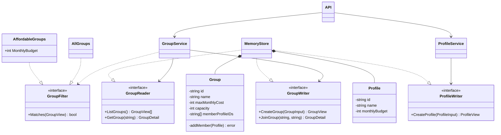
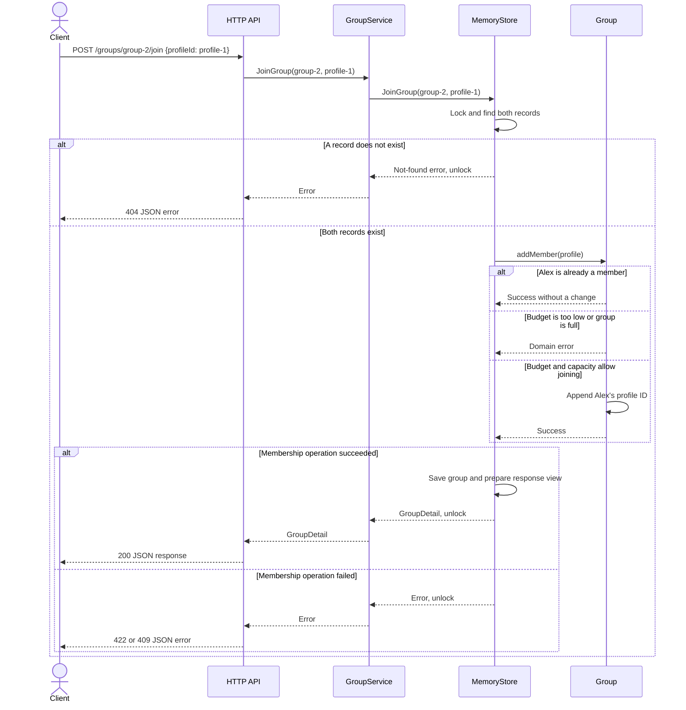

# Lab 0: SOLID principles in the Domi backend

**Student:** Lucian-Adrian Gavril, FAF-241

**Language:** Go

**Revision:** 7 October 2026

## Introduction

Domi helps people find roommates to share rent. The backend developed for this laboratory lets a person create a profile, browse roommate groups within their budget, and join a group that still has a free place.

The [laboratory assignment](https://else.fcim.utm.md/mod/assign/view.php?id=38256) requires a simple application demonstrating at least three SOLID principles. This implementation demonstrates all five. The purpose is to separate the application's responsibilities so that changing a membership rule, a listing rule, or the way data is stored does not require rewriting the whole backend.

Go expresses these ideas through structs, methods, and interfaces. A struct holds data, a method defines behavior for a type, and an interface describes the methods a caller needs. A type satisfies an interface by providing those methods. This allows the application to use polymorphism and composition without a class inheritance hierarchy.

## Requirements and application behavior

The application supports creating profiles and groups, listing groups, viewing a group's members, and joining a group. A profile contains a name and monthly budget. A group contains a name, a maximum monthly cost per person, a capacity, and the IDs of its members. Amounts in the examples are whole EUR per person per month.

Names must not be blank, group costs must be positive, and capacity must be between 1 and 20. A profile can join only if it exists, its budget covers the group's cost, and the group has a free place. Sending the same join request again leaves the membership unchanged. Group responses include members' IDs and names without returning their personal budgets.

The example used throughout the report follows Alex, whose monthly budget is 550. Two groups are available: Sunny apartment costs 700, and Shared flat costs 500. Filtering with a budget of 550 returns Shared flat. Alex can then join it because 550 covers 500 and the group has space.

## Structure of the implementation

The backend separates HTTP handling, application operations, domain rules, and storage:

| File | Responsibility |
| --- | --- |
| [domain.go](domain.go) | Profile and group data, input validation, and membership rules |
| [service.go](service.go) | Application services, storage interfaces, and group filters |
| [store.go](store.go) | In-memory records, ID assignment, and synchronized access |
| [http.go](http.go) | HTTP routes, JSON decoding, responses, and status codes |
| [main.go](main.go) | Dependency construction, server startup, and the CLI demonstration |

When a join request arrives, the HTTP handler reads the group and profile IDs and calls `GroupService.JoinGroup`. The service delegates storage access through `GroupWriter`. `MemoryStore` finds the records and calls the group's `addMember` method, where the membership rules are checked.

The following method in `domain.go` defines those rules:

```go
func (group *Group) addMember(profile Profile) error {
    for _, memberID := range group.memberProfileIDs {
        if memberID == profile.id {
            return nil
        }
    }
    if profile.monthlyBudget < group.maxMonthlyCost {
        return ErrBudgetTooLow
    }
    if len(group.memberProfileIDs) >= group.capacity {
        return ErrGroupFull
    }

    group.memberProfileIDs = append(group.memberProfileIDs, profile.id)
    return nil
}
```

The order matters. Existing membership is checked first, so a repeated request succeeds even if the group has become full. A new member must pass the budget and capacity checks before their ID is appended.

`MemoryStore.JoinGroup` holds a mutex while looking up the records, checking these rules, and saving the changed group. Without that lock, two simultaneous requests could both see the last free place and both take it. Keeping the check and update within the same locked operation prevents this situation.

## SOLID principles

### Single Responsibility Principle

The Single Responsibility Principle states that a component should have one focused reason to change. In Domi, the membership rule belongs to the group, JSON handling belongs to the HTTP layer, and map access belongs to the store.

For example, changing the maximum group capacity affects domain validation. Changing the JSON error format affects HTTP handling. Neither change requires editing the affordable-group filtering loop. These responsibilities are separated because they answer different questions: whether an operation is allowed, how it is requested, and how its result is stored.

The files support this separation, but the principle concerns responsibilities rather than file count. `Group.addMember` owns membership checks, while `MemoryStore.JoinGroup` owns record lookup and the lock needed to apply those checks safely.

### Open/Closed Principle

The Open/Closed Principle states that existing behavior should be extendable without repeatedly changing the code that uses it. Domi applies it to selecting groups. The service accepts a `GroupFilter` rather than containing a conditional branch for every possible listing rule.

```go
type GroupFilter interface {
    Matches(group GroupView) bool
}
```

The selection loop in `GroupService.ListGroups` asks the supplied filter whether each group belongs in the result:

```go
filtered := make([]GroupView, 0, len(groups))
for _, group := range groups {
    if filter.Matches(group) {
        filtered = append(filtered, group)
    }
}
```

`AllGroups` accepts every group. `AffordableGroups` accepts a group when its cost does not exceed the selected budget. A further rule, such as showing only groups with available places, can implement `Matches` without changing this loop. The caller chooses the filter; the service continues to perform the same selection process.

### Liskov Substitution Principle

The Liskov Substitution Principle states that an implementation must preserve the behavior expected by callers of its abstraction. Matching an interface's method signature is only part of that requirement.

Here, a `GroupFilter` receives a valid `GroupView` and returns whether to include it. The caller does not need to know which concrete filter it received. Both implementations fulfill this role:

```go
func (AllGroups) Matches(GroupView) bool {
    return true
}

type AffordableGroups struct {
    MonthlyBudget int
}

func (filter AffordableGroups) Matches(group GroupView) bool {
    return group.MaxMonthlyCost <= filter.MonthlyBudget
}
```

For Shared flat at 500, both filters return `true` when the selected budget is 550. For Sunny apartment at 700, `AllGroups` returns `true` and `AffordableGroups` returns `false`. Different selections are expected because the filters express different rules. Substitutability means that both remain valid inclusion predicates for the same service. A filter that panicked whenever a group had no members would break that expectation, since an empty group is valid input.

`TestGroupFiltersCanBeUsedThroughOneContract` supplies both implementations to the same service and checks the selected groups.

### Interface Segregation Principle

The Interface Segregation Principle states that a client should not depend on operations it does not need. Domi separates group reading, group writing, and profile creation into three interfaces:

```go
type GroupReader interface {
    ListGroups() ([]GroupView, error)
    GetGroup(id string) (GroupDetail, error)
}

type GroupWriter interface {
    CreateGroup(input GroupInput) (GroupView, error)
    JoinGroup(groupID, profileID string) (GroupDetail, error)
}

type ProfileWriter interface {
    CreateProfile(input ProfileInput) (ProfileView, error)
}
```

`ProfileService` receives only `ProfileWriter`. Creating a profile does not require knowledge of group listing or joining. `GroupService` receives the reader and writer interfaces because it uses both sets of operations. Although `MemoryStore` implements all three interfaces, each service sees only the capabilities declared by its dependencies.

This keeps a change to group operations from unnecessarily enlarging the contract used by profile creation.

### Dependency Inversion Principle

The Dependency Inversion Principle states that high-level application behavior should depend on abstractions rather than directly choosing low-level implementations. Domi's services depend on the interfaces above. They do not create maps or construct a `MemoryStore` themselves.

The group service receives its dependencies through its constructor:

```go
func NewGroupService(reader GroupReader, writer GroupWriter) *GroupService {
    return &GroupService{reader: reader, writer: writer}
}
```

`main.go` chooses the concrete implementation and supplies it to the services:

```go
store := NewMemoryStore()
groups := NewGroupService(store, store)
profiles := NewProfileService(store)
```

Passing collaborators into the constructor is dependency injection. The dependency inversion comes from the services being written against `GroupReader`, `GroupWriter`, and `ProfileWriter`. Their operations describe what the application needs from storage without exposing its maps or mutex.

A different store could implement these interfaces while preserving their results, errors, and membership guarantees. The current implementation uses memory storage; the interfaces define the boundary where another implementation would connect.

## UML class diagram

The diagram shows the Go structs and interfaces involved in this workflow. Dashed realization arrows show that a type implements an interface. Solid dependency arrows show which abstractions a service uses. The filled diamonds show that the store contains the profile and group records.



Storage methods also return a Go `error`; the diagram omits that additional return value to keep the method labels short. The full signatures appear in the interface excerpt above.

The group keeps its fields unexported and exposes response views instead of its stored state. In Go, unexported fields are accessible within the same package, so the encapsulation boundary is the package. Services use composition by holding collaborators in their fields, and the filter interface provides polymorphism when the same listing operation accepts different selection rules.

## UML sequence diagram

This sequence follows Alex joining Shared flat. The group and profile have already been created. The store checks both records before calling `addMember`.



A successful response includes the group's current member count and the IDs and names of its members. The budget remains in the profile record and is used for the eligibility check without being included in the group response.

## Running the application and results

From the `lab-00` directory, the following command runs the complete example and prints its result as JSON:

```sh
go run . --demo
```

The demo creates Alex with budget 550, Sunny apartment at 700, and Shared flat at 500 with capacity 2. Sunny apartment receives `group-1`; Shared flat receives `group-2`. Alex joins Shared flat, and the affordability filter selects that group. The resulting JSON is:

```json
{
  "affordableGroups": [
    {
      "id": "group-2",
      "name": "Shared flat",
      "maxMonthlyCost": 500,
      "capacity": 2,
      "memberCount": 1
    }
  ],
  "joinedGroup": {
    "group": {
      "id": "group-2",
      "name": "Shared flat",
      "maxMonthlyCost": 500,
      "capacity": 2,
      "memberCount": 1
    },
    "members": [
      {"id": "profile-1", "name": "Alex"}
    ]
  }
}
```

The HTTP server runs with:

```sh
go run . --addr localhost:8080
```

| Request | Input | Successful response |
| --- | --- | --- |
| `POST /profiles` | Name and monthly budget | Profile ID and name, 201 |
| `POST /groups` | Name, maximum monthly cost, capacity | Group summary, 201 |
| `GET /groups?budget=550` | Budget query | Affordable group summaries, 200 |
| `GET /groups/{id}` | Group ID | Group and member details, 200 |
| `POST /groups/{id}/join` | Profile ID in JSON | Updated group and member details, 200 |

For example, Alex's join request to `POST /groups/group-2/join` has the body:

```json
{"profileId":"profile-1"}
```

Invalid input returns 400, an unknown group or profile returns 404, a full group returns 409, and an insufficient budget returns 422. A repeated join returns 200 and keeps the same membership.

The automated checks run with:

```sh
go test ./...
```

The tests and CLI demonstration pass. The HTTP test creates a profile and group, filters the listing, joins the group, repeats the request, and checks rejection of an additional member once the group is full. It also checks that member responses omit budgets and that blank group names and capacity 21 are rejected.

The concurrent-join test sends 30 eligible profiles toward a group with three places. It checks that exactly three join successfully and the other 27 receive `ErrGroupFull`. Repeating a successful profile's request leaves the group at three members. This verifies the capacity rule under competing requests as well as the unchanged result of a repeated join.

## Conclusion

The Domi backend applies all five SOLID principles to a single workflow: finding an affordable roommate group and joining it. Domain methods own the membership rules, the HTTP layer handles requests and responses, and the store coordinates access to records. Small interfaces let services depend on the operations they use, while interchangeable filters extend group selection without changing its loop.

The application stores data in memory, so records disappear when the process stops. Authentication, persistent storage, and approval of join requests are outside this lab's scope. The implemented workflow provides JSON input and output and keeps its rules separate from transport and storage details.
