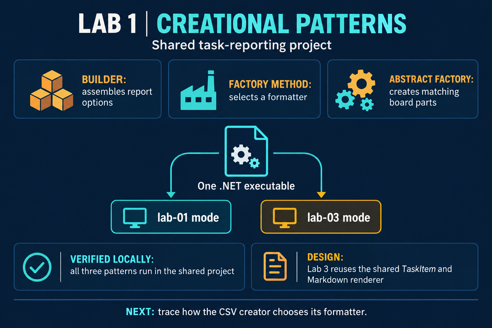
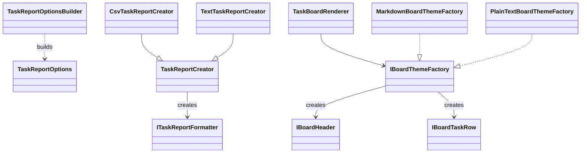

# Lab 1: Three creational patterns

## Report and summary

[Open the formatted report (PDF)](study-report.pdf) or its [LaTeX source](report.tex). The appendix lists the client, shared task model, and creational-pattern source files.



## Brief

The [ELSE brief](https://else.fcim.utm.md/mod/assign/view.php?id=27825) asks for three creational patterns selected from Singleton, Builder, Prototype, Factory Method, and Abstract Factory, plus familiarity with the others. Object Pooling is listed as useful to know. This project uses Builder, Factory Method, and Abstract Factory in the shared task-reporting example.

The project uses a task-reporting domain and selects Builder, Factory Method, and Abstract Factory. Laboratory 3 continues the same project with Command, Observer, and Strategy. Both modes use the same `TaskItem` type and one client.

## Repository requirements

The linked Lab 1 instructions require the project to be hosted in a Git repository, documented with a README or report, and submitted to ELSE by repository URL. The linked Lab 3 instructions continue the same project in the same repository, keep one client for the whole system, and also require submitting the repository URL. This folder is organized for that shared project. The code uses the standard .NET libraries and has no third-party package references.

## Build and run

Prerequisite: .NET 10. From this directory:

```powershell
$build = Join-Path $env:TEMP 'tmps-build'
dotnet build .\TMPSLab01.csproj -c Release --artifacts-path $build
dotnet (Join-Path $build 'bin\TMPSLab01\release\TMPSLab01.dll') lab-01
dotnet (Join-Path $build 'bin\TMPSLab01\release\TMPSLab01.dll') lab-03
```

The first mode prints the selected tasks in CSV and Markdown forms. The second mode also runs the behavioral continuation from Lab 3.

## Shared project structure

- `Program.cs` contains the single command-line client. Its `lab-01` and `lab-03` arguments select the two demonstrations.
- `TaskItem.cs` defines the shared task model used by both labs.
- `CreationalPatterns.cs` contains the Lab 1 builder, report creator, and board theme factory.
- `../lab-03/BehavioralPatterns.cs` contains the Lab 3 command, observer, strategy, and task board. The project file links it into the same executable.

## Pattern map

- **Builder:** `TaskReportOptionsBuilder` sets optional report settings, then creates one `TaskReportOptions` value.
- **Factory Method:** a `TaskReportCreator` subclass chooses the formatter that `Build` uses.
- **Abstract Factory:** `IBoardThemeFactory` creates a matching header and task-row formatter for one board style.



## Tiny trace

`WithTitle("Study tasks")` and `WithMinimumPriority(2)` set two builder fields. `Build()` returns the settings object. The report creator asks its subclass for a CSV formatter, which writes the chosen tasks. The Markdown abstract factory creates both a Markdown heading and Markdown rows, so the two products share one style.

## Know the remaining options

- **Singleton:** one controlled shared instance. Use sparingly because global state makes code harder to test.
- **Prototype:** make a new object by copying a configured example.
- **Object Pooling:** reuse expensive objects when creating and discarding them is costly. It is an extra topic, not one of the five core choices in this brief.

## Oral questions

1. **Why does a Builder help here?** It collects optional settings and returns a complete value only when the caller is ready.
2. **What does Factory Method let a subclass decide?** Which formatter object the parent workflow creates.
3. **Why is the theme factory abstract rather than one factory per product?** The header and rows must be a matching family of products.
4. **How would you add JSON output?** Add a formatter and a creator subclass; the existing CSV and text formatters remain unchanged.
