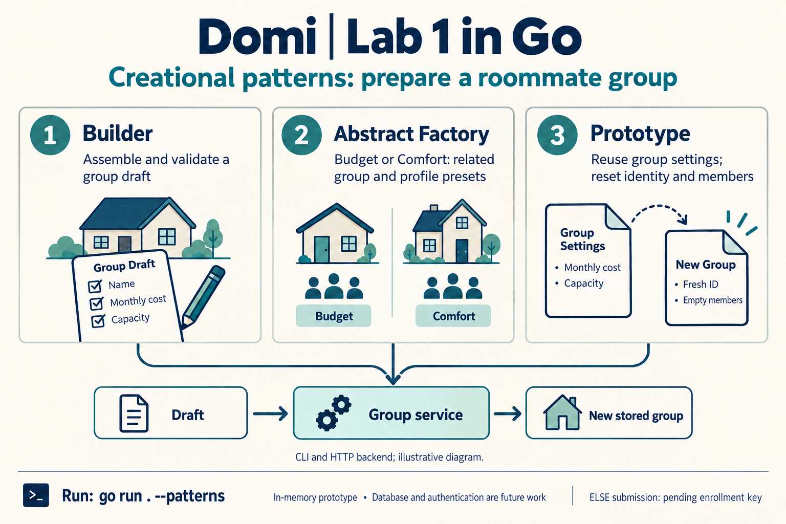

# Lab 1: Creational patterns in the Domi backend

Domi helps people form groups to rent a home together. This lab applies Builder, Abstract Factory, and Prototype to the group and profile backend carried forward from Lab 0.

Singleton, Factory Method, and Object Pooling are optional supplementary examples in `--extra-patterns`.

**Report revision:** 7 October 2026

Read the professor-facing [report](report.md) for the design, source connections, UML, and results. Use [learn.md](learn.md) for Go prerequisites, a worked trace, comparisons, oral questions, and practice cases.

## Local executable

A Windows executable is built in this folder. Run it from PowerShell:

```powershell
.\domi-lab-01.exe --patterns
```

After changing the Go source, rebuild it with `go build -o domi-lab-01.exe .`. The executable is a local build output and is not stored in Git.

## Run

The module uses the Go standard library and HTTP routing syntax available since Go 1.22.

```powershell
go test ./...
go run . --patterns
go run . --extra-patterns
go run . --demo
go run . --addr localhost:8080
```

`--patterns` prints JSON for a Builder-created group, Budget and Comfort onboarding families, and a Prototype copy. Each family creates a group and suggested profile, then joins the profile through the existing services. The copy keeps its source's cost and capacity but receives a fresh ID and no members when saved.

`--extra-patterns` demonstrates the optional patterns separately. The Singleton supplies fixed, process-wide catalog defaults to real service calls; it suits immutable defaults, not per-user settings or mutable application state. Factory Method uses student and quiet group creators with one shared workflow that saves a profile and joins it. Object Pooling reuses a bounded `bytes.Buffer` pool for a short group summary; releasing a buffer resets it before reuse. The pool is single-threaded and limits retained idle buffers, not total buffers in use. These examples are separate from the required `--patterns` output.

## HTTP example

While the server runs, create a profile and group, then join them:

```powershell
$api = 'http://localhost:8080'
$profile = Invoke-RestMethod -Method Post -Uri "$api/profiles" -ContentType 'application/json' -Body '{"name":"Ana","monthlyBudget":550}'
$group = Invoke-RestMethod -Method Post -Uri "$api/groups" -ContentType 'application/json' -Body '{"name":"Shared flat","maxMonthlyCost":500,"capacity":2}'
Invoke-RestMethod -Uri "$api/groups?budget=550"
$joinBody = @{ profileId = $profile.id } | ConvertTo-Json
Invoke-RestMethod -Method Post -Uri "$api/groups/$($group.id)/join" -ContentType 'application/json' -Body $joinBody
Invoke-RestMethod -Uri "$api/groups/$($group.id)"
```

The HTTP contract remains `POST /profiles`, `POST /groups`, `GET /groups`, `GET /groups/{id}`, and `POST /groups/{id}/join`. Records are held in memory and disappear when the process stops.

## Files

| File | Responsibility |
| --- | --- |
| [domain.go](domain.go) | Domain values, validation, membership rules, and response views |
| [patterns.go](patterns.go) | Builder, Abstract Factory, and Prototype implementations |
| [patterns_demo.go](patterns_demo.go) | Wires core pattern types to services, joins profiles, and prints JSON |
| [optional_patterns.go](optional_patterns.go) | Optional Singleton, Factory Method creators, and buffer pool |
| [optional_patterns_demo.go](optional_patterns_demo.go) | Optional examples, service calls, and JSON output |
| [main.go](main.go) | HTTP server, baseline demo, and pattern options |
| [patterns_test.go](patterns_test.go) | Focused checks for Builder validation, factory compatibility, and Prototype copies |
| [optional_patterns_test.go](optional_patterns_test.go) | Optional pattern behavior checks |

Authentication, persistent storage, and frontend integration are outside this lab.

For one core-pattern walkthrough, start in `patterns.go` and follow Builder, Abstract Factory, then Prototype. `patterns_demo.go` shows those definitions used through the services; `patterns_test.go` checks their behavior. The [report](report.md) presents the design and results for the professor, while [learn.md](learn.md) keeps the private oral prompts and checking answers.



## Editable UML diagrams

Open [assets/sequence.isx](assets/sequence.isx) in [Isomorph](https://iso.meandivision.foo/app/) to edit the diagram. The report displays the [SVG export](assets/sequence.svg); a [PNG export](assets/sequence.png) is also included.

Each pattern also has its own class diagram, editable in Isomorph:

| Pattern | Class diagram | Editable source |
| --- | --- | --- |
| Builder | [SVG](assets/builder.svg) | [Isomorph](assets/builder.isx) |
| Abstract Factory | [SVG](assets/abstract-factory.svg) | [Isomorph](assets/abstract-factory.isx) |
| Prototype | [SVG](assets/prototype.svg) | [Isomorph](assets/prototype.isx) |
| Singleton | [SVG](assets/singleton.svg) | [Isomorph](assets/singleton.isx) |
| Factory Method | [SVG](assets/factory-method.svg) | [Isomorph](assets/factory-method.isx) |
| Object Pooling | [SVG](assets/object-pool.svg) | [Isomorph](assets/object-pool.isx) |
