# Laboratory Work No. 1: Creational Design Patterns

**Course:** Software Design Techniques and Mechanisms (TMPS)
**Project:** Domi, a service for forming shared-rent groups
**Language:** C# (.NET 8)

## Contents

1. [Task and purpose](#1-task-and-purpose)
2. [Theory: why creational patterns exist](#2-theory-why-creational-patterns-exist)
3. [The Domi domain](#3-the-domi-domain)
4. [Builder](#4-builder)
5. [Abstract Factory](#5-abstract-factory)
6. [Prototype](#6-prototype)
7. [Singleton](#7-singleton)
8. [Factory Method](#8-factory-method)
9. [Object Pool](#9-object-pool)
10. [How the patterns work together](#10-how-the-patterns-work-together)
11. [Results](#11-results)
12. [Conclusion](#12-conclusion)

---

## 1. Task and purpose

The task is to study the creational design patterns, implement at least three of them in a project of our choice, and be able to explain the remaining ones. The report must state the project theme, the patterns used, short descriptions with code, and a UML diagram.

The deeper goal is to learn when object creation itself becomes a design problem. Writing `new` is the simplest way to create an object, and for most objects it is enough. The creational patterns answer the cases where it is not enough: when the caller should not know the concrete class, when construction is complicated, when objects must match each other, when a copy is easier than a construction, when only one instance may exist, or when creating an object is too expensive to repeat.

The project is **Domi**, a service that helps people who do not know each other form a group to rent a home together. Domi is a good fit because creating its objects has real rules: a group must have a valid cost and capacity, a suggested renter must be able to afford the group, and a copied group must not inherit the original's identity or members.

Implemented in the main demo: **Builder**, **Abstract Factory**, **Prototype**.
Implemented as additional examples: **Singleton**, **Factory Method**, **Object Pool**.

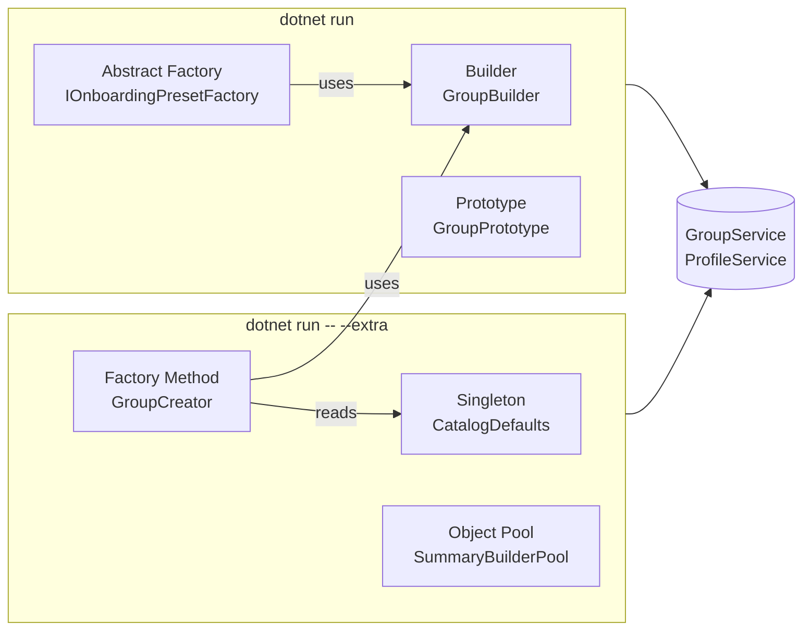

*Figure 1. The six patterns in the project and how they relate. Arrows show which pattern uses another.*

---

## 2. Theory: why creational patterns exist

### 2.1 The problem with `new` everywhere

Consider a service that creates groups directly:

```csharp
public GroupView CreateBudgetGroup()
{
    var group = new Group("group-7", new GroupInput("Budget home", 450, 4));
    ...
}
```

This works, but three things are now fixed inside the service: the concrete class, the values, and the validation order. When Domi adds a student group, the service must be edited. That is a violation of the **Open/Closed Principle** from Lab 0 (a module should be open for extension and closed for modification). The service also depends on a concrete class instead of an abstraction, which breaks **Dependency Inversion**. If several services repeat the same construction steps, the rules drift apart, which breaks **Single Responsibility**.

Creational patterns fix this by moving the act of creation into one place that the rest of the code calls through an abstraction or a controlled entry point. The code that *uses* an object stops deciding *how* it is made.

### 2.2 The six patterns and the question each one answers

| Pattern | The creation problem it solves | One-line idea |
| --- | --- | --- |
| Singleton | Something must exist exactly once | Private constructor, one static instance |
| Factory Method | Same workflow, different object at one step | Subclass overrides the method that creates |
| Abstract Factory | Objects must come in matching families | One factory object creates every member of a family |
| Builder | Construction has many steps or settings that must be valid together | Set values step by step, validate in `Build()` |
| Prototype | A new object should start as a copy of an existing one | The object knows how to clone itself correctly |
| Object Pool | Creating the object is expensive or limited | Reuse released objects instead of creating new ones |

The first five come from *Design Patterns: Elements of Reusable Object-Oriented Software* (Gamma, Helm, Johnson, Vlissides, 1994). Object Pool is not in that book but is commonly taught with them because it also controls how instances come into existence.

### 2.3 Class-level and object-level patterns

The patterns differ in the OOP mechanism they rely on, and this is the clearest way to tell Factory Method from Abstract Factory:

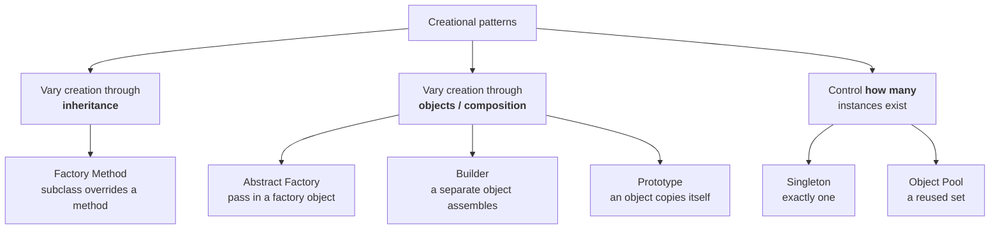

*Figure 2. Factory Method varies the created object through inheritance. Abstract Factory, Builder and Prototype vary it through objects. Singleton and Object Pool control the number of instances.*

### 2.4 OOP terms used in this report

- **Class / object.** `Group` is a class (a blueprint). `group-2` is an object (one concrete group in memory).
- **Interface.** A contract of methods without implementation. `IOnboardingPresetFactory` says "you can create a group draft and a profile," without saying how.
- **Abstract class and method.** `GroupCreator` is abstract: it cannot be instantiated and contains an `abstract` method with no body that every subclass must `override`.
- **Reference.** A variable of class type holds an address, not the object. `Group a = b;` gives two names for one group. This matters for Prototype.
- **`static`.** Belongs to the class, not to an object. `CatalogDefaults.Instance` exists once for the whole program. This matters for Singleton.
- **`record`.** A C# class meant to hold data, with value equality and `with` for making a changed copy. `GroupInput` and `ProfileInput` are records.

---

## 3. The Domi domain

Domi has two core objects. A **Group** has a name, a maximum monthly cost per person, a capacity from 1 to 20, and a list of member IDs. A **Profile** has a name and a private monthly budget. A profile can join a group only when its budget covers the cost and the group has a free place.

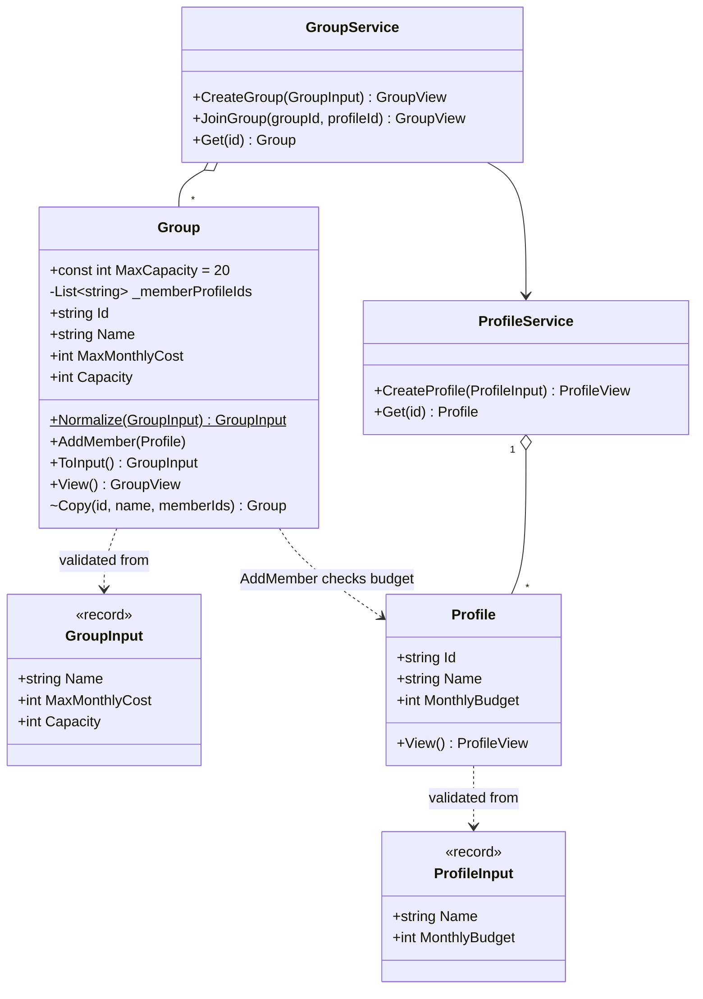

*Figure 3. Domain model. Inputs are what a caller sends; the services turn them into stored objects with IDs.*

### 3.1 One place for the rules

Every pattern in this lab eventually produces a `GroupInput`, and every `GroupInput` passes through one method:

```csharp
public static GroupInput Normalize(GroupInput input)
{
    string name = (input.Name ?? "").Trim();
    if (name == "") throw new DomainException("group name is required");
    if (input.MaxMonthlyCost <= 0) throw new DomainException("maxMonthlyCost must be greater than zero");
    if (input.Capacity <= 0) throw new DomainException("capacity must be greater than zero");
    if (input.Capacity > MaxCapacity) throw new DomainException($"capacity cannot exceed {MaxCapacity} people");
    return input with { Name = name };
}
```

**How it works.** It trims the name, rejects an empty name, a non-positive cost and a capacity outside 1 to 20, and returns a cleaned copy using `with`. On a rule violation it throws `DomainException`.

**Why it matters for this lab.** The Builder calls it in `Build()`, the `Group` constructor calls it, and the Prototype calls it through that constructor. Because creation is centralised, no pattern can produce a group the rest of the system would reject.

### 3.2 Joining a group

```csharp
public void AddMember(Profile profile)
{
    if (_memberProfileIds.Contains(profile.Id)) return;
    if (profile.MonthlyBudget < MaxMonthlyCost) throw new DomainException("monthly budget is below the group's cost");
    if (_memberProfileIds.Count >= Capacity) throw new DomainException("group is full");
    _memberProfileIds.Add(profile.Id);
}
```

**How it works.** A repeated join returns without error, so retrying a request is safe. Then it checks the budget and the capacity *before* changing anything, so a failed join leaves the group unchanged. Only after both checks does it add the ID.

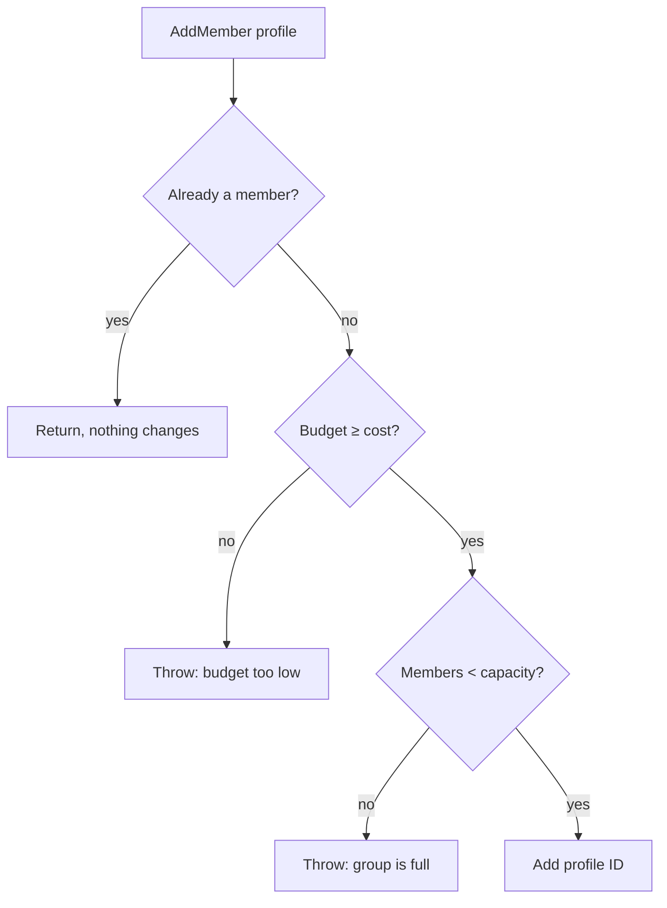

*Figure 4. The join rule. Every check happens before the member list changes.*

---

## 4. Builder

### 4.1 Problem

A group needs three values that are only meaningful together. A positional constructor puts two integers side by side:

```csharp
new GroupInput("Flat", 4, 450);   // meant: cost 450, capacity 4
```

This compiles, and Normalize rejects capacity 450 only because it exceeds 20. With `new GroupInput("Flat", 4, 6)` both values are in range and the mistake passes silently: a group that costs 4 per month for 6 people. As Domi grows (city, pets, smoking, move-in date), the number of constructor overloads grows with it. This is the **telescoping constructor** problem.

### 4.2 Where it fits in Domi

The "create group" form collects fields one at a time, and the user presses *Create* at the end. The Builder has the same shape: set values in any order, validate once at the end.

### 4.3 Code

```csharp
public sealed class GroupBuilder
{
    private string _name = "";
    private int _maxMonthlyCost;
    private int _capacity;

    public GroupBuilder WithName(string name)
    {
        _name = name;
        return this;
    }

    public GroupBuilder WithMaxMonthlyCost(int amount)
    {
        _maxMonthlyCost = amount;
        return this;
    }

    public GroupBuilder WithCapacity(int people)
    {
        _capacity = people;
        return this;
    }

    public GroupInput Build() => Group.Normalize(new GroupInput(_name, _maxMonthlyCost, _capacity));
}
```

Usage in `Program.cs`:

```csharp
GroupInput builderInput = new GroupBuilder()
    .WithName("Builder example home")
    .WithMaxMonthlyCost(650)
    .WithCapacity(3)
    .Build();
GroupView builderGroup = groups.CreateGroup(builderInput);
```

### 4.4 How it works

Each `With...` method stores one value in a private field and returns `this`, the same builder object. Because the return type is `GroupBuilder`, the next call can be chained directly, which is called a **fluent interface**. No validation runs while values are being set, so the order of calls does not matter and an incomplete builder is never mistaken for a finished group. `Build()` creates the record and passes it to `Group.Normalize`, which validates all three values together and either returns a clean input or throws.

The Builder returns a `GroupInput`, not a saved `Group`. Saving and assigning an ID is the service's job. The Builder only knows how to assemble a valid request, which keeps its responsibility small.

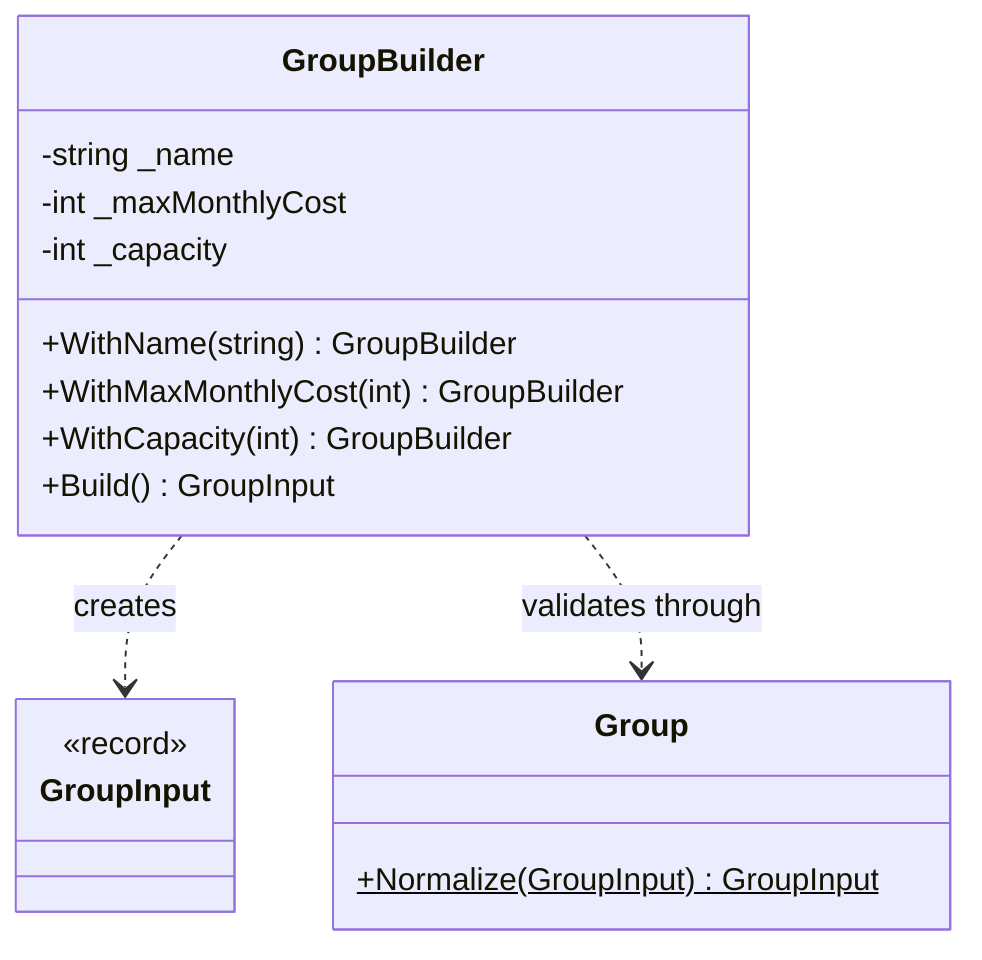

*Figure 5. Builder class diagram.*

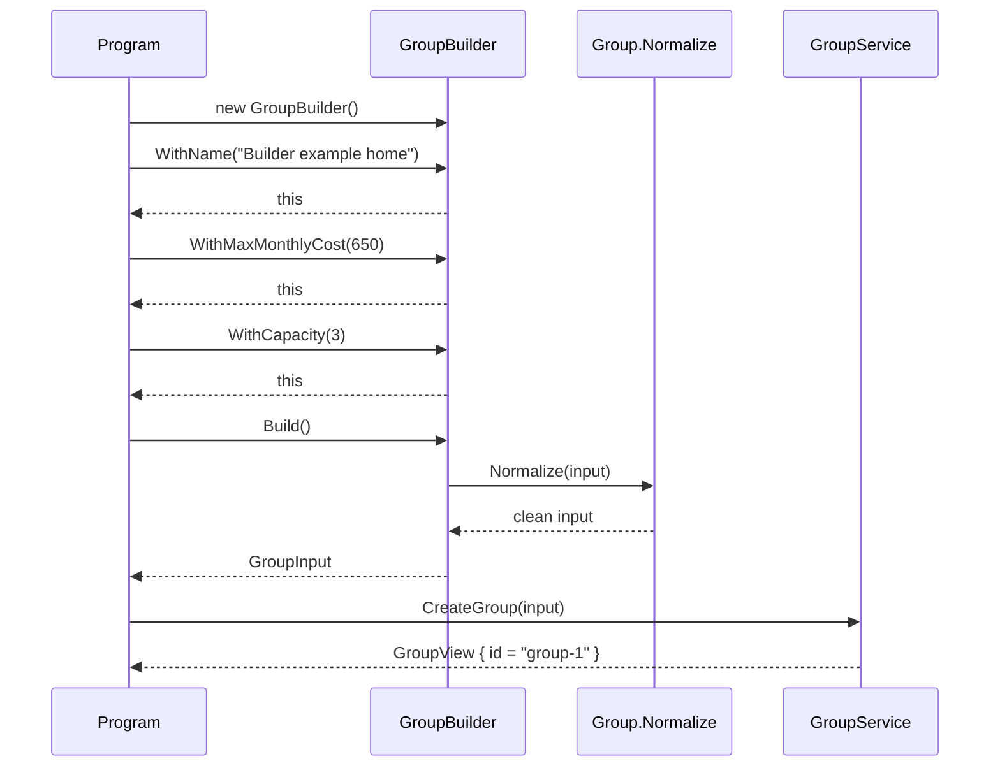

*Figure 6. Builder sequence. Validation happens once, in `Build()`.*

### 4.5 Why not something simpler

C# named arguments, `new GroupInput(Name: "Flat", MaxMonthlyCost: 450, Capacity: 4)`, already fix the readability problem. A Builder is worth its extra class when values arrive in separate steps (a multi-page form, defaults that some callers override) or when validation must see all values together. Domi's onboarding factories use the Builder with partly fixed values, which is the second case.

### 4.6 Trade-offs

The Builder is one more class to maintain for each built type, and for an object with two fields it adds ceremony without benefit. A mutable builder reused after `Build()` keeps its old values, so each construction should start with `new GroupBuilder()`.

---

## 5. Abstract Factory

### 5.1 Problem

Domi's onboarding suggests a group and a renter profile together. They only make sense as a pair: a budget renter with 500 per month cannot join a comfort group at 700. If the code chooses the group and the profile in two separate places, nothing prevents a mismatched pair, and the first join fails.

### 5.2 Where it fits in Domi

The onboarding screen asks once: *Budget* or *Comfort*. That single choice must give a matching group and profile. Each style is a **family** of related objects.

### 5.3 Code

```csharp
public sealed record OnboardingPreset(GroupInput Group, ProfileInput SuggestedProfile);

public interface IOnboardingPresetFactory
{
    GroupInput CreateGroupDraft();
    ProfileInput CreateSuggestedProfile();
}

public sealed class BudgetPresetFactory : IOnboardingPresetFactory
{
    public GroupInput CreateGroupDraft() => new GroupBuilder()
        .WithName("Budget shared home")
        .WithMaxMonthlyCost(450)
        .WithCapacity(4)
        .Build();

    public ProfileInput CreateSuggestedProfile() => Presets.ProfileSuggestion("Budget renter", 500);
}

public sealed class ComfortPresetFactory : IOnboardingPresetFactory
{
    public GroupInput CreateGroupDraft() => new GroupBuilder()
        .WithName("Comfort shared home")
        .WithMaxMonthlyCost(700)
        .WithCapacity(2)
        .Build();

    public ProfileInput CreateSuggestedProfile() => Presets.ProfileSuggestion("Comfort renter", 900);
}
```

The client code:

```csharp
public static OnboardingPreset Build(IOnboardingPresetFactory factory)
{
    GroupInput group = factory.CreateGroupDraft();
    ProfileInput profile = factory.CreateSuggestedProfile();

    if (profile.MonthlyBudget < group.MaxMonthlyCost)
        throw new DomainException("monthly budget is below the group's cost");

    return new OnboardingPreset(group, profile);
}
```

### 5.4 How it works

The interface declares one creation method per product in the family. Each concrete factory implements all of them for one family, so the Budget factory can only produce budget products. `Presets.Build` receives the factory as an `IOnboardingPresetFactory` and never mentions `BudgetPresetFactory` or `ComfortPresetFactory`. It asks for both products and checks that they fit before returning the pair.

The demo loops over both families, saves each group and profile, and joins them:

```csharp
foreach (var (name, factory) in families)
{
    OnboardingPreset preset = Presets.Build(factory);
    GroupView group = groups.CreateGroup(preset.Group);
    ProfileView profile = profiles.CreateProfile(preset.SuggestedProfile);
    GroupView joined = groups.JoinGroup(group.Id, profile.Id);
    ...
}
```

Both joins succeed, which shows that each family is internally consistent.

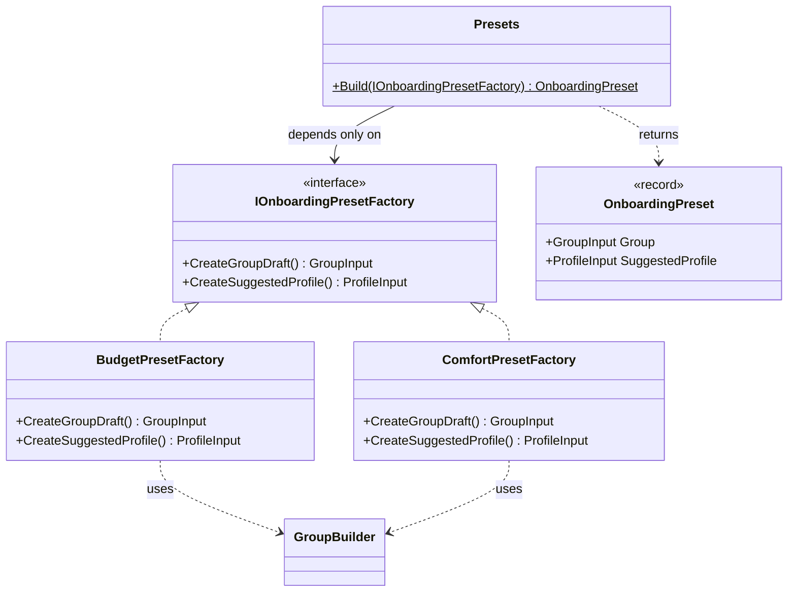

*Figure 7. Abstract Factory class diagram. The client depends on the interface only.*

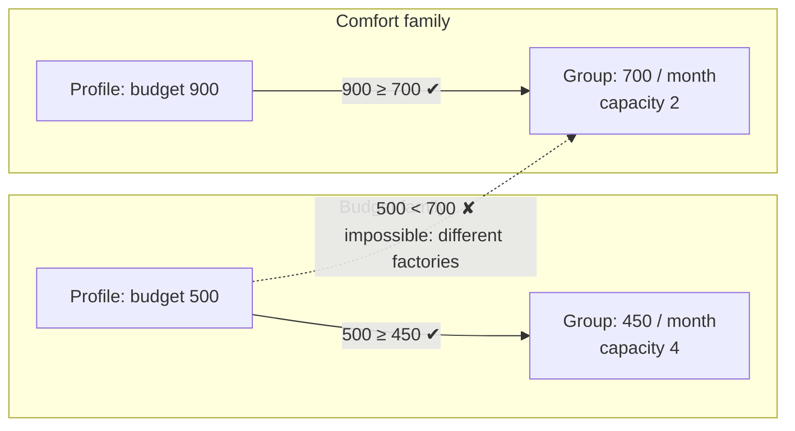

*Figure 8. Each factory produces a matching pair. A cross-family pair cannot be produced because one factory creates both products.*

### 5.5 Why not something simpler

The alternative is two `switch` statements, one choosing the group and one choosing the profile. When a third style is added, both must be updated, and forgetting one creates exactly the mismatch above. With the factory, a new *Student* family is one new class, and `Presets.Build` and the demo loop do not change. That is the Open/Closed Principle in practice, and the client depending on the interface instead of concrete classes is Dependency Inversion.

### 5.6 Trade-offs

Adding a new **family** is cheap: one class. Adding a new **product** to every family (for example, a suggested apartment) is expensive: the interface and every factory must change. Abstract Factory is a good choice when families change more often than the kinds of products in them.

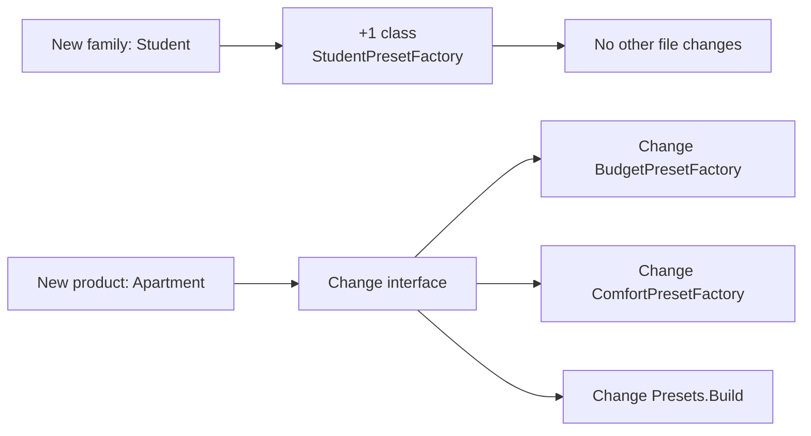

*Figure 9. The Abstract Factory trade-off: families are cheap to add, product types are not.*

---

## 6. Prototype

### 6.1 Problem

A user wants "a group like this one": the same cost and capacity, a new name, and nobody in it yet. Copying the fields from outside forces the caller to know every field, and it breaks when a field is added. Assigning the object (`Group copy = source;`) creates no copy at all, just a second reference to the same group.

### 6.2 Where it fits in Domi

A *Duplicate group* action, or reusing last semester's group settings for a new group.

### 6.3 Code

```csharp
public sealed class GroupPrototype
{
    private readonly Group _template;

    public GroupPrototype(Group source)
    {
        _template = source.Copy(source.Id, source.Name, source.MemberProfileIds);
    }

    public Group CloneAsDraft(string name) => _template.Copy(id: "", name: name, memberIds: []);
}
```

The copy itself lives inside `Group`, because only `Group` can reach its private member list:

```csharp
internal Group Copy(string id, string name, IEnumerable<string> memberIds)
{
    Group copy = new(id, new GroupInput(name, MaxMonthlyCost, Capacity));
    copy._memberProfileIds.AddRange(memberIds);
    return copy;
}
```

Usage:

```csharp
Group source = groups.Get(budgetGroupId);
GroupPrototype prototype = new(source);
Group draft = prototype.CloneAsDraft("Budget shared home copy");
GroupView copy = groups.CreateGroup(draft.ToInput());
```

### 6.4 How it works

The constructor takes a **snapshot** of the source. `Copy` creates a brand-new `Group` through the normal constructor (so validation runs) and fills a **new** list with the source's member IDs. Later changes to the source cannot affect the snapshot.

`CloneAsDraft` copies the snapshot again, keeping cost and capacity, but with an empty ID, a new name and no members. The service then saves the draft and assigns a fresh ID.

Two things are deliberately not copied:

- **The ID.** It is the identity of the original record. Two records with the same ID would be the same group to the store, which is a bug.
- **The members.** They joined the original group. A new group starts empty.

### 6.5 Shallow copy and deep copy

This is the central idea of Prototype. A field of type `List<string>` does not hold the list; it holds a **reference** to it. A **shallow copy** copies field values, so the copy receives the same reference, and both groups point to one list. A **deep copy** creates a new list.

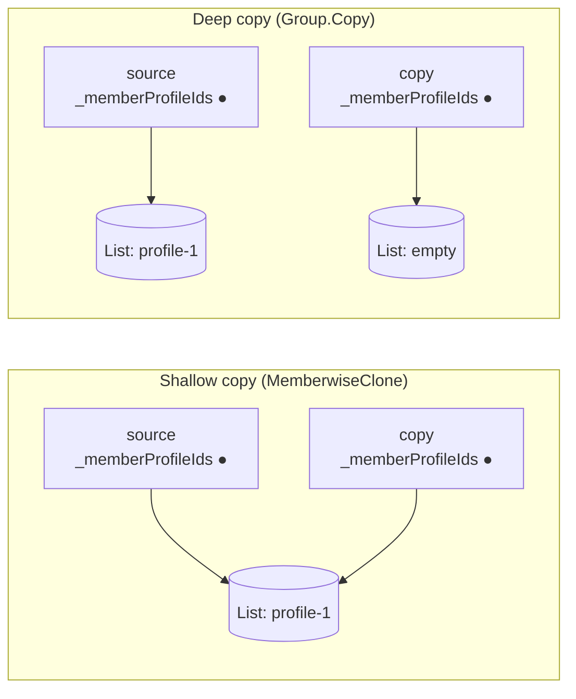

*Figure 10. With a shallow copy, adding a member to the copy also adds it to the source, because there is only one list. The deep copy gives each group its own list.*

C# offers `object.MemberwiseClone()`, which performs a shallow copy, and the `ICloneable` interface, which does not say whether its `Clone()` is shallow or deep. Both are reasons this lab writes the copy explicitly.

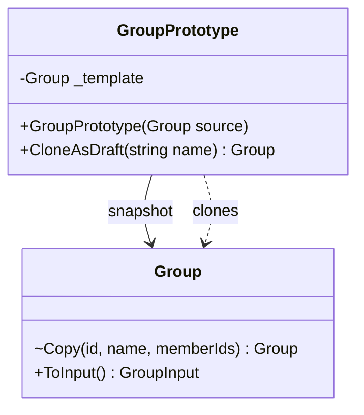

*Figure 11. Prototype class diagram.*

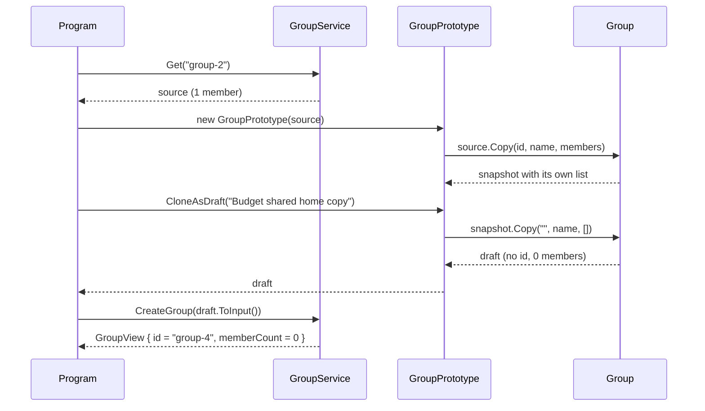

*Figure 12. Prototype sequence. The copy receives a new ID from the service.*

### 6.6 Trade-offs

Every new field forces a decision: copy it, deep-copy it, or reset it. A forgotten field produces a wrong copy without any error. Objects with references to other objects (graphs, cycles) make deep copying harder.

---

## 7. Singleton

### 7.1 Problem

Some things must exist exactly once in a program: shared configuration, a logger, a handle to a single hardware device. Two instances would disagree with each other or waste a scarce resource.

### 7.2 Where it fits in Domi

Domi's catalog defaults (default capacity 3, default cost 500) are fixed for the whole application. The group creators in section 8 read them.

### 7.3 Code

```csharp
public sealed class CatalogDefaults
{
    private static readonly Lazy<CatalogDefaults> _instance = new(() => new CatalogDefaults());

    public static CatalogDefaults Instance => _instance.Value;

    private CatalogDefaults() { }

    public int DefaultCapacity { get; } = 3;
    public int DefaultMaxMonthlyCost { get; } = 500;
}
```

### 7.4 How it works

- `private CatalogDefaults()`: no code outside the class can write `new CatalogDefaults()`.
- `static ... _instance`: the field belongs to the class, so there is one for the whole program.
- `Lazy<T>`: creates the object the first time `.Value` is read and guarantees, by default, that this happens once even when several threads ask at the same moment.
- `sealed`: no subclass can add a second constructor path.
- Properties have only `get`, so the shared object cannot be changed.

The demo prints `Singleton same instance: True` by comparing two reads with `ReferenceEquals`.

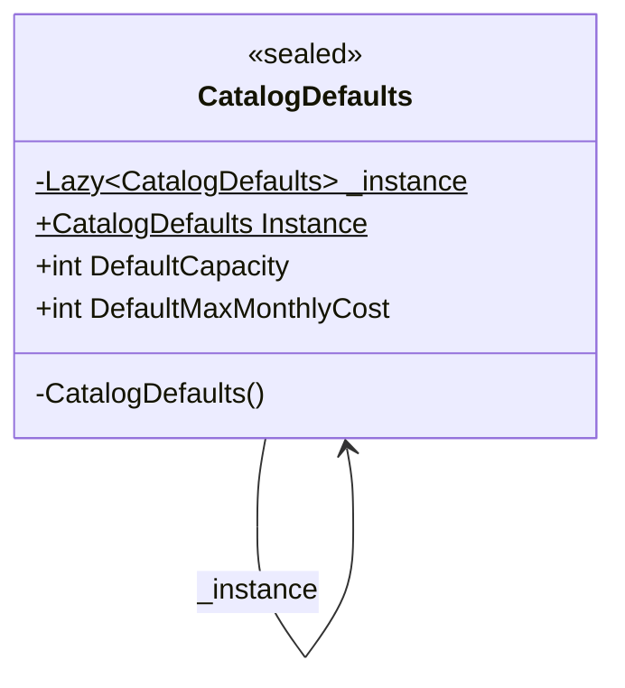

*Figure 13. Singleton class diagram. The class holds its only instance.*

### 7.5 Why thread safety matters

The naive version checks and creates in two steps:

```csharp
if (_instance == null) _instance = new Config();
return _instance;
```

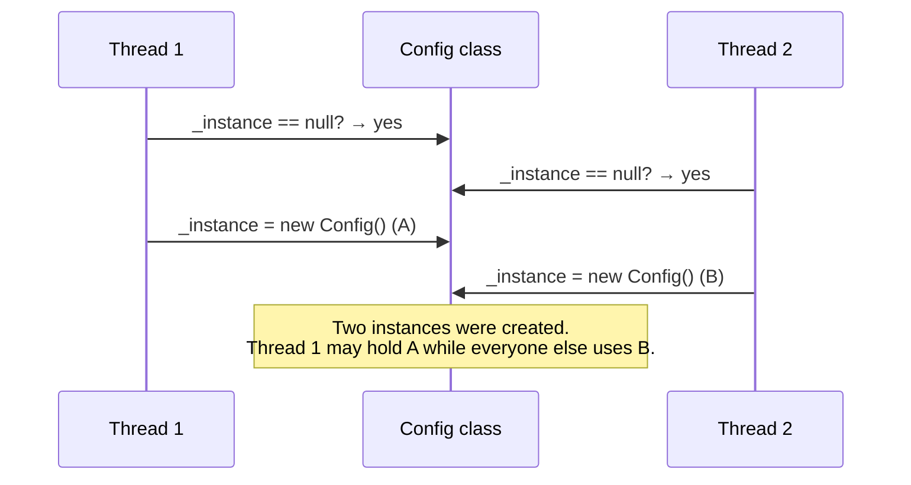

*Figure 14. A race in the naive Singleton. Both threads pass the null check before either assigns.*

`Lazy<T>` removes the race by locking internally during the first creation.

### 7.6 Why Singleton is often criticised

A Singleton is global state. Any class can call `CatalogDefaults.Instance` without declaring it in its constructor, so its dependencies are hidden, which goes against Dependency Inversion. In a unit test the instance cannot be replaced with a fake, and mutable state in a Singleton leaks from one test to the next. Modern .NET applications usually register a service with a single lifetime in the dependency injection container instead:

```csharp
services.AddSingleton<ICatalogDefaults, CatalogDefaults>();
```

There is still one instance, but classes receive it through their constructors and tests can pass a different one. In Domi the Singleton is limited to immutable defaults. Groups and profiles are per-user data with many instances, so they are never Singletons.

---

## 8. Factory Method

### 8.1 Problem

A workflow is always the same, but one step in it creates an object whose type varies. Copying the whole workflow for each type duplicates code; putting a `switch` inside it means editing the workflow for every new type.

### 8.2 Where it fits in Domi

Creating a group with its founder always means: create the group, save the founder's profile, join them. Only the kind of group differs: a student flat (cheap, five people) or a quiet home (two people).

### 8.3 Code

```csharp
public abstract class GroupCreator
{
    public GroupView CreateAndJoin(GroupService groups, ProfileService profiles, ProfileInput founder)
    {
        GroupInput draft = CreateGroupDraft();
        GroupView group = groups.CreateGroup(draft);
        ProfileView profile = profiles.CreateProfile(founder);
        return groups.JoinGroup(group.Id, profile.Id);
    }

    protected abstract GroupInput CreateGroupDraft();
}

public sealed class StudentGroupCreator : GroupCreator
{
    protected override GroupInput CreateGroupDraft() => new GroupBuilder()
        .WithName("Student flat")
        .WithMaxMonthlyCost(300)
        .WithCapacity(CatalogDefaults.Instance.DefaultCapacity + 2)
        .Build();
}

public sealed class QuietGroupCreator : GroupCreator
{
    protected override GroupInput CreateGroupDraft() => new GroupBuilder()
        .WithName("Quiet home")
        .WithMaxMonthlyCost(CatalogDefaults.Instance.DefaultMaxMonthlyCost)
        .WithCapacity(2)
        .Build();
}
```

### 8.4 How it works

`CreateAndJoin` is a normal method in the base class and contains the fixed workflow. At its first step it calls `CreateGroupDraft()`, which is `abstract`: the base class does not know what it returns. When the program calls `new StudentGroupCreator().CreateAndJoin(...)`, the runtime dispatches `CreateGroupDraft()` to the `StudentGroupCreator` override. This is **polymorphism**: the same call in the base class runs different code depending on the actual object.

`CreateGroupDraft` is the **factory method**. It is `protected` because only the workflow should call it.

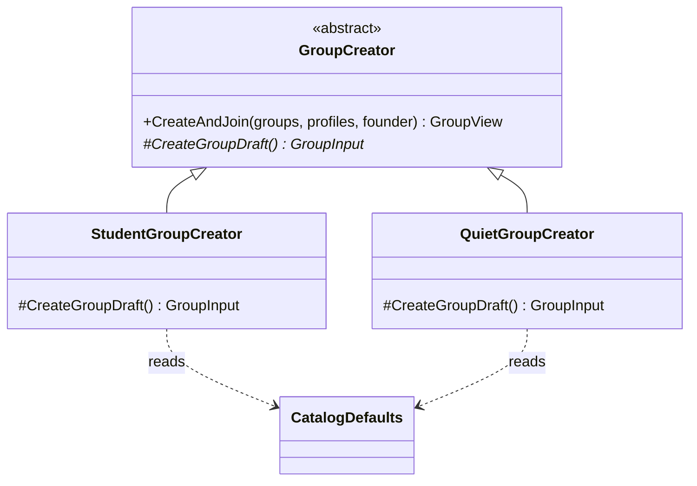

*Figure 15. Factory Method class diagram. The subclasses override only the creation step.*

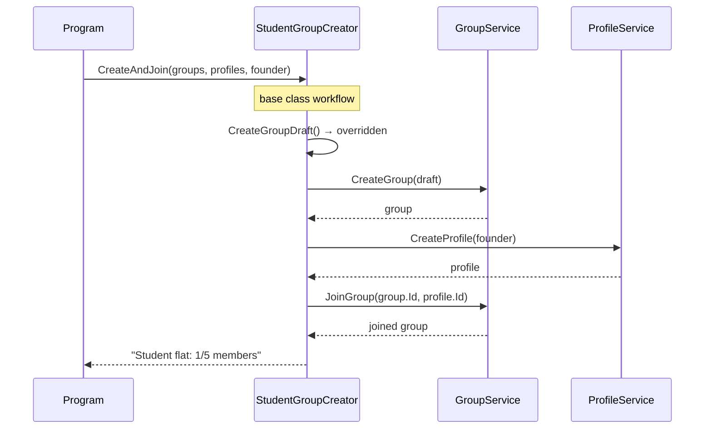

*Figure 16. Factory Method sequence. The workflow is inherited; one step is overridden.*

### 8.5 Factory Method and Abstract Factory compared

Both create objects through an abstraction, which is why they are easy to confuse. They differ in what they create and in which OOP mechanism varies the result.

| | Factory Method | Abstract Factory |
| --- | --- | --- |
| Creates | one product | a family of related products |
| Varies through | inheritance: a subclass overrides one method | composition: the client receives a factory object |
| The creating code lives in | a method inside the class that uses the product | a separate factory object |
| In Domi | `GroupCreator.CreateGroupDraft()` | `IOnboardingPresetFactory` |

Each method of an Abstract Factory is often implemented as a factory method, so the two patterns frequently appear together.

A **Simple Factory**, a single static method with a `switch` that returns different types, is a common idiom but not one of the Gang of Four patterns. It centralises creation but must be edited for every new type, which Factory Method avoids.

### 8.6 Trade-offs

Each variant needs a subclass. When variants differ only in data, a parameter or a Builder is simpler than a class hierarchy.

---

## 9. Object Pool

### 9.1 Problem

Some objects are expensive to create or exist in limited numbers: database connections, threads, network sockets, large buffers. Creating and destroying one for every request wastes time and can exhaust the limit.

### 9.2 Where it fits in Domi

Domi builds short text summaries of groups. The pool reuses `StringBuilder` buffers between summaries. In a production backend the same idea is applied to database connections; ADO.NET keeps a connection pool for each connection string, and `ArrayPool<T>.Shared` does the same for arrays.

### 9.3 Code

```csharp
public sealed class SummaryBuilderPool(int maxIdle)
{
    private readonly Stack<StringBuilder> _idle = new();

    public int Created { get; private set; }

    public StringBuilder Acquire()
    {
        if (_idle.Count > 0) return _idle.Pop();
        Created++;
        return new StringBuilder();
    }

    public void Release(StringBuilder builder)
    {
        builder.Clear();
        if (_idle.Count < maxIdle) _idle.Push(builder);
    }

    public string Summarize(GroupView group)
    {
        StringBuilder sb = Acquire();
        try
        {
            return sb.Append(group.Name).Append(": ")
                .Append(group.MemberCount).Append('/').Append(group.Capacity)
                .Append(" members, ").Append(group.MaxMonthlyCost).Append(" per month")
                .ToString();
        }
        finally
        {
            Release(sb);
        }
    }
}
```

### 9.4 How it works

The pool keeps idle objects on a stack.

- **Acquire** returns an idle builder if there is one. Otherwise it creates a new one and counts it in `Created`.
- **Release** clears the builder and puts it back, unless the pool already holds `maxIdle` idle builders. In that case the builder is dropped and the garbage collector frees it.
- **Summarize** shows the correct usage: acquire, use, and release in `finally`, so the builder returns to the pool even when an exception is thrown.

The demo creates two summaries with one pool and prints `Pool created 1 StringBuilder(s) for 2 summaries`: the second summary reused the first builder.

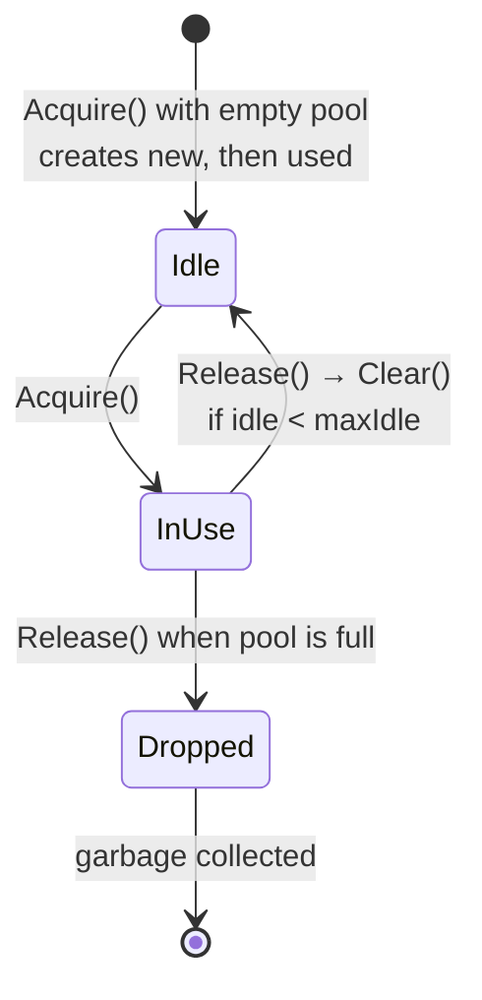

*Figure 17. Life cycle of a pooled object.*

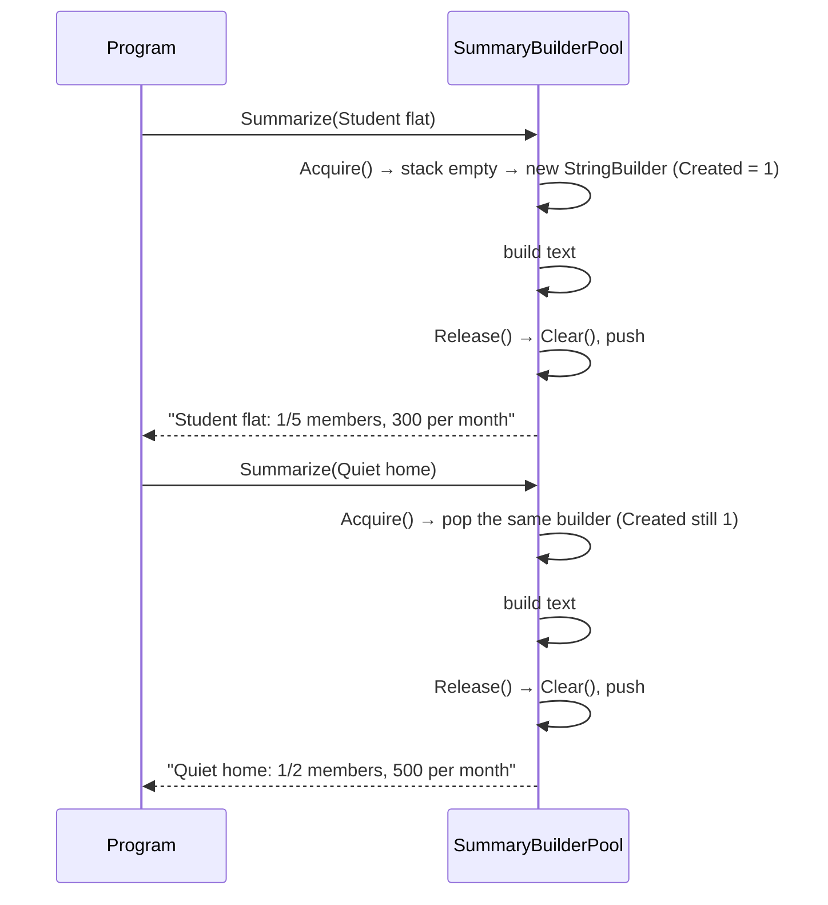

*Figure 18. Two summaries, one builder.*

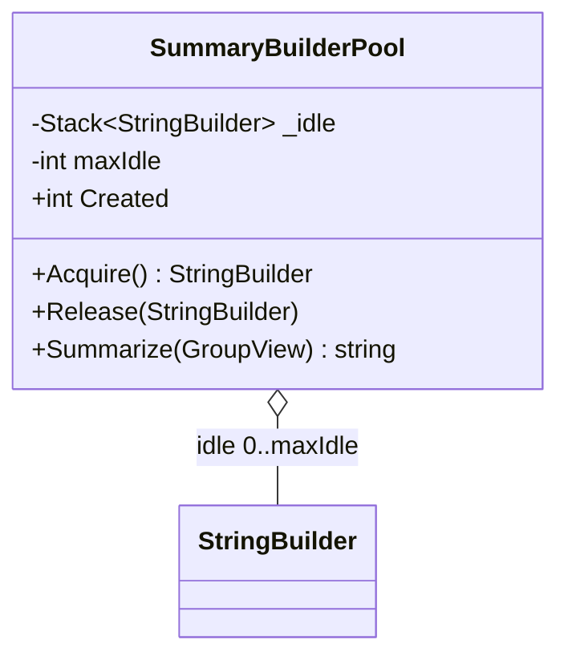

*Figure 19. Object Pool class diagram.*

### 9.5 The two rules of pooling

1. **Reset on release.** Without `Clear()`, the next user would receive a builder that still contains the previous summary. With database connections the same mistake leaks an open transaction or another user's session settings.
2. **Always release.** If a user acquires an object and an exception skips the release, the object never returns. The pool keeps creating new ones and the benefit is lost; with a hard limit, such as a connection pool of 100, the application eventually blocks waiting for a connection. `try/finally` (or `using` with a disposable wrapper) prevents this.

`maxIdle` caps how much the pool holds when demand drops, so a burst of traffic does not leave memory reserved forever.

### 9.6 Trade-offs

Pooling pays off only when creation is expensive compared with the bookkeeping. A small `StringBuilder` is cheap, and the .NET garbage collector handles short-lived objects efficiently, so in Domi the pool is mainly a clear demonstration of the mechanism. This pool is also not thread-safe; a shared pool used by several threads would need `ConcurrentBag<T>` or a lock.

---

## 10. How the patterns work together

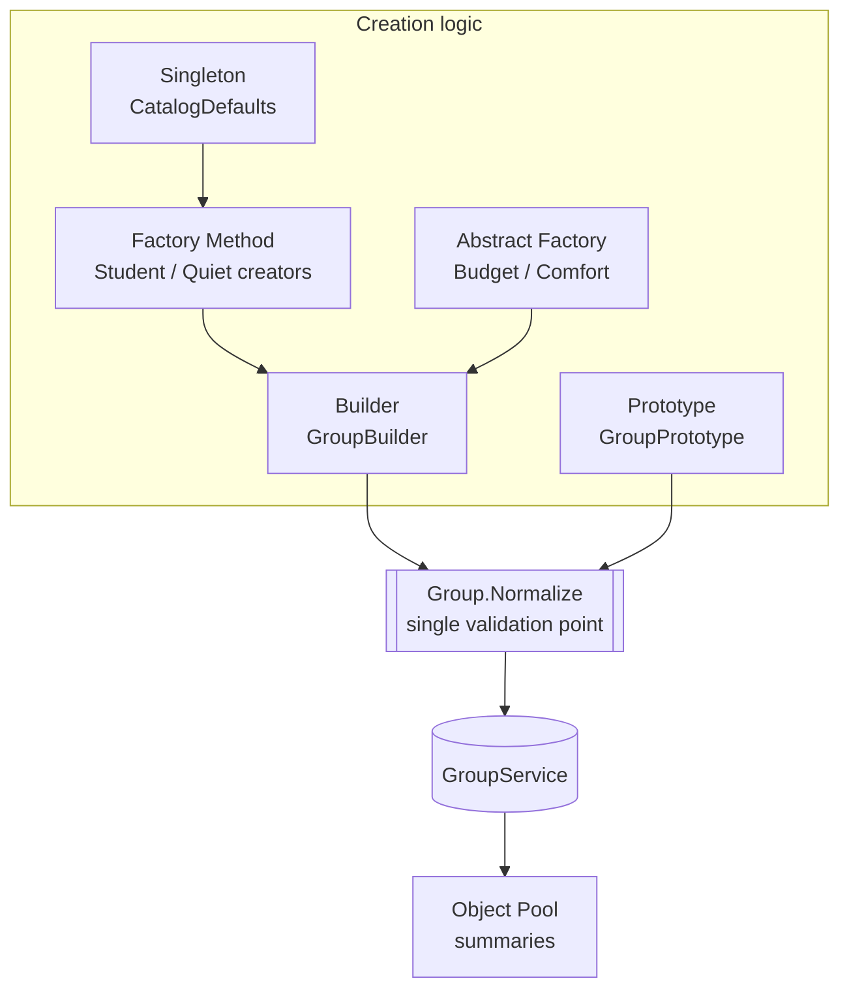

*Figure 20. Every creation path ends in `Group.Normalize` before the service stores the group.*

The patterns combine instead of competing. Both factories use the Builder to assemble their group drafts, the Factory Method creators read defaults from the Singleton, and the Prototype goes through the same constructor as everything else. Because every path converges on one validation method, adding a new creation path cannot weaken the rules.

### 10.1 Connection to SOLID (Lab 0)

| Principle | Where this lab applies it |
| --- | --- |
| Single Responsibility | The Builder assembles, `Normalize` validates, the services store. The Prototype only copies. |
| Open/Closed | A new onboarding family or a new group creator is a new class; existing code does not change. |
| Liskov Substitution | Any `IOnboardingPresetFactory` or `GroupCreator` subclass can replace another without breaking the caller. |
| Interface Segregation | `IOnboardingPresetFactory` contains only the two methods onboarding needs. |
| Dependency Inversion | `Presets.Build` depends on `IOnboardingPresetFactory`, not on concrete factories. The Singleton section explains where it conflicts with this principle and how DI fixes it. |

### 10.2 Choosing a pattern

```mermaid
flowchart TD
    Q0{What is hard about<br/>creating this object?}
    Q0 -->|Must exist once| S[Singleton<br/>or DI single lifetime]
    Q0 -->|Expensive, reusable| OP[Object Pool]
    Q0 -->|Many settings,<br/>validate together| B[Builder]
    Q0 -->|Start from an<br/>existing object| P[Prototype]
    Q0 -->|Type varies| Q1{One product or<br/>a matching family?}
    Q1 -->|One, inside a fixed workflow| FM[Factory Method]
    Q1 -->|A family| AF[Abstract Factory]
    Q0 -->|Nothing hard| N["Plain new / constructor"]
```

*Figure 21. A decision guide. "Nothing hard" is a valid answer: patterns are for problems that exist.*

---

## 11. Results

Running `dotnet run`:

```json
{
  "builderGroup": { "id": "group-1", "name": "Builder example home", "maxMonthlyCost": 650, "capacity": 3, "memberCount": 0 },
  "presetGroups": [
    {
      "family": "budget",
      "group": { "id": "group-2", "name": "Budget shared home", "maxMonthlyCost": 450, "capacity": 4, "memberCount": 1 },
      "suggestedProfile": { "id": "profile-1", "name": "Budget renter" }
    },
    {
      "family": "comfort",
      "group": { "id": "group-3", "name": "Comfort shared home", "maxMonthlyCost": 700, "capacity": 2, "memberCount": 1 },
      "suggestedProfile": { "id": "profile-2", "name": "Comfort renter" }
    }
  ],
  "prototype": {
    "sourceGroupId": "group-2",
    "sourceMemberCount": 1,
    "copy": { "id": "group-4", "name": "Budget shared home copy", "maxMonthlyCost": 450, "capacity": 4, "memberCount": 0 }
  }
}
```

| Output | What it shows |
| --- | --- |
| `builderGroup` is `group-1` with the three values set | The Builder produced a valid input that the service saved. |
| Both preset groups have `memberCount: 1` | Each factory produced a matching pair, so the suggested renter could join. |
| The prototype source has 1 member, the copy has 0 and a new ID `group-4` | The clone copied the settings, not the identity or the members, and the source was not affected. |

Running `dotnet run -- --extra`:

```
Singleton same instance: True
Student flat: 1/5 members, 300 per month
Quiet home: 1/2 members, 500 per month
Pool created 1 StringBuilder(s) for 2 summaries
```

| Output | What it shows |
| --- | --- |
| `same instance: True` | Two reads of `CatalogDefaults.Instance` return the same object. |
| Student 1/5 at 300, Quiet 1/2 at 500 | One inherited workflow, two different overridden creation steps. Capacity 5 and cost 500 come from the Singleton's defaults. |
| `Created 1 ... for 2 summaries` | The second summary reused the pooled builder. |

### 11.1 Project structure

```
lab-01/csharp/
├── DomiLab01.csproj   .NET 8 console project
├── Domain.cs          Group, Profile, inputs, views, validation
├── Services.cs        GroupService, ProfileService
├── Patterns.cs        Builder, Abstract Factory, Prototype
├── ExtraPatterns.cs   Singleton, Factory Method, Object Pool
└── Program.cs         Demo for both runs
```

---

## 12. Conclusion

Creating an object becomes a design problem when the caller should not depend on the concrete class, when construction has rules that must hold together, or when the number of instances matters. This lab applied the six creational patterns to those situations in Domi.

The **Builder** made group creation readable and validated it once at the end. The **Abstract Factory** guaranteed that an onboarding group and its suggested renter always match, and showed its trade-off: new families are cheap, new product types are not. The **Prototype** reused a group's settings while deliberately leaving out its identity and members, which made the difference between a shallow and a deep copy concrete. The **Singleton** gave one shared set of defaults, together with the reasons it is usually replaced by a dependency injection lifetime. The **Factory Method** kept one workflow and let subclasses choose the group, which is the inheritance-based counterpart to Abstract Factory. The **Object Pool** reused buffers and showed the two rules that make pooling safe: reset on release and always release.

The most useful lesson is that the patterns serve the SOLID principles from Lab 0. They move the decision of *what to create* away from the code that *uses* the object, so that new kinds of groups, families and copies can be added without editing the code that already works.
