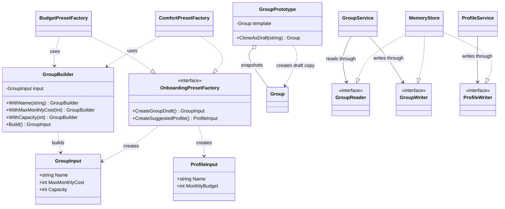

# Lab 1: Creational patterns in the Domi backend

**Student:** Lucian-Adrian Gavril, FAF-241 | **Language:** Go | **Revision:** 7 October 2026

## Introduction

Domi helps people find roommates and form groups to rent a home together. The backend carried forward from Lab 0 creates profiles and groups, checks whether a profile can afford a group's monthly cost, and stores records through application services. This laboratory examines three ways to decide how new objects are assembled: Builder prepares a group input in stages, Abstract Factory creates a related group and profile suggestion, and Prototype derives a clean group draft from an existing group.

The [ELSE Laboratory work #1 brief](https://else.fcim.utm.md/mod/assign/view.php?id=27825), titled "Creational Design Patterns," requires three patterns from Singleton, Builder, Prototype, Object Pooling, Factory Method, and Abstract Factory. It also asks students to know the remaining patterns. This implementation uses Builder, Prototype, and Abstract Factory. Singleton concerns one shared instance; Factory Method lets a creator vary how it constructs one product; Object Pooling reuses available objects. They solve different creation problems and do not replace the three patterns used here. The application has small input values and no expensive reusable resources, so its examples have no need for a singleton store or an object pool.

The examples use whole EUR per person per month. A group has a name, a maximum monthly cost, and a capacity from 1 to 20. A profile has a name and a monthly budget. These values make the domain rules concrete; they are example data, not measurements of a deployed service. The application is a local prototype with an in-memory store.

## Go types, objects, and the program

Object-oriented programming is one way to organize a program around objects that combine state with operations. State is the data held by a value. An operation is behavior that reads or changes that data. In Domi, a group has state such as its capacity and member IDs, and the domain method that adds a member checks whether the change is allowed. Go supports this style through types, methods, and interfaces. It does not require class inheritance; types can be composed by storing values of other types and can satisfy interfaces by providing the required methods. The [Go FAQ](https://go.dev/doc/faq#Is_Go_an_object-oriented_language) describes this approach.

A struct declares named fields. A type declaration such as `type Group struct { ... }` defines the shape of a group value, while each created value is one particular group. A Go variable holds a value of its declared type. A stored `Group` differs from a `GroupInput`: the former represents a domain record with an identity and membership; the latter represents only the settings requested by a caller.

```text
Keep the stored group record, creation input, and public response as separate shapes.
The record has its ID and member IDs.
The input has only the requested settings.
The response exposes an ID and a member count.
```

```go
type Group struct {
    id               string
    name             string
    maxMonthlyCost   int
    capacity         int
    memberProfileIDs []string
}

type GroupInput struct {
    Name           string `json:"name"`
    MaxMonthlyCost int    `json:"maxMonthlyCost"`
    Capacity       int    `json:"capacity"`
}

type GroupView struct {
    ID             string `json:"id"`
    Name           string `json:"name"`
    MaxMonthlyCost int    `json:"maxMonthlyCost"`
    Capacity       int    `json:"capacity"`
    MemberCount    int    `json:"memberCount"`
}
```

The code uses Go's `string` and `int` types. The `[]string` notation means a slice, a growable sequence of strings. Here it stores member IDs rather than whole profile records. The `GroupInput` has exported fields, whose names begin with capital letters, so callers in other packages can set them. Its struct tags map Go field names to JSON names. The fields in `Group` begin with lowercase letters and are unexported outside the package. All lab files use `package main`, so other files in this package, including the store, can access them.

The separation between input, domain record, and view serves different purposes. A request should not choose the ID assigned by the store. A domain group needs member IDs so membership rules can operate on them. A public view needs enough information to display the group, but can omit internal state. The same distinction appears with `ProfileInput`, `Profile`, and `ProfileView`. The profile model retains the monthly budget for eligibility checks while its response view exposes only its ID and name.

Each file starts with a package declaration. The package name `main` means Go builds these files together into an executable. The module file, `go.mod`, names the module `domi-lab-01` and declares Go 1.22. The project uses standard-library packages, not a separate application framework. Running `go run . --patterns` from the lab directory compiles the package in that directory and passes the `--patterns` option to its `main` function. The dot means "this package"; running only `main.go` would leave out declarations in the other files.

Methods attach behavior to a receiver type. In `func (builder GroupBuilder) WithName(name string) GroupBuilder`, the part in parentheses names the receiver value, `builder`, and its type, `GroupBuilder`. The method accepts a string named `name` and returns another `GroupBuilder`. A function or method can return several values, so `(GroupInput, error)` means one input and one possible error. Go code normally checks that error explicitly. The short declaration `:=` introduces local variables and assigns values; `err != nil` checks whether an error was returned. A `nil` error represents success.

A struct literal constructs a value by naming its fields, for example the factory can provide a `GroupInput` with a name, cost, and capacity. A method call uses a dot between a value and method, as in `builder.WithName(...)`. When the returned builder is followed by another dot and method call, the result of the first call becomes the receiver for the next. This ordinary method-call syntax is the basis of the builder chain.

The domain method `Group.addMember` uses a pointer receiver, written `*Group`, because it changes the group's membership slice. A pointer refers to a particular value, so the method can update that value rather than only a temporary copy. The store's map lookup still produces a group value copy, so `JoinGroup` writes the changed group back to the map after the method succeeds. The builder uses value receivers for a different reason: each setting returns the updated builder value for the next call.

Go's concrete types and interfaces supply the polymorphism used in the factory. An interface lists the operations a caller needs, not the data fields of a concrete type. A type satisfies an interface implicitly if it has methods with the required names and signatures. There is no separate `implements` declaration. This lets the demonstration work with multiple factory families through one interface value. These language conventions follow the style described in [Effective Go](https://go.dev/doc/effective_go).

## Builder: assemble and validate a group input

Builder separates the construction of a value from the code that uses it. It is useful when the caller sets related fields in distinct steps and wants a final validation point. In this implementation, the product is a `GroupInput`, which is a request to create a group. It is not yet the stored `Group`.

```text
Start with an empty group input.
Set its name, monthly cost, and capacity on successive builder values.
When all settings are present, normalize and validate the input.
```

```go
type GroupBuilder struct {
    input GroupInput
}

func NewGroupBuilder() GroupBuilder {
    return GroupBuilder{}
}

func (builder GroupBuilder) WithName(name string) GroupBuilder {
    builder.input.Name = name
    return builder
}

func (builder GroupBuilder) WithMaxMonthlyCost(amount int) GroupBuilder {
    builder.input.MaxMonthlyCost = amount
    return builder
}

func (builder GroupBuilder) WithCapacity(people int) GroupBuilder {
    builder.input.Capacity = people
    return builder
}

func (builder GroupBuilder) Build() (GroupInput, error) {
    return normalizeGroupInput(builder.input)
}
```

The receiver on each `With...` method is a value receiver, written as `(builder GroupBuilder)`. Calling the method copies the builder struct into the receiver. The method changes the receiver's `input` and returns that updated builder value. The next call receives the returned value. This is why the methods can be chained without a pointer receiver. In this builder the input contains strings and integers, so copying the builder copies those values. A value receiver is a shallow copy in Go; it would not independently copy a slice or map stored inside a future version of the builder.

The factory uses the chain this way:

```text
Create a fresh builder.
Set the family's group name, cost, and capacity in sequence.
Build one validated group input and return its error if invalid.
```

```go
func (BudgetPresetFactory) CreateGroupDraft() (GroupInput, error) {
    return NewGroupBuilder().
        WithName("Budget shared home").
        WithMaxMonthlyCost(450).
        WithCapacity(4).
        Build()
}
```

The dot begins each continued method call. `NewGroupBuilder()` returns a zero-valued builder. `WithName` returns the builder containing the name; the next call receives it, adds the cost, and returns it again. `Build` is called on the final value. The Budget family uses a cost of 450 and capacity 4; the Comfort family follows the same sequence with cost 700 and capacity 2. These values are in EUR per person per month.

The builder does not make an invalid value impossible merely because it has a `Build` method. Callers can construct `GroupInput` directly, and the HTTP handler also decodes request data into input types. Therefore validation must remain at the domain and persistence boundaries. The builder is a named, reusable path to a valid input, not a security boundary or a substitute for storage validation.

The shared validator trims whitespace from names, rejects a blank name, requires a positive monthly cost, and restricts capacity to 1 through 20. It returns the normalized input on success. On failure it returns a zero-valued input and an error that wraps `ErrInvalidInput` with a specific reason.

```text
Trim surrounding spaces from the proposed name.
Reject a blank name, nonpositive cost, or capacity outside 1 to 20.
Return the normalized input only after all checks pass.
```

```go
func normalizeGroupInput(input GroupInput) (GroupInput, error) {
    input.Name = strings.TrimSpace(input.Name)
    if input.Name == "" {
        return GroupInput{}, fmt.Errorf("%w: group name is required", ErrInvalidInput)
    }
    if input.MaxMonthlyCost <= 0 {
        return GroupInput{}, fmt.Errorf("%w: maxMonthlyCost must be greater than zero", ErrInvalidInput)
    }
    if input.Capacity <= 0 {
        return GroupInput{}, fmt.Errorf("%w: capacity must be greater than zero", ErrInvalidInput)
    }
    if input.Capacity > maxGroupCapacity {
        return GroupInput{}, fmt.Errorf("%w: capacity cannot exceed %d people in a roommate group", ErrInvalidInput, maxGroupCapacity)
    }
    return input, nil
}
```

The `if` statements reject one condition at a time and return immediately, so later code runs only when earlier checks pass. The format verb `%w` wraps the shared error value while adding detail. Callers can use `errors.Is` to identify the category even if a more specific message has been attached. Returning `(GroupInput{}, err)` on failure avoids presenting a partially valid input as a successful result.

A struct literal is shorter for a single fixed input at one call site. Builder adds value here because the standalone example and both preset families use the same staged construction and validator. If group inputs had few fields and one construction site, direct literals would be simpler. A pattern is useful when its named responsibility clarifies the code, not simply because it can be applied.

## Abstract Factory: create a compatible family

Abstract Factory provides one contract for creating a family of related products. A family here consists of a group input and a suggested profile input. They are related by a domain constraint: the profile's monthly budget must cover the group's maximum monthly cost. The products are input values; the factory does not write to the store.

```text
Require each factory family to produce both kinds of input.
Let the caller request the group and profile through the same contract.
```

```go
type OnboardingPresetFactory interface {
    CreateGroupDraft() (GroupInput, error)
    CreateSuggestedProfile() (ProfileInput, error)
}

type BudgetPresetFactory struct{}

func (BudgetPresetFactory) CreateGroupDraft() (GroupInput, error) {
    return NewGroupBuilder().
        WithName("Budget shared home").
        WithMaxMonthlyCost(450).
        WithCapacity(4).
        Build()
}

func (BudgetPresetFactory) CreateSuggestedProfile() (ProfileInput, error) {
    return buildProfileSuggestion("Budget renter", 500)
}

type ComfortPresetFactory struct{}

func (ComfortPresetFactory) CreateGroupDraft() (GroupInput, error) {
    return NewGroupBuilder().
        WithName("Comfort shared home").
        WithMaxMonthlyCost(700).
        WithCapacity(2).
        Build()
}

func (ComfortPresetFactory) CreateSuggestedProfile() (ProfileInput, error) {
    return buildProfileSuggestion("Comfort renter", 900)
}
```

Both concrete factories satisfy the interface because they provide the two matching methods. Their struct types are empty because their methods use fixed example settings and need no per-instance fields. The Budget family pairs a 450-cost group with a 500-budget profile. The Comfort family pairs a 700-cost group with a 900-budget profile. The concrete values differ, but callers can ask either factory for the same two kinds of product.

The shared interface describes available operations, not the compatibility rule. An interface can verify that a factory has methods returning `GroupInput` and `ProfileInput`; it cannot state that one returned budget must be at least the other returned cost. `buildOnboardingPreset` checks that relationship after asking for both products. It validates the profile using the domain constructor, then compares its normalized monthly budget with the group cost. If the budget is lower, it returns `ErrBudgetTooLow` instead of a successful preset. It normalizes the group before returning the pair as an `OnboardingPreset`.

```text
Ask one family for both proposed products.
Validate the profile and compare its budget with the group cost.
Return a preset only when the pair is valid and affordable.
```

```go
profileModel, err := newProfile("suggested-profile", profile)
if err != nil {
    return OnboardingPreset{}, err
}
if profileModel.monthlyBudget < group.MaxMonthlyCost {
    return OnboardingPreset{}, ErrBudgetTooLow
}

group, err = normalizeGroupInput(group)
if err != nil {
    return OnboardingPreset{}, err
}
return OnboardingPreset{Group: group, SuggestedProfile: profile}, nil
```

The ID string `suggested-profile` passed to `newProfile` is used only to reuse domain validation. This temporary model is not stored. The function returns the profile input, and the store later assigns the profile's real ID. Likewise, normalizing the group here produces an input but does not create a stored record. This keeps construction and validation separate from persistence.

The demonstration stores the families in a slice of anonymous structs. Each element has a display name and a factory stored through the interface type. It then loops over the elements and runs the same creation logic for each family, without branching on whether the current concrete value is Budget or Comfort.

```text
Keep each display name beside its factory.
Place different concrete factories in the same interface-typed field.
Iterate over the families with one shared creation path.
```

```go
families := []struct {
    name    string
    factory OnboardingPresetFactory
}{
    {name: "budget", factory: BudgetPresetFactory{}},
    {name: "comfort", factory: ComfortPresetFactory{}},
}
```

The slice is a list of values; the anonymous struct declares the element shape locally instead of adding a separate named type. Each `factory` field can hold either concrete factory because both satisfy `OnboardingPresetFactory`. The loop passes that interface value to the same function. This is polymorphism through a common contract, implemented with composition and interface satisfaction rather than subclassing.

Factory Method is related but has a different emphasis. A factory method generally lets a creator vary the construction of one product type. Abstract Factory coordinates several product-creation methods as a family. Domi needs the pair because the group and profile suggestion must be chosen together and checked for compatibility. If there were one permanent preset with no choice of family, two ordinary functions could be simpler than an interface.

## Validation, services, and storage

Creation has three distinct stages. A builder or factory prepares an input. A domain constructor checks the values and creates a domain record. An application service delegates the operation to a storage interface, and the store assigns identity and saves the record. These stages answer different questions: are the requested settings valid, what is the domain value, and can this record be persisted here?

The builder's `Build` calls the same group input normalizer used by the domain constructor. That gives the caller an early error before attempting storage. The store repeats validation when creating a group because callers can bypass the builder. For example, the HTTP handler decodes a `GroupInput` directly, and other service callers may create input literals. If storage trusted only the builder, invalid values could enter through those paths.

```text
Lock the store while creating the record.
Choose the next candidate ID and validate the input.
Only after validation succeeds, advance the counter and save.
Return a view of the stored record.
```

```go
func (store *MemoryStore) CreateGroup(input GroupInput) (GroupView, error) {
    store.mutex.Lock()
    defer store.mutex.Unlock()

    id := formatID("group", store.nextGroupID+1)
    group, err := newGroup(id, input)
    if err != nil {
        return GroupView{}, err
    }
    store.nextGroupID++
    store.groups[id] = group
    return group.view(), nil
}
```

The service calls its writer interface; the store implements that interface. The store calculates a candidate ID such as `group-1` but does not increment the counter until validation succeeds. Invalid input therefore does not consume an ID. A successful call saves the `Group` in a map keyed by ID, then returns a `GroupView`. The input had no identity, and the response contains the assigned one.

The `MemoryStore` is in-memory: its maps exist only while the process runs. The mutex protects access to those maps and ID counters. The new creational patterns do not add an alternate save path. The group and profile services still delegate creation and joins to the same store contracts used by the rest of the application. This keeps IDs, membership checks, and persistence responsibilities in one place.

## Prototype: copy settings without copying identity

Prototype creates a new object by starting from an existing object's state. A group listing can provide the settings for another listing, but copying a complete record would also copy its identity and member IDs. The prototype therefore distinguishes reusable configuration from state that belongs only to one group.

A Go assignment such as `snapshot := source` copies the struct value. Its string and integer fields are copied as values. The member field is a slice, however. A slice contains a pointer to an underlying array plus its length and capacity. Copying a slice value copies that descriptor, not the elements. The source and copied struct would still refer to the same member-ID array. Mutating an element through either slice could then be observed through the other.

```text
Validate the source group's reusable settings.
Copy the source record, then copy its member-ID elements into a new slice.
Store the resulting value as the prototype snapshot.
```

```go
func NewGroupPrototype(source Group) (GroupPrototype, error) {
    input, err := normalizeGroupInput(source.input())
    if err != nil {
        return GroupPrototype{}, err
    }

    snapshot := source
    snapshot.name = input.Name
    snapshot.memberProfileIDs = append([]string(nil), source.memberProfileIDs...)
    return GroupPrototype{template: snapshot}, nil
}
```

The expression `append([]string(nil), source.memberProfileIDs...)` creates a destination slice and appends each source member ID. The three dots expand the source slice into individual arguments to `append`. For a nonempty source, the new slice has its own backing array, so later changes to source membership do not alter the prototype snapshot. The name is set to its normalized version. The snapshot keeps its source ID and copied membership because it represents the source state from which drafts can be derived.

Copying a prototype into a draft uses a different membership rule. The prototype preserves a snapshot, but each new group must begin as a distinct record with no members. The clone method validates the requested new name together with the stored cost and capacity, copies the template, clears its ID, applies the normalized name, and replaces the member slice with an empty one.

```text
Validate the new name and the copied group settings.
Copy the snapshot, clear its old ID, and apply the new name.
Replace the member list with an empty slice and return the unsaved value.
```

```go
func (prototype GroupPrototype) CloneAsDraft(name string) (Group, error) {
    input, err := normalizeGroupInput(GroupInput{
        Name:           name,
        MaxMonthlyCost: prototype.template.maxMonthlyCost,
        Capacity:       prototype.template.capacity,
    })
    if err != nil {
        return Group{}, err
    }

    clone := prototype.template
    clone.id = ""
    clone.name = input.Name
    clone.memberProfileIDs = make([]string, 0)
    return clone, nil
}
```

The draft keeps the cost and capacity but does not keep the source identity or membership. The slice replacement matters even though the clone is a shallow copy of the template: after `clone := prototype.template`, the clone initially shares the template's slice descriptor and backing array. Assigning a new empty slice to the clone means it no longer points at that member array. The prototype's captured state remains intact.

An empty slice has length zero, so the resulting view reports `memberCount: 0`. Whether the empty slice is `nil` or non-`nil` does not change this count; here `make([]string, 0)` creates a non-nil empty slice. The store does not save this returned value as-is. The demo converts it to a `GroupInput` with the `input()` method, which contains only name, cost, and capacity. `GroupService.CreateGroup` then uses the normal store path to validate, assign a new ID, and save it.

This reset prevents two identity errors. Reusing the source ID could overwrite the original map entry, because IDs are storage keys. Reusing the source member IDs would make the copied listing appear occupied by the source group's members. A prototype centralizes the field-copy and reset rules, so each caller does not have to remember them.

The demonstration first reconstructs a domain `Group` from the joined Budget group's response. It appends the response members' IDs and checks that the number reconstructed agrees with `MemberCount`. The prototype then snapshots that joined state, and `CloneAsDraft` removes membership for the new listing. This check ensures that the data used for cloning is internally consistent before the example proceeds.

## One execution from inputs to saved records

The `--patterns` option follows a separate command-line branch from `--demo` and the HTTP server. Both demo modes use the same in-memory store and services, but they create different sample data. If both flags are supplied, `main` rejects the request rather than choosing one silently.

```text
After parsing options and constructing the services, inspect the patterns flag.
When it is set, run the creational demonstration with those services.
If the demonstration fails, log the error and exit unsuccessfully.
Otherwise return from main after printing the result.
```

```go
if *patterns {
    if err := runCreationalDemo(groups, profiles); err != nil {
        log.Fatal(err)
    }
    return
}
```

The call to `flag.Bool` returns a pointer to a Boolean option value, so `*patterns` reads whether the option was supplied. The services keep interface-typed dependencies: `GroupService` receives a reader and writer, and `ProfileService` receives a profile writer. The concrete store satisfies those interfaces by implementing their methods. Both services refer to the same store value, so groups and profiles created through them share the same maps and ID counters.

The demonstration creates its values in this order:

| Step | Operation | State or result |
| --- | --- | --- |
| 1 | Create the store and services | Empty group and profile maps with independent counters. |
| 2 | Build and save the standalone example | `group-1`, cost 650, capacity 3, no members. |
| 3 | Build the Budget family and save both inputs | `group-2` and `profile-1`; the profile joins the group. |
| 4 | Build the Comfort family and save both inputs | `group-3` and `profile-2`; the profile joins the group. |
| 5 | Reconstruct the joined Budget group and snapshot it | Source `group-2` has one member in the captured state. |
| 6 | Clone the snapshot and save the new input | `group-4`, same cost and capacity as Budget, no members. |
| 7 | Encode the result | One indented JSON object is written to standard output. |

The Budget profile can afford the 450 monthly cost because 500 is greater than 450. The Comfort profile can afford the 700 cost because 900 is greater than 700. Each profile is created by `ProfileService.CreateProfile` and joined using the group and profile IDs. The join passes through the existing service and storage path, so the member count in each preset result reflects a real in-memory membership change in this execution.

The prototype uses the joined Budget group rather than the original empty group input. The output therefore makes the reset visible: its source count is one and its copy count is zero. Its name differs, while cost and capacity remain 450 and 4. Since each invocation creates a new store, IDs start again from `group-1` and `profile-1`. They are not persistent identifiers.

From the lab directory, this command runs the demonstration. Go builds for the current machine when using `go run`, so this source command works on Windows, macOS, or Linux when Go is installed. A separately built executable targets an operating system and architecture; a Windows `.exe` is not directly runnable on Linux.

```text
Build and run the Go package in the current directory.
Pass the patterns option to print the pattern examples as JSON.
```

```sh
go run . --patterns
```

For a new process with an empty memory store, the demonstration prints the following JSON. The IDs reflect the creation order above; the data is produced by the application rather than being a persisted database snapshot.

```text
Create one Builder group.
Create and join the Budget and Comfort family products.
Clone the joined Budget group's settings into a new empty group.
Return the source and copy information as indented JSON.
```

```json
{
  "builderGroup": {
    "id": "group-1",
    "name": "Builder example home",
    "maxMonthlyCost": 650,
    "capacity": 3,
    "memberCount": 0
  },
  "presetGroups": [
    {
      "family": "budget",
      "group": {
        "group": {
          "id": "group-2",
          "name": "Budget shared home",
          "maxMonthlyCost": 450,
          "capacity": 4,
          "memberCount": 1
        },
        "members": [
          {
            "id": "profile-1",
            "name": "Budget renter"
          }
        ]
      },
      "suggestedProfile": {
        "id": "profile-1",
        "name": "Budget renter"
      }
    },
    {
      "family": "comfort",
      "group": {
        "group": {
          "id": "group-3",
          "name": "Comfort shared home",
          "maxMonthlyCost": 700,
          "capacity": 2,
          "memberCount": 1
        },
        "members": [
          {
            "id": "profile-2",
            "name": "Comfort renter"
          }
        ]
      },
      "suggestedProfile": {
        "id": "profile-2",
        "name": "Comfort renter"
      }
    }
  ],
  "prototype": {
    "sourceGroupId": "group-2",
    "sourceMemberCount": 1,
    "copy": {
      "id": "group-4",
      "name": "Budget shared home copy",
      "maxMonthlyCost": 450,
      "capacity": 4,
      "memberCount": 0
    }
  }
}
```

The outer result groups the standalone builder result, both preset results, and the prototype result. Each preset contains a group detail and a suggested profile view. The repeated profile data is intentional: the detail shows current group membership, while the separate field shows the profile product returned by its creation service. The prototype section reports its source ID and original member count beside the saved copy. These JSON keys come from struct tags in the result types.

## Source responsibilities

| Source | Responsibility |
| --- | --- |
| [domain.go](domain.go) | Domain records, input types, validation, membership rules, and response views |
| [patterns.go](patterns.go) | Builder, onboarding factory interface and families, and group prototype |
| [patterns_demo.go](patterns_demo.go) | Pattern examples, service calls, result assembly, and JSON output |
| [main.go](main.go) | HTTP server, baseline demo, and the `--patterns` command-line option |
| [service.go](service.go) | Application services and storage interfaces |
| [store.go](store.go) | In-memory persistence, synchronization, and ID assignment |
| [patterns_test.go](patterns_test.go) | Checks for Builder validation, Prototype isolation, and factory-family consistency |

The sequence of calls is `main -> runCreationalDemo -> createBuilderExample and createPresetExamples -> createPrototypeExample -> GroupService and ProfileService -> MemoryStore`. The pattern functions prepare and validate values. The application services expose use-case operations and delegate through interfaces. The store creates records and assigns IDs. This boundary lets the examples add construction choices without changing how the backend stores groups or profiles.

## UML class diagram

The dashed realization arrows show that both concrete factories satisfy the `OnboardingPresetFactory` interface. `GroupPrototype` holds a snapshot of a `Group`, then returns a draft that is saved later through the existing service and store.

```text
Show the builder creating a group input.
Show both factories implementing the shared factory interface.
Show the prototype holding a group snapshot and producing a draft.
Show services using storage interfaces implemented by the memory store.
```



## UML sequence diagram

The sequence follows construction through the Budget factory and creation of a Prototype copy. The factory uses Builder to produce its group input and supplies a compatible profile suggestion. The application saves and joins those records through the services, then copies the joined group's settings into a fresh draft. Saving the copy assigns its new ID. The Comfort factory follows the same family contract in the demonstration's other iteration.


[Editable Isomorph diagram](assets/sequence.isx)  |  [PNG export](assets/sequence.png)

The arrows distinguish preparing a draft from storing a record. The prototype returns an unsaved value with a blank ID and empty membership; the service and store perform final creation.

## Results

The `--patterns` demonstration creates four groups in one in-memory process: one constructed directly with Builder, one for each onboarding family, and one Prototype copy. The two preset profiles are saved and joined to their matching groups through the existing services. The copy carries the Budget group's cost and capacity but has a different name, a new ID, and zero members. The JSON output above exposes these results and the creation order.

The source test file covers invalid Builder capacity, normalization of valid input, isolation of the prototype snapshot and draft membership, assignment of a fresh ID when a clone is saved, and validity and affordability of each factory family's inputs. These checks address the edge cases implied by the patterns; the demonstration output shows their ordinary successful path.

The HTTP routes and original `--demo` option remain available. The `--patterns` path uses the same services and store, so it adds a demonstration entry point without introducing another persistence or ID-assignment mechanism. Records disappear when the process stops because this store is in memory.

## Conclusion

Builder assembles and validates a group input through a staged API. Abstract Factory returns a related group and profile suggestion through one family interface, while a separate domain check enforces that the profile can afford the group. Prototype captures an isolated source snapshot and produces a renamed draft with the same cost and capacity but no inherited identity or membership. The application services and store remain responsible for saving records, applying the existing validation path, and assigning IDs. The three patterns therefore address separate creation decisions while fitting the backend's existing domain and storage design.
