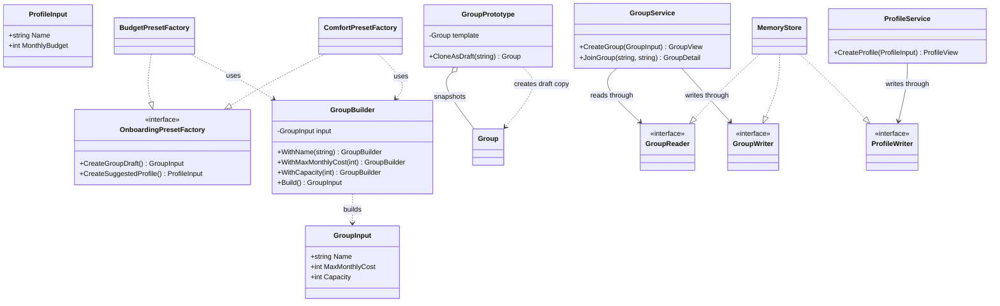
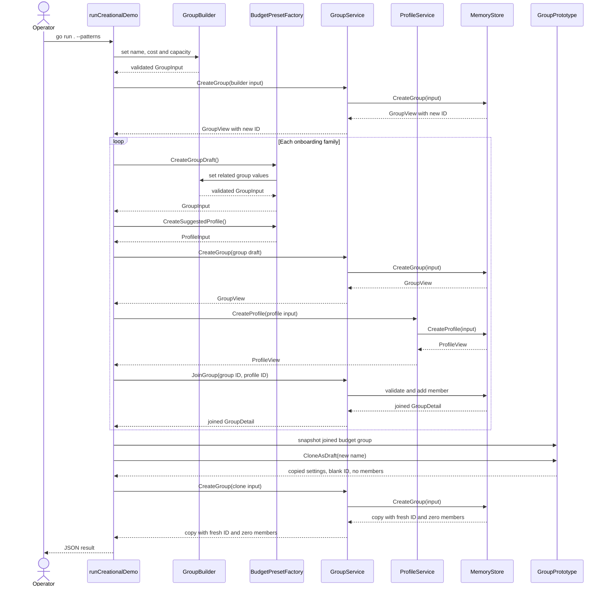

# Lab 1: Creational patterns in the Domi backend

Student: Lucian-Adrian Gavril, FAF-241. Language: Go. Report revision: 15 October 2026.

## Introduction and condition

Domi helps people find roommates and form groups to rent a home together. The preceding lab supplies a Go backend for profiles, groups, affordable-group browsing and joining. This lab adds three creational patterns to the same domain.

The [ELSE Laboratory work #1 brief](https://else.fcim.utm.md/mod/assign/view.php?id=27825) is titled “Creational Design Patterns”. It asks for three patterns from Singleton, Builder, Prototype, Object Pooling, Factory Method and Abstract Factory, and asks students to know the rest. This implementation selects Builder, Prototype and Abstract Factory because they address three concrete creation needs in roommate onboarding.

Go uses structs, methods, interfaces and composition for object-oriented design. The report describes those mechanisms directly. It does not introduce a class inheritance hierarchy.

## Tasks and completed workflow

- Build a group draft by collecting its name, monthly cost and capacity, then validate the whole draft.
- Create related group and suggested-profile products for Budget and Comfort onboarding families.
- Copy an existing group configuration into a new draft while clearing its ID and member list.
- Save the drafts and profiles through the existing services so normal validation and ID assignment still apply.
- Keep the HTTP API and `--demo` workflow available, and print a JSON example with `--patterns`.

Amounts are illustrative whole EUR per person per month. Capacity is limited to 1 through 20. The code is a local in-memory prototype; authentication, persistent storage and frontend integration are outside this implementation.

## Builder

### Need

A group draft has three related settings: a name, a maximum monthly cost and a capacity. The demo and onboarding families assemble groups in more than one place. A builder gives each caller a readable order for setting those values and sends the completed draft through the same validation used by the domain constructor.

### Mechanism in the source

`GroupBuilder` stores a `GroupInput`. Each `With...` method returns an updated builder value. `Build` calls `normalizeGroupInput`, which trims the name and rejects a blank name, non-positive cost or capacity, and capacity above the domain limit. The result remains an input draft. `GroupService.CreateGroup` and the store are still responsible for creating and storing the group.

```go
func NewGroupBuilder() GroupBuilder {
	return GroupBuilder{}
}

func (builder GroupBuilder) WithName(name string) GroupBuilder {
	builder.input.Name = name
	return builder
}

func (builder GroupBuilder) WithMaxMonthlyCost(amount int) GroupBuilder {
	builder.input.MaxMonthlyCost = amount
	return builder
}

func (builder GroupBuilder) WithCapacity(people int) GroupBuilder {
	builder.input.Capacity = people
	return builder
}

func (builder GroupBuilder) Build() (GroupInput, error) {
	return normalizeGroupInput(builder.input)
}
```

The `--patterns` demo supplies “Builder example home”, cost 650 and capacity 3. `Build` returns a valid `GroupInput`; `CreateGroup` stores it and assigns the first group ID.

## Prototype

### Need

An onboarding family can use an existing group as a starting point. Reusing the full record would also reuse its identity and members, which would make a new listing appear to belong to the old roommates. The copy needs the same cost and capacity with a new name and an empty membership.

### Mechanism in the source

`NewGroupPrototype` validates the source configuration and copies its member-ID slice so the snapshot is independent. `CloneAsDraft` carries over only the settings, validates the requested name, and clears both the ID and membership. The clone is not persisted yet. Passing its `GroupInput` to `GroupService.CreateGroup` lets the store assign a fresh ID.

```go
func NewGroupPrototype(source Group) (GroupPrototype, error) {
	input, err := normalizeGroupInput(source.input())
	if err != nil {
		return GroupPrototype{}, err
	}

	snapshot := source
	snapshot.name = input.Name
	snapshot.memberProfileIDs = append([]string(nil), source.memberProfileIDs...)
	return GroupPrototype{template: snapshot}, nil
}

func (prototype GroupPrototype) CloneAsDraft(name string) (Group, error) {
	input, err := normalizeGroupInput(GroupInput{
		Name:           name,
		MaxMonthlyCost: prototype.template.maxMonthlyCost,
		Capacity:       prototype.template.capacity,
	})
	if err != nil {
		return Group{}, err
	}

	clone := prototype.template
	clone.id = ""
	clone.name = input.Name
	clone.memberProfileIDs = make([]string, 0)
	return clone, nil
}
```

In the demo, the budget group has one suggested profile after a service-level join. Its prototype creates “Budget shared home copy”. The store gives the copy a different ID and its member count is zero.

## Abstract Factory

### Need

Onboarding should offer related group and profile suggestions as a family. A suggested profile should have enough monthly budget for the group's stated cost. Creating either product from an unrelated preset could yield an inconsistent pair.

### Mechanism in the source

`OnboardingPresetFactory` has two product-creation methods. `BudgetPresetFactory` and `ComfortPresetFactory` implement both methods, each producing a group draft and a suggested profile for its family. The group method uses `GroupBuilder`; the profile method validates the profile name and budget. `buildOnboardingPreset` gathers the two products and rejects a profile budget lower than the group cost.

```go
type OnboardingPresetFactory interface {
	CreateGroupDraft() (GroupInput, error)
	CreateSuggestedProfile() (ProfileInput, error)
}

type BudgetPresetFactory struct{}

func (BudgetPresetFactory) CreateGroupDraft() (GroupInput, error) {
	return NewGroupBuilder().
		WithName("Budget shared home").
		WithMaxMonthlyCost(450).
		WithCapacity(4).
		Build()
}

func (BudgetPresetFactory) CreateSuggestedProfile() (ProfileInput, error) {
	return buildProfileSuggestion("Budget renter", 500)
}
```

The Comfort family uses a group cost of 700 and capacity 2, with a suggested profile budget of 900. The demo saves each product through `GroupService` and `ProfileService`, then joins the suggested profile to its family group. The same factory interface can be supplied to `buildOnboardingPreset` without a family-specific branch.

## Source roles and relationships

| Source                               | Role in this lab                                                                             |
| ------------------------------------ | -------------------------------------------------------------------------------------------- |
| [domain.go](domain.go)               | Shared group-input validation used by Builder, Prototype and the existing domain constructor |
| [patterns.go](patterns.go)           | Builder, two-product factory interface and families, Prototype snapshot and clone            |
| [patterns_demo.go](patterns_demo.go) | Builds examples and uses the existing group/profile services for JSON output                 |
| [main.go](main.go)                   | Adds `--patterns` while keeping the server and baseline `--demo`                             |
| [patterns_test.go](patterns_test.go) | Invalid-builder, clone-isolation and family-consistency checks                               |

The services and memory store are carried forward from Lab 0. They remain the single path for persistence and ID assignment in this demo.

## UML class diagram

The factory realization arrows show implicit Go interface implementation. `GroupPrototype` contains a snapshot of a `Group`; the draft sent to the service has no ID or member references.



## UML sequence diagram: create a family and clone a group

The trace follows `runCreationalDemo`, the factories, the services and the store. The budget group is joined before it is snapshotted. The copied draft is saved through the same service, which generates its new ID.



## Results

On 15 October 2026, the requested `go test ./...` run passed (`ok domi-lab-01`). The focused pattern tests verify that invalid capacity is rejected, prototype snapshots and clones do not share membership, saving a clone gives it a fresh ID, and each onboarding family returns valid related inputs with sufficient profile budget.

The requested `go run . --patterns` run completed. Its JSON assigned `group-1` to the Builder example, `group-2` and `group-3` to the Budget and Comfort family groups, and `group-4` to the Prototype copy. Each family group had one joined suggested profile. The copy had a fresh ID and `memberCount: 0`, while its source had `memberCount: 1`. The demo uses illustrative data and the memory store; it does not measure deployment behavior.

The original HTTP routes and `--demo` remain available. The `--patterns` option uses the services and store rather than creating alternate persistence behavior.

## Conclusion

The three patterns map to distinct creation tasks in Domi. Builder assembles a validated group draft. Abstract Factory creates related group and profile suggestions for two onboarding styles. Prototype copies a group's settings while resetting its identity and membership. All resulting records pass through the existing services, so the patterns extend the Lab 0 workflow without replacing its HTTP or storage path.
