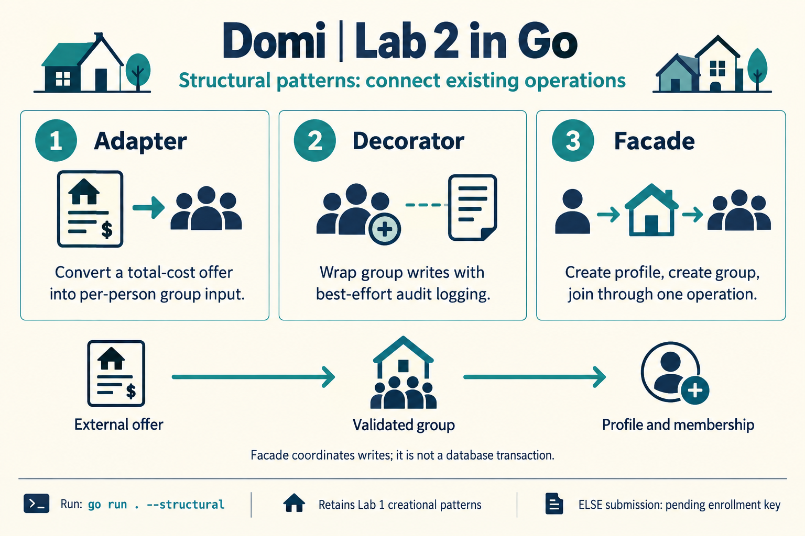

# Domi structural patterns

This Go 1.22+ lab demonstrates Adapter, Decorator, and Facade around the Domi roommate group services. The module also retains the Lab 1 creational examples and the existing HTTP API.

## Local executable

A Windows executable is built in this folder. Run it from PowerShell:

```powershell
.\domi-lab-02.exe --structural
```

After changing the Go source, rebuild it with `go build -o domi-lab-02.exe .`. The executable is a local build output and is not stored in Git.

## Run

From this directory:

```powershell
go run . --structural
go run . --patterns
go run . --demo
go run . --addr localhost:8080
go test ./...
```

The HTTP server exposes `GET /groups`, `GET /groups/{id}`, `POST /groups`, `POST /groups/{id}/join`, and `POST /profiles`. The store keeps records in memory and resets when the process exits.

The Lab 2 patterns are implemented in [structural.go](structural.go) and composed by [structural_demo.go](structural_demo.go). The Lab 1 creational examples remain in [patterns.go](patterns.go) and [patterns_demo.go](patterns_demo.go), using `--patterns`.

Read [report.md](report.md) for the design and demonstrated results. Read [learn.md](learn.md) for the explanation tied to source and oral questions with answers.



## Editable UML diagrams

Open [assets/sequence.isx](assets/sequence.isx) in [Isomorph](https://iso.meandivision.foo/app/) to edit the diagram. The report displays the [SVG export](assets/sequence.svg); a [PNG export](assets/sequence.png) is also included.

Each pattern also has its own class diagram, editable in Isomorph:

| Pattern | Class diagram | Editable source |
| --- | --- | --- |
| Adapter | [SVG](assets/adapter.svg) | [Isomorph](assets/adapter.isx) |
| Decorator | [SVG](assets/decorator.svg) | [Isomorph](assets/decorator.isx) |
| Facade | [SVG](assets/facade.svg) | [Isomorph](assets/facade.isx) |
