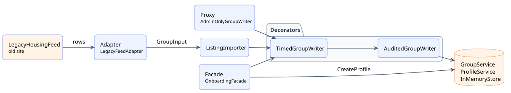
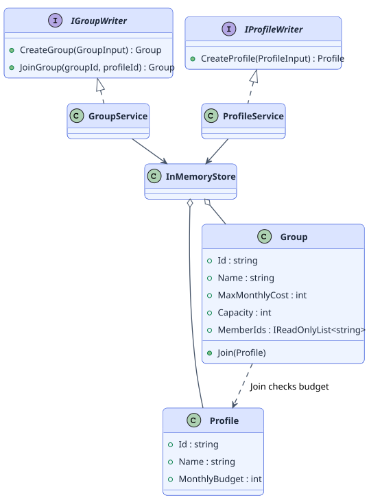
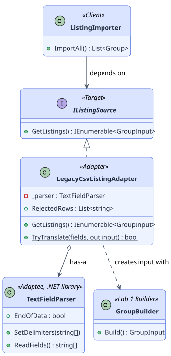
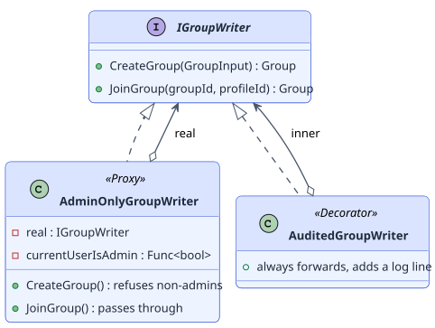

# Laboratory Work No. 2: Structural Design Patterns

**Course:** Software Design Techniques and Mechanisms (TMPS)<br>
**Project:** Domi, a service for forming shared-rent groups<br>
**Language:** C# (.NET 10)

## Contents

1. [Task and purpose](#1-task-and-purpose)
2. [Theory: why structural patterns exist](#2-theory-why-structural-patterns-exist)
3. [The Domi domain](#3-the-domi-domain)
4. [Adapter](#4-adapter)
5. [Decorator](#5-decorator)
6. [Facade](#6-facade)
7. [Proxy](#7-proxy)
8. [The remaining structural patterns](#8-the-remaining-structural-patterns)
9. [Results](#9-results)
10. [Conclusion](#10-conclusion)

---

## 1. Task and purpose

The task is to study the structural design patterns, implement at least three of them in a project of our choice, and be able to explain the remaining ones. The list is Adapter, Bridge, Composite, Decorator, Facade, Flyweight and Proxy. The report must state the project theme, the patterns used, short descriptions with code, and UML diagrams.

The deeper goal is to learn how to connect existing objects without rewriting them. Creational patterns, in Laboratory work No. 1, decided how objects are made. Structural patterns decide how finished objects are put together: how one object fits an interface it was not written for, how behaviour is added to an object without editing it, and how a group of objects is offered to a caller through one simple entry point.

The project is again **Domi**, a service that helps people form a group to rent a home together. Domi has real structural needs: an old housing site sends offers in a different format, every change to a group should be logged and measured, onboarding a new person takes several calls in a fixed order, and only administrators may create groups.

Implemented: **Adapter**, **Decorator**, **Facade**, and, as a fourth pattern, **Proxy**. Bridge, Composite and Flyweight are explained with Domi examples in the chapter after Proxy.



*Figure 1. The four implemented patterns around the unchanged Domi services.*

---

## 2. Theory: why structural patterns exist

### 2.1 One idea behind every structural pattern

Each structural pattern places an object between two other objects. The patterns differ in why that object stands there:

| Pattern | The middle object exists to | Same interface as the wrapped object |
| --- | --- | --- |
| Adapter | translate one interface into another | No |
| Decorator | add behaviour, then forward the call | Yes |
| Proxy | control whether the real object is reached | Yes |
| Facade | offer one simple call over several objects | No, a new smaller one |
| Bridge | connect two independent hierarchies through a field | Not applicable |
| Composite | treat one object and a tree of objects alike | Yes, leaf and branch share it |
| Flyweight | share the common immutable part of many objects | Not applicable |

### 2.2 Composition over inheritance

Almost every structural pattern prefers composition, holding another object in a field, to inheritance. Inheritance fixes a relationship when the code is compiled. Composition lets the program choose and combine collaborators when it runs. The Decorator chapter shows the cost of the alternative: with inheritance, every combination of extra behaviours would need its own subclass.

### 2.3 Programming to an interface

The patterns in this lab work because the services depend on interfaces, not on concrete classes. `ListingImporter` depends on `IListingSource`, and the facade and the demo depend on `IGroupWriter`. Any object that implements the interface can take the real object's place. This is the dependency inversion principle from Laboratory work No. 0 used in practice.

---

## 3. The Domi domain

### 3.1 The classes

A `Profile` has an identifier, a name and a monthly budget. A `Group` has an identifier, a name, a per-person monthly cost, a capacity of at most 20 and a list of member identifiers. Both constructors validate their input and throw a `DomainException` on invalid data, so an invalid object can never exist.

`GroupService` and `ProfileService` create and store objects in an `InMemoryStore`. `GroupService` implements the `IGroupWriter` interface, which the Decorator and Proxy also implement.

```csharp
public interface IGroupWriter
{
    Group CreateGroup(GroupInput input);
    Group JoinGroup(string groupId, string profileId);
}
```



*Figure 2. The Domi domain classes used by all four patterns.*

### 3.2 The joining rule

`Group.Join` holds the only business rule. A person may join when they are not already a member, the group is not full, and their budget covers the per-person cost:

```csharp
public void Join(Profile profile)
{
    if (_memberIds.Contains(profile.Id))
        throw new DomainException($"{profile.Name} is already in {Name}");
    if (_memberIds.Count >= Capacity)
        throw new DomainException($"{Name} is full");
    if (profile.MonthlyBudget < MaxMonthlyCost)
        throw new DomainException($"{profile.Name}'s budget ... is below ...");
    _memberIds.Add(profile.Id);
}
```

None of the four patterns modifies this code. They are added around it.

---

## 4. Adapter

### 4.1 The idea in plain words

An adapter is a translator. A travel plug adapter lets a European plug fit a British socket without changing the plug or the socket. In code, an adapter lets an existing class work with an interface it was not written for.

### 4.2 Problem it solves

An old housing site sends offers as text rows in the format `name;total;people`, where `total` is the rent for the whole flat. Domi's `GroupService` expects a `GroupInput` with a per-person cost and a capacity. The two formats differ in shape (a text row against a typed record) and in meaning (a total against a per-person amount). We cannot change the old site, and we do not want every caller of `GroupService` to know about its format.

### 4.3 Where it fits in Domi

| Role | Class |
| --- | --- |
| Target, the interface the client wants | `IListingSource` |
| Adaptee, the existing class with the wrong interface | `LegacyHousingFeed` |
| Adapter, implements the target and holds the adaptee | `LegacyFeedAdapter` |
| Client, knows only the target | `ListingImporter` |



*Figure 3. Adapter class diagram.*

### 4.4 Code

```csharp
public class LegacyFeedAdapter(LegacyHousingFeed feed) : IListingSource
{
    public List<string> RejectedRows { get; } = [];

    public IEnumerable<GroupInput> GetListings()
    {
        foreach (var row in feed.DownloadRows())
        {
            if (TryConvert(row, out var input))
                yield return input;
            else
                RejectedRows.Add(row);
        }
    }

    public static bool TryConvert(string row, out GroupInput input)
    {
        input = default!;
        var parts = row.Split(';');
        if (parts.Length != 3) return false;
        if (!int.TryParse(parts[1], out var total) || total <= 0) return false;
        if (!int.TryParse(parts[2], out var people) || people <= 0
            || people > Group.MaxCapacity) return false;

        var perPerson = total / people;
        if (total % people != 0) perPerson++;

        input = new GroupInput(parts[0], perPerson, people);
        return true;
    }
}
```

### 4.5 How it works

For the row `Botanica studio;1501;3`, the adapter splits the text, reads 1501 and 3, and divides: 1501 / 3 is 500 with remainder 1. Because the remainder is not zero, the per-person cost becomes 501. Rounding down to 500 would let three people pay only 1500, one unit short of the rent; 3 × 501 = 1503 covers it. Computing the quotient and then adding one avoids the overflow that `(total + people - 1) / people` could cause near the largest `int` value.

A row with a zero total or more than 20 people is stored in `RejectedRows` instead of stopping the import. `ListingImporter` loops over `GetListings()` and calls `CreateGroup` for each result; it never sees a semicolon.

### 4.6 Why not something simpler

Adding a `CreateFromLegacy(total, people)` method to `GroupService` would work for one site. A second legacy site with another format would add another method, and the service would slowly fill with format details that have nothing to do with groups. The adapter keeps each foreign format at the edge of the system. If the old site starts sending prices in euros, only `TryConvert` changes.

### 4.7 Object adapter and class adapter

This is an object adapter: it holds the adaptee in a field. A class adapter would inherit from the adaptee instead. C# allows only one base class, so the object adapter is the usual choice and also allows the adaptee to be replaced in tests.

---

## 5. Decorator

### 5.1 The idea in plain words

A decorator is wrapping paper. A wrapped gift is still a gift from the outside, and it can be wrapped again. In code, a decorator implements the same interface as the object it wraps, does something extra, and forwards the call.

### 5.2 Problem it solves

Every group write should be recorded in an audit log and timed. `GroupService` should keep one responsibility, writing groups. With inheritance, a logged service, a timed service and a logged-and-timed service would each need their own subclass; with n optional behaviours that is up to 2ⁿ classes.

### 5.3 Where it fits in Domi

`AuditedGroupWriter` and `TimedGroupWriter` implement `IGroupWriter` and each hold another `IGroupWriter`. Because they accept the interface and not `GroupService`, they can wrap each other in any order.


*Figure 4. Decorator class diagram.*

### 5.4 Code

```csharp
public class AuditedGroupWriter(IGroupWriter inner, TextWriter log) : IGroupWriter
{
    public Group CreateGroup(GroupInput input) =>
        Record("CreateGroup", () => inner.CreateGroup(input));

    public Group JoinGroup(string groupId, string profileId) =>
        Record("JoinGroup", () => inner.JoinGroup(groupId, profileId));

    private Group Record(string operation, Func<Group> call)
    {
        try
        {
            var group = call();
            log.WriteLine($"[audit] {operation} ok -> {group.Id}");
            return group;
        }
        catch (DomainException e)
        {
            log.WriteLine($"[audit] {operation} error: {e.Message}");
            throw;
        }
    }
}
```

The objects are combined once, in `Program.cs`:

```csharp
IGroupWriter groups = new TimedGroupWriter(
    new AuditedGroupWriter(new GroupService(store), log), log);
```

### 5.5 How it works

A call to `groups.JoinGroup` reaches the timer first, which starts a stopwatch. The timer calls the audit decorator, which calls `GroupService`, which calls `Group.Join`. On the way back, the audit decorator writes one line and the timer writes the elapsed time in a `finally` block, so failed calls are timed too.


*Figure 5. Call order through the stacked decorators.*

The audit decorator returns the same `Group` object and rethrows the same exception with `throw;`. The caller cannot tell that it is there. `throw;` keeps the original stack trace; `throw e;` would reset it to the decorator.

### 5.6 Trade-offs

Many small wrapper objects make debugging harder, because a stack trace passes through each layer. The order of the layers matters: `Audited(Timed(real))` prints the timer line first and no longer includes the logging in the measured time. A decorator must also implement every method of the interface, even the ones it only forwards.

---

## 6. Facade

### 6.1 The idea in plain words

A facade is a hotel reception desk. The guest says "check me in"; the desk talks to the room system, the payment system and the key-card machine. The guest can still visit the payment office directly; the desk only makes the usual case easy.

### 6.2 Problem it solves

Onboarding a new person in Domi takes three calls in a fixed order: create the profile, create the group, then join the profile to the group. A frontend that makes these calls itself can use the wrong order, or stop after the first call and leave a half-created state.

### 6.3 Where it fits in Domi

`OnboardingFacade` holds `ProfileService` and an `IGroupWriter` and offers one method, `Onboard`.


*Figure 6. Facade sequence diagram.*

### 6.4 Code

```csharp
public OnboardingResult Onboard(ProfileInput person, GroupInput newGroup)
{
    var draftProfile = new Profile("draft", person);
    var draftGroup = new Group("draft", newGroup);
    if (draftProfile.MonthlyBudget < draftGroup.MaxMonthlyCost)
        throw new DomainException($"{draftProfile.Name} cannot afford ...");

    var profile = profiles.CreateProfile(person);
    var group = groups.CreateGroup(newGroup);
    groups.JoinGroup(group.Id, profile.Id);

    return new OnboardingResult(profile, group);
}
```

### 6.5 How it works

The facade first builds draft objects. Their constructors apply the same validation as normal creation, and the affordability check repeats the joining rule. If anything is wrong, the facade throws before writing anything; in the demo, Dan with a budget of 100 is refused for a group costing 900 and the store stays unchanged. Only then does it perform the three steps in order.

The facade adds no business rules. The rules still live in `Profile` and `Group`. Because the group writer passed in is the decorated one, onboarding writes are also audited and timed.

### 6.6 Limits

The three steps are not a transaction. If `JoinGroup` failed after the first two steps, for example because of a concurrent change, the profile and the group would remain. A database-backed version would wrap the three calls in one transaction. A facade can also grow into a class that knows too much; it should coordinate, not decide.

---

## 7. Proxy

### 7.1 The idea in plain words

A proxy is a security guard at a door. The guard looks like the entrance from the outside, but decides who gets through. In code, a proxy has the same interface as the real object and controls access to it.

### 7.2 Problem it solves

Only administrators should create groups, but `GroupService` should not know about users and roles.

### 7.3 Code

```csharp
public class AdminOnlyGroupWriter(IGroupWriter real, Func<bool> currentUserIsAdmin)
    : IGroupWriter
{
    public Group CreateGroup(GroupInput input)
    {
        if (!currentUserIsAdmin())
            throw new DomainException("only admins can create groups");
        return real.CreateGroup(input);
    }

    public Group JoinGroup(string groupId, string profileId) =>
        real.JoinGroup(groupId, profileId);
}
```

The check is a `Func<bool>`, not a `bool`, so it is evaluated on every call and reflects the current user.



*Figure 7. Proxy and Decorator share a shape but differ in intent.*

### 7.4 Proxy against Decorator

The class diagrams of Proxy and Decorator are the same: both implement the interface and hold an object of that interface. The difference is intent. A decorator always forwards and adds behaviour. A proxy decides whether the real object is used at all. Other kinds of proxy are the virtual proxy, which creates an expensive object only when it is first needed; the remote proxy, which represents an object on another machine; and the caching proxy, which returns a stored result.

---

## 8. The remaining structural patterns

### 8.1 Bridge

**Problem.** Two independent dimensions multiply classes. Domi notifications come in kinds (invitation, rent reminder) and are sent through channels (e-mail, SMS). Classes such as `EmailInvite`, `SmsInvite`, `EmailReminder` and `SmsReminder` grow as n × m.

**Solution.** Split the dimensions into two hierarchies and connect them with a field. An abstract `Notification` holds an `IChannel`; `Invite` and `RentReminder` extend `Notification`; `EmailChannel` and `SmsChannel` implement `IChannel`. `new Invite(new SmsChannel()).Send()` combines them, and the number of classes grows as n + m.

**Bridge against Adapter.** A bridge is designed up front so that two sides can change independently. An adapter is added afterwards so that two existing parts fit together.

### 8.2 Composite

**Problem.** A tree whose leaves and branches should be treated the same way. A Domi building contains flats, and flats contain rooms.

**Solution.** `Room` and `Flat` both implement `IRentPart.TotalRent()`. A room returns its own rent; a flat returns the sum of its parts. A caller asks a whole building for its total rent with the same call it would use for one room.

### 8.3 Flyweight

**Problem.** Many small objects repeat the same heavy data. Thousands of Domi listings in the same neighbourhood would each copy the neighbourhood's name, description and map outline.

**Solution.** Split the state into an intrinsic part that is shared and immutable (the neighbourhood) and an extrinsic part kept per object (the listing's price and address). A `NeighbourhoodFactory` returns the same `Neighbourhood` object for the same name. The shared part must be immutable, because a change through one listing would affect every listing that shares it.

---

## 9. Results

The program has two modes:

```text
dotnet run              # demonstration of all four patterns
dotnet run -- --check   # 13 self-checks, exit code 0 when all pass
```

The recorded run on 20 November 2026, in `evidence/demo-output.txt`, shows:

| Pattern | Observed behaviour |
| --- | --- |
| Adapter | Imported two rows at 500 and 501 per person and rejected `Centru loft;0;2` |
| Decorator | Logged and timed successful and failed writes; the caller still received the original error |
| Facade | Onboarded Ana into a new group in one call; refused Dan before any write |
| Proxy | Blocked a non-administrator's group creation and allowed the same user to join |
| Self-checks | 13 passed, 0 failed |

```text
=== 1. ADAPTER: import the legacy feed ===
[audit] CreateGroup ok -> group-1
[timer] CreateGroup took 2.207 ms
[audit] CreateGroup ok -> group-2
[timer] CreateGroup took 0.011 ms
  imported Riscani flat [group-1] cost=500/person members=0/3
  imported Botanica studio [group-2] cost=501/person members=0/3
  rejected "Centru loft;0;2"
```

---

## 10. Conclusion

This laboratory work applied structural design patterns to Domi without changing its domain classes or services. The Adapter translated an old site's whole-flat totals into Domi's per-person costs, rounding up so that the rent is always covered and rejecting invalid rows. The Decorator added auditing and timing to group writes through two wrappers that keep the same interface, return the same result and rethrow the same error. The Facade turned a three-step onboarding sequence into one call that validates before it writes. The Proxy restricted group creation to administrators and showed that a pattern is defined by its intent, not only by its class diagram.

Each pattern answered a different connection problem: translation, added behaviour, simplification and access control. All four depended on interfaces, and the objects were combined in one place, the program's entry point. The implementation keeps its limits visible: the store is in memory, the audit lines are console output and not durable records, and the facade's steps do not form a transaction.
