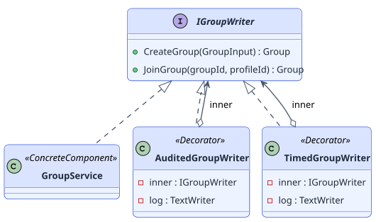
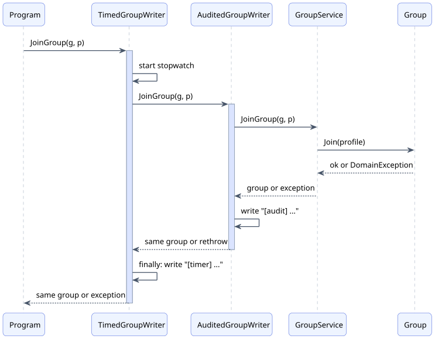
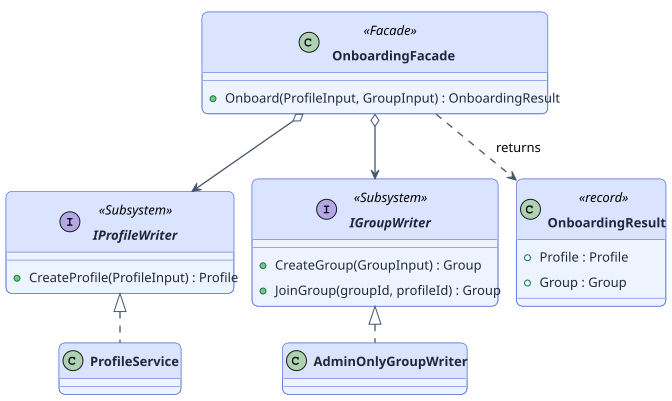
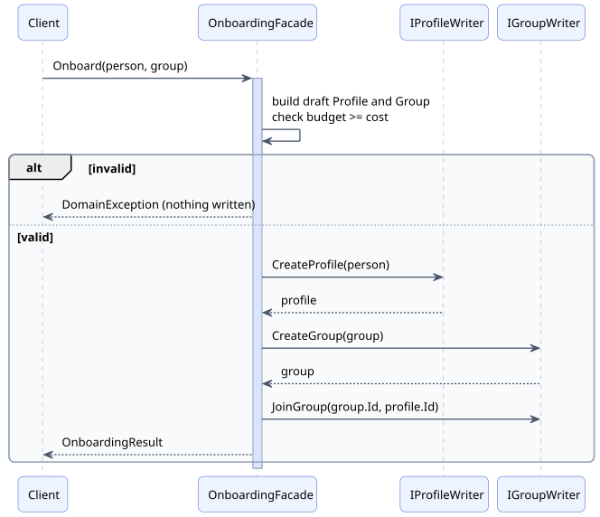
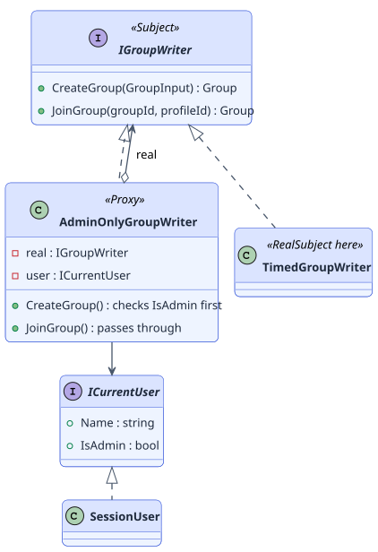

# Laboratory Work No. 2: Structural Design Patterns

**Course:** Software Design Techniques and Mechanisms (TMPS)<br>
**Project:** Domi, a service for forming shared-rent groups<br>
**Language:** C# (.NET 10)

## Contents

1. [Task and purpose](#1-task-and-purpose)
2. [Theory: why structural patterns exist](#2-theory-why-structural-patterns-exist)
3. [The Domi domain](#3-the-domi-domain)
4. [Adapter](#4-adapter)
5. [Decorator](#5-decorator)
6. [Facade](#6-facade)
7. [Proxy](#7-proxy)
8. [How the patterns interact](#8-how-the-patterns-interact)
9. [The remaining structural patterns](#9-the-remaining-structural-patterns)
10. [Results](#10-results)
11. [Conclusion](#11-conclusion)

---

## 1. Task and purpose

The task is to study the structural design patterns, implement at least three of them in a project of our choice, and be able to explain the remaining ones. The list is Adapter, Bridge, Composite, Decorator, Facade, Flyweight and Proxy. The handout also requires that the patterns interact on one execution path, that client code depends on abstractions, that new variants can be added without editing existing classes, that the project builds on Lab 1 by reusing a creational pattern, that an adapted class is code we did not write, and that each pattern has at least two unit tests.

The deeper goal is to learn how to connect existing objects without rewriting them. Creational patterns, in Laboratory work No. 1, decided how objects are made. Structural patterns decide how finished objects are put together: how one object fits an interface it was not written for, how behaviour is added to an object without editing it, and how a group of objects is offered to a caller through one simple entry point.

The project is again **Domi**, a service that helps people form a group to rent a home together. Domi has real structural needs: an old housing site sends offers in a different format, every change to a group should be logged and measured, onboarding a new person takes several calls in a fixed order, and only administrators may create groups.

Implemented: **Adapter**, **Decorator**, **Facade**, and, as a fourth pattern, **Proxy**. The Builder from Lab 1 creates the objects the Adapter passes on. Bridge, Composite and Flyweight are explained with Domi examples after the interaction chapter.

The code is organised in separate folders: `Domain` for the models and services, `Creational` for the reused Builder, `Patterns/Adapter`, `Patterns/Decorator`, `Patterns/Facade` and `Patterns/Proxy`, `Client` for the demo, and a separate `tests` project. The repository is https://github.com/Lucian-Adrian/sem5-software-design/tree/main/lab-02/csharp.


*Figure 1. The four implemented patterns, the reused Builder and the library adaptee around the unchanged Domi services.*

---

## 2. Theory: why structural patterns exist

### 2.1 One idea behind every structural pattern

Each structural pattern places an object between two other objects. The patterns differ in why that object stands there:

| Pattern | The middle object exists to | Same interface as the wrapped object |
| --- | --- | --- |
| Adapter | translate one interface into another | No |
| Decorator | add behaviour, then forward the call | Yes |
| Proxy | control whether the real object is reached | Yes |
| Facade | offer one simple call over several objects | No, a new smaller one |
| Bridge | connect two independent hierarchies through a field | Not applicable |
| Composite | treat one object and a tree of objects alike | Yes, leaf and branch share it |
| Flyweight | share the common immutable part of many objects | Not applicable |

### 2.2 Composition over inheritance

Almost every structural pattern prefers composition, holding another object in a field, to inheritance. Inheritance fixes a relationship when the code is compiled. Composition lets the program choose and combine collaborators when it runs. The Decorator chapter shows the cost of the alternative: with inheritance, every combination of extra behaviours would need its own subclass.

### 2.3 Programming to an interface

The patterns in this lab work because the services depend on interfaces, not on concrete classes. `ListingImporter` depends on `IListingSource` and `IGroupWriter`, and `OnboardingFacade` depends on `IProfileWriter` and `IGroupWriter`. Only `Program.cs`, the composition root, names concrete classes. Any object that implements the interface can take the real object's place. This is the dependency inversion principle from Laboratory work No. 0 used in practice.

---

## 3. The Domi domain

### 3.1 The classes

A `Profile` has an identifier, a name and a monthly budget. A `Group` has an identifier, a name, a per-person monthly cost, a capacity of at most 20 and a list of member identifiers. Both constructors validate their input and throw a `DomainException` on invalid data, so an invalid object can never exist.

Domi lets people who do not know each other form a group to rent a home together. A person creates a profile with a budget, a group states its per-person monthly cost and capacity, and a person joins a group they can afford. `GroupService` and `ProfileService` create and store objects in an `InMemoryStore`. They implement the interfaces `IGroupWriter` and `IProfileWriter`; the Decorator and the Proxy also implement `IGroupWriter`.

```csharp
public interface IGroupWriter
{
    Group CreateGroup(GroupInput input);
    Group JoinGroup(string groupId, string profileId);
}
```


*Figure 2. The Domi domain classes used by all four patterns.*

### 3.2 The joining rule

`Group.Join` holds the only business rule. A person may join when they are not already a member, the group is not full, and their budget covers the per-person cost:

```csharp
public void Join(Profile profile)
{
    if (_memberIds.Contains(profile.Id))
        throw new DomainException($"{profile.Name} is already in {Name}");
    if (_memberIds.Count >= Capacity)
        throw new DomainException($"{Name} is full");
    if (profile.MonthlyBudget < MaxMonthlyCost)
        throw new DomainException($"{profile.Name}'s budget ... is below ...");
    _memberIds.Add(profile.Id);
}
```

None of the four patterns modifies this code. They are added around it.

---

## 4. Adapter

### 4.1 The idea in plain words

An adapter is a translator. A travel plug adapter lets a European plug fit a British socket without changing the plug or the socket. In code, an adapter lets an existing class work with an interface it was not written for.

### 4.2 Problem it solves

An old housing site exports its offers as a CSV file in the format `name;monthly_total;roommates`, where the total is the rent for the whole flat and names may be quoted. Domi's importer wants typed `GroupInput` objects with a **per-person** cost. Reading the CSV is done by `Microsoft.VisualBasic.FileIO.TextFieldParser`, a .NET library class we did not write and cannot change. It offers only `SetDelimiters`, `ReadFields()` returning `string[]`, and `EndOfData`. The incompatibility is real: in the shape of the call (a pull loop over string arrays against an enumerable of typed records) and in the meaning of the data (a total against a per-person amount).

### 4.3 Where it fits in Domi

| Role | Class |
| --- | --- |
| Target | `IListingSource` |
| Adaptee | `TextFieldParser` (.NET library) |
| Adapter | `LegacyCsvListingAdapter` |
| Client | `ListingImporter` |


*Figure 3. Adapter class diagram with the real class names.*

### 4.4 Code

Source: [Patterns/Adapter/LegacyCsvListingAdapter.cs](https://github.com/Lucian-Adrian/sem5-software-design/blob/main/lab-02/csharp/src/Domi.Structural/Patterns/Adapter/LegacyCsvListingAdapter.cs)

```csharp
public IEnumerable<GroupInput> GetListings()
{
    _parser.ReadFields(); // skip the header row
    while (!_parser.EndOfData)
    {
        var fields = _parser.ReadFields() ?? [];
        if (TryTranslate(fields, out var input))
            yield return input;
        else
            RejectedRows.Add(string.Join(";", fields));
    }
}

public static bool TryTranslate(string[] fields, out GroupInput input)
{
    // ... parse total and people, reject non-positive values ...
    var perPerson = total / people;
    if (total % people != 0) perPerson++;
    input = new GroupBuilder()          // creational pattern from Lab 1
        .WithName(fields[0])
        .WithMaxMonthlyCost(perPerson)
        .WithCapacity(people)
        .Build();
    return true;
}
```

`GetListings` turns the adaptee's pull loop into the enumerable the client expects, and `TryTranslate` converts the meaning. 1501 / 3 is 500 with remainder 1, so the cost becomes 501: rounding down would leave the rent one unit short. The Lab 1 `GroupBuilder` validates and builds the input, so a row with more than 20 people is rejected with the domain's own rule.

### 4.5 Tests

| Test | What it checks |
| --- | --- |
| `Translates_whole_flat_total_into_per_person_cost` | `Riscani flat;1500;3` becomes `GroupInput("Riscani flat", 500, 3)` |
| `Rounds_up_so_the_rent_is_always_covered` | 1501 for 3 gives 501, and 3 × 501 ≥ 1501 |
| `Handles_quoted_fields_from_the_library_parser` | a quoted name containing `;` is read as one field |
| `Rejects_invalid_rows_without_stopping_the_import` | a zero total and 21 people are rejected, the valid row is kept |

### 4.6 Why not something simpler

Adding a `CreateFromLegacyCsv` method to `GroupService` would mix file parsing with domain writes, and each new legacy source would add another method. The adapter keeps foreign formats at the edge. If the site starts sending prices in euros, only `TryTranslate` changes. A new source, such as a JSON API, is a new `IListingSource` class; `ListingImporter` is not edited.

## 5. Decorator

### 5.1 The idea in plain words

A decorator is wrapping paper. A wrapped gift is still a gift from the outside, and it can be wrapped again. In code, a decorator implements the same interface as the object it wraps, does something extra, and forwards the call.

### 5.2 Problem it solves

Every group write should be recorded in an audit log and timed. `GroupService` should keep one responsibility, writing groups. With inheritance, a logged service, a timed service and a logged-and-timed service would each need their own subclass; with n optional behaviours that is up to 2ⁿ classes.

### 5.3 Where it fits in Domi

| Role | Class |
| --- | --- |
| Component | `IGroupWriter` |
| Concrete component | `GroupService` |
| Base decorator | `GroupWriterDecorator` (abstract, holds `Inner`, forwards by default) |
| Concrete decorators | `AuditedGroupWriter`, `TimedGroupWriter` |



*Figure 4. Decorator class diagram.*

### 5.4 Code

Source: [Patterns/Decorator/GroupWriterDecorator.cs](https://github.com/Lucian-Adrian/sem5-software-design/blob/main/lab-02/csharp/src/Domi.Structural/Patterns/Decorator/GroupWriterDecorator.cs)

```csharp
public abstract class GroupWriterDecorator(IGroupWriter inner) : IGroupWriter
{
    protected IGroupWriter Inner { get; } = inner;
    public virtual Group CreateGroup(GroupInput input) => Inner.CreateGroup(input);
    public virtual Group JoinGroup(string groupId, string profileId) =>
        Inner.JoinGroup(groupId, profileId);
}

public sealed class AuditedGroupWriter(IGroupWriter inner, TextWriter log)
    : GroupWriterDecorator(inner)
{
    public override Group JoinGroup(string groupId, string profileId) =>
        Record("JoinGroup", () => base.JoinGroup(groupId, profileId));

    private Group Record(string operation, Func<Group> call)
    {
        try
        {
            var group = call();
            log.WriteLine($"[audit] {operation} ok -> {group.Id}");
            return group;
        }
        catch (DomainException e)
        {
            log.WriteLine($"[audit] {operation} error: {e.Message}");
            throw;
        }
    }
}
```

The base class holds the wrapped writer and forwards every call, so a concrete decorator overrides only what it changes and calls `base`. The audit decorator returns the same object and rethrows the same exception with `throw;`, which keeps the original stack trace. The objects are combined in `Program.cs`: `new TimedGroupWriter(new AuditedGroupWriter(new GroupService(store), log), log)`.

### 5.5 How it works

A call to `JoinGroup` reaches the timer, which starts a stopwatch, then the audit decorator, then `GroupService` and `Group.Join`. On the way back the audit decorator writes one line and the timer writes the elapsed time in a `finally` block, so failed calls are timed too.



*Figure 5. Call order through the stacked decorators.*

### 5.6 Tests

| Test | What it checks |
| --- | --- |
| `Stacked_in_any_order_returns_the_same_stored_group` (two cases) | audit outside and timer outside both return the stored group and write both log lines |
| `Errors_are_logged_and_rethrown_unchanged` | a failed join writes an audit error line, is still timed, and the caller receives the original `DomainException` |

### 5.7 Trade-offs

Many small wrappers make stack traces longer. The order matters for the output: with the audit outside, the timer line is printed first. A new concern, such as retrying, is one new subclass of `GroupWriterDecorator`, and no existing class changes.

## 6. Facade

### 6.1 The idea in plain words

A facade is a hotel reception desk. The guest says "check me in"; the desk talks to the room system, the payment system and the key-card machine. The guest can still visit the payment office directly; the desk only makes the usual case easy.

### 6.2 Problem it solves

Onboarding a new person in Domi takes three calls in a fixed order: create the profile, create the group, then join the profile to the group. A frontend that makes these calls itself can use the wrong order, or stop after the first call and leave a half-created state.

### 6.3 Where it fits in Domi

`OnboardingFacade` holds two abstractions, `IProfileWriter` and `IGroupWriter`, and offers one method, `Onboard`. In the demo its `IGroupWriter` is the proxy, which wraps the decorators.



*Figure 6. Facade class diagram.*

### 6.4 Code

Source: [Patterns/Facade/OnboardingFacade.cs](https://github.com/Lucian-Adrian/sem5-software-design/blob/main/lab-02/csharp/src/Domi.Structural/Patterns/Facade/OnboardingFacade.cs)

```csharp
public sealed class OnboardingFacade(IProfileWriter profiles, IGroupWriter groups)
{
    public OnboardingResult Onboard(ProfileInput person, GroupInput newGroup)
    {
        var draftProfile = new Profile("draft", person);
        var draftGroup = new Group("draft", newGroup);
        if (draftProfile.MonthlyBudget < draftGroup.MaxMonthlyCost)
            throw new DomainException($"{draftProfile.Name} cannot afford ...");

        var profile = profiles.CreateProfile(person);
        var group = groups.CreateGroup(newGroup);
        groups.JoinGroup(group.Id, profile.Id);

        return new OnboardingResult(profile, group);
    }
}
```

The facade first validates with draft objects, which apply the domain's own rules, so an unaffordable request is refused before anything is written. Then it calls the subsystem in the only correct order. It adds no business rules of its own.



*Figure 7. Facade sequence diagram.*

### 6.5 Tests

Both tests use `RecordingWriter`, a stub that implements `IProfileWriter` and `IGroupWriter` and records every call.

| Test | What it checks |
| --- | --- |
| `Calls_the_subsystem_in_the_right_order` | the recorded calls are exactly `CreateProfile`, `CreateGroup`, `JoinGroup` |
| `Refuses_unaffordable_onboarding_before_any_write` | Dan (100) for a group at 900 throws and the stub records no call |

### 6.6 Limits

The three steps are not a transaction. The demo shows it: when the proxy refuses Maria's group, her profile from step 1 already exists. A database-backed version would wrap the steps in one transaction.

## 7. Proxy

### 7.1 The idea in plain words

A proxy is a security guard at a door. The guard looks like the entrance from the outside, but decides who gets through. In code, a proxy has the same interface as the real object and controls access to it.

### 7.2 Problem it solves

Only administrators should create groups, but `GroupService` should not know about users and roles.

### 7.3 Code

Source: [Patterns/Proxy/AdminOnlyGroupWriter.cs](https://github.com/Lucian-Adrian/sem5-software-design/blob/main/lab-02/csharp/src/Domi.Structural/Patterns/Proxy/AdminOnlyGroupWriter.cs)

```csharp
public sealed class AdminOnlyGroupWriter(IGroupWriter real, ICurrentUser user) : IGroupWriter
{
    public Group CreateGroup(GroupInput input)
    {
        if (!user.IsAdmin)
            throw new UnauthorizedAccessException(
                $"{user.Name} is not an admin and cannot create groups");
        return real.CreateGroup(input);
    }

    public Group JoinGroup(string groupId, string profileId) =>
        real.JoinGroup(groupId, profileId);
}
```

The proxy checks the current user before delegating. A refused call never reaches the real writer. The user is read through `ICurrentUser` on every call, so a change of role takes effect at once.



*Figure 8. Proxy class diagram.*

### 7.4 Tests

| Test | What it checks |
| --- | --- |
| `Blocks_unauthorized_create_without_reaching_the_real_writer` | a guest's create throws and the stub records no call |
| `Passes_authorized_calls_through_unchanged` | an admin's create returns the real group and is recorded once |
| `Non_admins_can_still_join` | joining passes through for a non-admin |

### 7.5 Proxy against Decorator

Proxy and Decorator have the same class structure: both implement the interface and hold an object of that interface. The difference is intent. A decorator always forwards and adds behaviour. A proxy decides whether the real object is used at all. Other kinds are the virtual proxy, the remote proxy and the caching proxy.

---

## 8. How the patterns interact

The patterns are not isolated demos. In `Program.cs` one execution path passes through four of them:

```text
Client -> OnboardingFacade -> AdminOnlyGroupWriter (Proxy)
       -> TimedGroupWriter -> AuditedGroupWriter (Decorators) -> GroupService
```

The import path is `Client -> ListingImporter -> LegacyCsvListingAdapter -> TextFieldParser`, and the groups it creates go through the same proxy and decorators. Each object knows only the interface of the next one. The composition root is the only place that names concrete classes, so the chain can be reordered or extended without editing any pattern class.

## 9. The remaining structural patterns

### 9.1 Bridge

**Problem.** Two independent dimensions multiply classes. Domi notifications come in kinds (invitation, rent reminder) and are sent through channels (e-mail, SMS). Classes such as `EmailInvite`, `SmsInvite`, `EmailReminder` and `SmsReminder` grow as n × m.

**Solution.** Split the dimensions into two hierarchies and connect them with a field. An abstract `Notification` holds an `IChannel`; `Invite` and `RentReminder` extend `Notification`; `EmailChannel` and `SmsChannel` implement `IChannel`. `new Invite(new SmsChannel()).Send()` combines them, and the number of classes grows as n + m.

**Bridge against Adapter.** A bridge is designed up front so that two sides can change independently. An adapter is added afterwards so that two existing parts fit together.

### 9.2 Composite

**Problem.** A tree whose leaves and branches should be treated the same way. A Domi building contains flats, and flats contain rooms.

**Solution.** `Room` and `Flat` both implement `IRentPart.TotalRent()`. A room returns its own rent; a flat returns the sum of its parts. A caller asks a whole building for its total rent with the same call it would use for one room.

### 9.3 Flyweight

**Problem.** Many small objects repeat the same heavy data. Thousands of Domi listings in the same neighbourhood would each copy the neighbourhood's name, description and map outline.

**Solution.** Split the state into an intrinsic part that is shared and immutable (the neighbourhood) and an extrinsic part kept per object (the listing's price and address). A `NeighbourhoodFactory` returns the same `Neighbourhood` object for the same name. The shared part must be immutable, because a change through one listing would affect every listing that shares it.

---

## 10. Results

The project builds and runs with three commands from `lab-02/csharp`:

```text
dotnet build
dotnet test                              # 12 tests
dotnet run --project src/Domi.Structural # demonstration
```

The test log in `evidence/test-output.txt`, recorded on 20 November 2026:

```text
Passed AdapterTests.Handles_quoted_fields_from_the_library_parser
Passed ProxyTests.Blocks_unauthorized_create_without_reaching_the_real_writer
Passed AdapterTests.Rounds_up_so_the_rent_is_always_covered
Passed AdapterTests.Rejects_invalid_rows_without_stopping_the_import
Passed AdapterTests.Translates_whole_flat_total_into_per_person_cost
Passed DecoratorTests.Stacked_in_any_order_returns_the_same_stored_group(auditOutside: False)
Passed DecoratorTests.Stacked_in_any_order_returns_the_same_stored_group(auditOutside: True)
Passed ProxyTests.Passes_authorized_calls_through_unchanged
Passed FacadeTests.Calls_the_subsystem_in_the_right_order
Passed FacadeTests.Refuses_unaffordable_onboarding_before_any_write
Passed ProxyTests.Non_admins_can_still_join
Passed DecoratorTests.Errors_are_logged_and_rethrown_unchanged
Total tests: 12
```

The demonstration output in `evidence/demo-output.txt` shows the adapter importing two rows at 500 and 501 per person and rejecting `Centru loft;0;2`, the decorators logging and timing a failed join, the facade onboarding Ana through the proxy and decorators and refusing Dan before any write, and the proxy blocking a non-admin's onboarding while still allowing a join.

---

## 11. Conclusion

This laboratory work applied four structural patterns to Domi without changing its domain classes. The Adapter made a .NET library parser feed Domi's importer, translating whole-flat totals into per-person costs with the Lab 1 Builder. The Decorator added auditing and timing through a base decorator and two concrete decorators that can be stacked in any order. The Facade turned onboarding into one call that validates before it writes. The Proxy restricted group creation to administrators. One execution path passes through the facade, the proxy and both decorators, and every class depends only on interfaces.

**What was harder than expected.** Keeping the decorators truly invisible took care: a decorator that caught the error and returned nothing would have changed the meaning of the call, so it must rethrow with `throw;`. The facade's validation was also subtler than it looks. Validating first prevents most half-finished onboardings, but the demo showed that a refusal from the proxy in step 2 still leaves the profile from step 1. Finding a real incompatibility for the Adapter also mattered: adapting a class written for the occasion would not show the pattern's purpose, so the adaptee is the library's `TextFieldParser`.

**What I would design differently.** In a real system the facade's steps would run in a database transaction, or the facade would check permissions before the first write. The audit decorator writes to the console; a durable audit log would write to storage and include the user, which the proxy already knows. Finally, the admin check would come from the authentication system rather than a mutable `SessionUser`.
