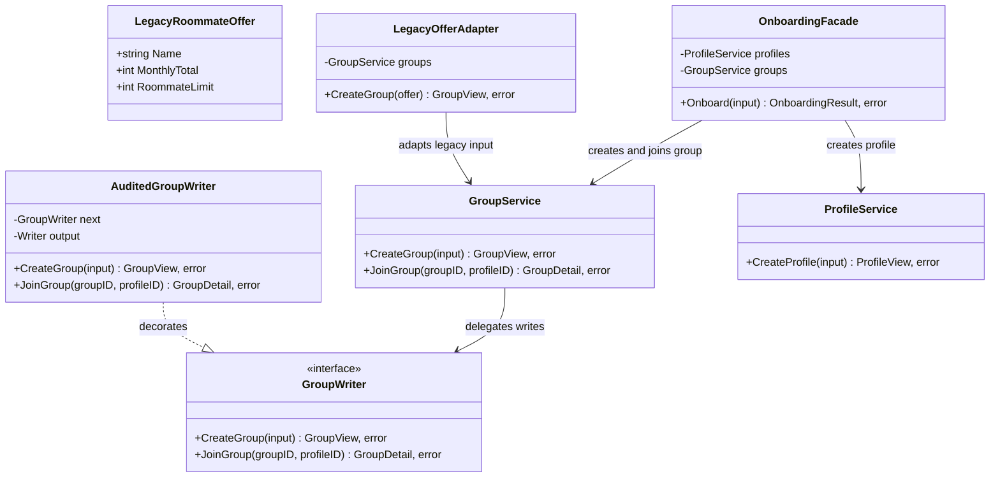
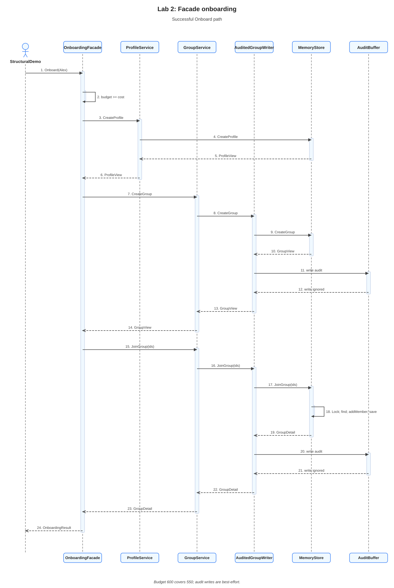

# Lab 2: Structural patterns in the Domi roommate backend

**Student:** Lucian-Adrian Gavril, FAF-241 | **Language:** Go | **Revision:** 7 October 2026

## Problem and model

Domi's group service accepts a group name, a maximum monthly cost per person, and a capacity. A legacy housing feed provides the same idea in a different form: the total monthly cost for the whole group and a target roommate count. The feed and service therefore disagree about the shape and meaning of their data. The legacy total must be converted before it can pass through the existing group service.

The example uses monthly costs in whole units. A legacy offer for 1,501 and three roommates becomes a maximum of 501 for each person. The group service stores one shared affordability limit for every member; it does not retain individual rent shares. The conversion therefore gives a conservative limit, with a possible rounding difference when the total does not divide evenly.

The same backend also needs to record the outcomes of group writes and provide one operation for onboarding a profile into a new group. Adapter, Decorator, and Facade address these three boundaries while reusing the existing `GroupService`, `ProfileService`, and `MemoryStore`.

## Adapter: convert the legacy contract

`LegacyRoommateOffer` has `MonthlyTotal` and `RoommateLimit`. `GroupInput` instead has `MaxMonthlyCost` and `Capacity`. `LegacyOfferAdapter.CreateGroup` translates the former into the latter, then delegates creation to `GroupService`. The service remains responsible for validating the group name and the resulting domain object.

The conversion uses integer division and the remainder:

```go
perPersonCost := offer.MonthlyTotal / offer.RoommateLimit
if offer.MonthlyTotal%offer.RoommateLimit != 0 {
	perPersonCost++
}
```

For 1,501 divided among three roommates, the quotient is 500 and the remainder is 1, so the adapter passes 501 as `MaxMonthlyCost`. For 1,500 among three, the remainder is zero and the limit is 500. This is the ceiling of total divided by capacity. Using quotient and remainder avoids the intermediate addition in `(total + capacity - 1) / capacity`, which could overflow for a very large total.

The adapter rejects totals and capacities that are zero or negative, and it rejects capacity above the domain maximum of 20 before dividing. These checks prevent division by zero and keep the legacy input within the current group model. A blank name is left for `GroupService` and the domain constructor to reject. This boundary is useful because it keeps the old feed's units and field names out of the core group service. If only one caller needed a single conversion, a local conversion function could be simpler than a dedicated adapter type.

Rounding upward means the represented limit does not understate the shared total when multiplied by the roommate count. It may overstate it by up to `capacity - 1` units. For example, three members each accepted at 501 could represent 1,503 even though the source total was 1,501. The current domain has no rent allocation for each member with which to represent the remainder more exactly.

## Decorator: add outcome records around group writes

`AuditedGroupWriter` implements the existing `GroupWriter` interface and holds another `GroupWriter` in `next`. Its `CreateGroup` and `JoinGroup` methods call the wrapped writer, record the operation name and whether it returned an error, then return the wrapped value and error unchanged. The decorator preserves the service contract while adding a second effect.

For a join, the sequence is:

```text
receive JoinGroup(groupID, profileID)
call next.JoinGroup with the same arguments
write operation=JoinGroup and success or error
return the exact value and error from next
```

The record omits names, budgets, IDs, and raw error text. If the audit writer fails, that failure is ignored so it cannot replace the result of the group operation. A nil output is replaced with `io.Discard`. The output is therefore best effort diagnostics, not durable audit storage. A caller needing durable records would need a storage contract with delivery and failure guarantees, and would have to decide whether a logging failure should affect the mutation.

The decorator differs from an adapter because its input and output contract stays `GroupWriter`; it adds behavior around the same calls rather than translating another data shape. Logging inside `MemoryStore` would couple storage to a diagnostic concern. The wrapper keeps that concern at the composition boundary. In the structural demonstration the group service uses this decorator. The ordinary HTTP server composition still uses `MemoryStore` directly.

## Facade: coordinate onboarding

`OnboardingFacade.Onboard` accepts a profile and group together. It first calls the existing domain constructors with a temporary validation ID, then checks that the profile's monthly budget covers the group's maximum cost. These checks happen before any record is created. It then calls `ProfileService.CreateProfile`, `GroupService.CreateGroup`, and `GroupService.JoinGroup` in order.

The result carries the views returned by completed calls. If profile creation fails, the result is empty. If group creation fails, the result contains the created profile. If joining fails, it contains both the created profile and group, while `JoinedGroup` remains nil. Each error is returned alongside that partial result. The already completed write remains in the store.

This behavior makes the call sequence explicit, but it does not make the sequence atomic. The precheck catches invalid input and known affordability failures before writes. It cannot prevent a later storage failure, and the services do not share a transaction or rollback operation. Atomic onboarding would require a storage operation that can validate and commit the profile, group, and membership as one unit, or an explicit compensation design with its own failure cases. A caller that performs this short sequence only once may be clearer without a facade; the facade is useful when onboarding is a named use case that should have one entry point.

## Composition and execution

The structural demo creates one `MemoryStore`, wraps its group write contract with `AuditedGroupWriter`, and passes the wrapped writer to `GroupService`. It then creates a legacy offer through the adapter and performs onboarding through the facade. The same store makes the order visible: the adapter creates `group-1`, then onboarding creates `profile-1` and `group-2` before joining them.

Run the focused demonstration from this directory:

```powershell
go run . --structural
```

For the inputs in `structural_demo.go`, the encoded result contains:

```json
{
  "adaptedGroup": {
    "id": "group-1",
    "name": "Central apartment",
    "maxMonthlyCost": 501,
    "capacity": 3,
    "memberCount": 0
  },
  "auditLog": "operation=CreateGroup result=success\noperation=CreateGroup result=success\noperation=JoinGroup result=success\n",
  "onboarding": {
    "profile": {"id": "profile-1", "name": "Alex"},
    "group": {
      "id": "group-2",
      "name": "Quiet shared flat",
      "maxMonthlyCost": 550,
      "capacity": 2,
      "memberCount": 0
    },
    "joinedGroup": {
      "group": {
        "id": "group-2",
        "name": "Quiet shared flat",
        "maxMonthlyCost": 550,
        "capacity": 2,
        "memberCount": 1
      },
      "members": [{"id": "profile-1", "name": "Alex"}]
    }
  }
}
```

The adapter and onboarding group writes both pass through the decorator, which accounts for the two `CreateGroup` records. The join adds the third record. `GroupDetail` returns member IDs and names; it does not expose the profile's budget.

The integrated package also retains the three creational examples from Lab 1 under `--patterns`. The normal server remains available with `go run . --addr localhost:8080`, and the existing routes remain `GET /groups`, `GET /groups/{id}`, `POST /groups`, `POST /groups/{id}/join`, and `POST /profiles`.

## Source responsibilities

| File | Role in this design |
| --- | --- |
| [domain.go](domain.go) | Validates profiles and groups, stores domain state, and defines response views. |
| [service.go](service.go) | Defines the reader and writer contracts and coordinates group and profile operations. |
| [store.go](store.go) | Implements the contracts with synchronized records stored in memory. |
| [structural.go](structural.go) | Defines the legacy adapter, outcome recording decorator, and onboarding facade. |
| [structural_demo.go](structural_demo.go) | Composes the three patterns and encodes the `--structural` result as JSON. |
| [structural_test.go](structural_test.go) | Specifies conversion, wrapping, validation before writes, and partial result behavior. |

## UML diagrams

### Class diagram



### Sequence diagram for onboarding

The sequence follows the successful facade operation in the structural demonstration. It validates the supplied profile and group before creating either record. Profile creation uses its service directly. Group creation and joining pass through the audited writer, which forwards each operation to storage and records its outcome.



[Editable Isomorph diagram](assets/sequence.isx) · [PNG export](assets/sequence.png)

The legacy-offer adapter runs earlier in the same demonstration. This diagram focuses on onboarding and the decorator around its group writes. If a later write fails, the facade returns the views from completed steps with the error. It does not roll those steps back.

## Conclusion

The adapter translates a legacy cost contract, the decorator adds outcome records while preserving the writer contract, and the facade gives profile creation, group creation, and joining one entry point. Their boundaries keep conversion, diagnostics, and workflow coordination outside the existing domain rules. The current implementation stores data in memory, writes audit records on a best effort basis, and performs the steps sequentially without a transaction.
