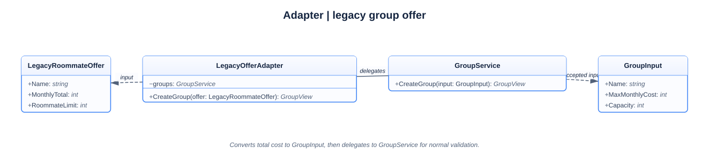
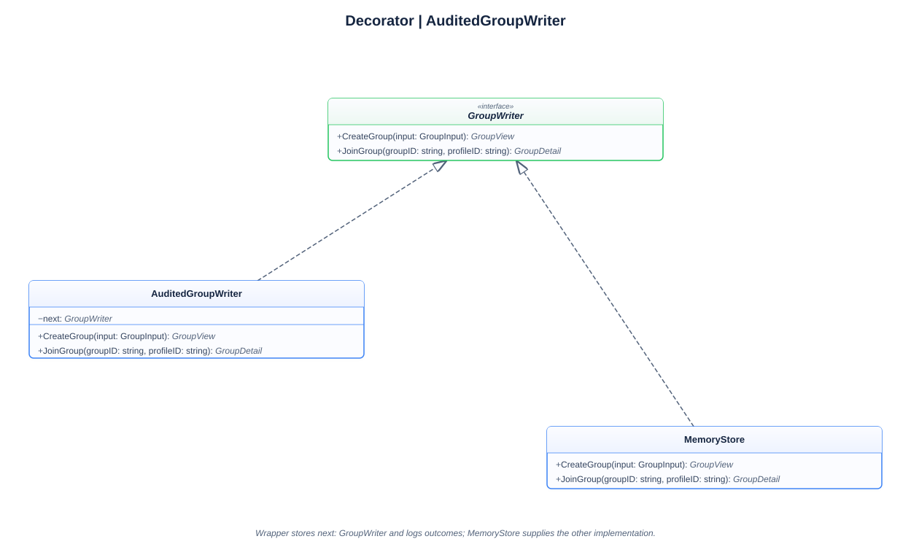
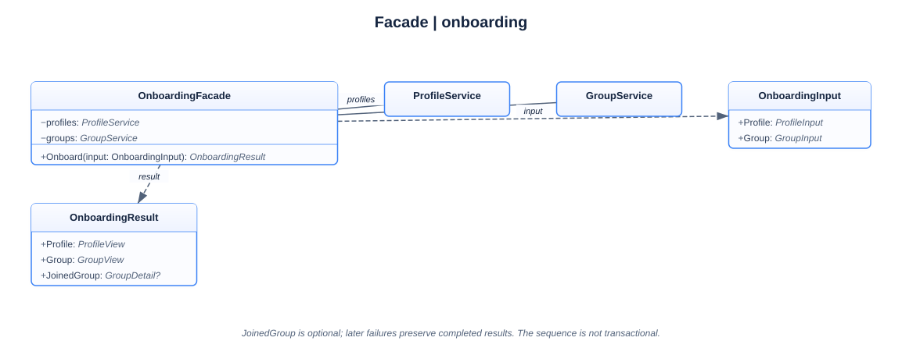

# Lab 2: Structural patterns in the Domi roommate backend

**Student:** Lucian-Adrian Gavril, FAF-241

**Language:** Go

**Revision:** 7 October 2026

## Introduction

This laboratory extends the Domi roommate-group backend from the earlier coursework. It focuses on three structural design patterns: Adapter, Decorator, and Facade. Each pattern changes how existing parts are connected while reusing the existing domain rules and application services.

The application offers a useful setting for these patterns because it has three different needs. A legacy housing feed describes a group's total monthly cost and roommate limit, while the current service accepts a per-person maximum cost and capacity. Group writes also need a concise record of their outcomes. Finally, onboarding a profile into a new group requires several existing service calls in a particular order. These are different problems, so they receive different boundaries: conversion, wrapping, and coordination.

Go does not require class inheritance to express these designs. The implementation uses structs to hold dependencies, methods to define behavior, and interfaces to state the operations a component needs. The result is composition: small objects are assembled around the existing services and in-memory store. The report follows the data from the legacy input through the service and store, then explains what the successful command output shows and what it does not establish.

## Condition

The existing domain represents a roommate group with a name, a maximum monthly cost per person, a capacity, and a list of member profile IDs. A profile has a name and a monthly budget. The model uses whole-number amounts; it does not define a currency type, decimal precision, or a separate rent share for each member. The domain limits group capacity to 20. Names must contain non-whitespace text, group costs must be positive, and profile budgets cannot be negative. These rules are implemented in [domain.go](domain.go).

The current [GroupService](service.go) accepts a `GroupInput` when creating a group. That input already uses the domain's terms: `MaxMonthlyCost` and `Capacity`. A legacy feed has a different contract. It supplies a single `MonthlyTotal` and a `RoommateLimit`. The two formats do not mean the same thing field by field. Passing the total directly as the current per-person cost could reject people whose budgets are sufficient for a share, and could display a per-person threshold with the wrong meaning. The boundary must calculate a whole-unit per-person limit and then invoke the existing service.

The backend also has existing operations for profile creation, group creation, and joining. They are deliberately separate service calls. A request to record those mutations should not change their returned group or error. A request to onboard a person should validate known input constraints before writes, then expose each completed result if a later operation fails. These requirements leave important limits: outcome lines are not durable audit records, and sequential service calls do not form a transaction.

The code is part of the same Go application as the earlier Domi work. Lab 0 established the domain, services, HTTP API, and in-memory store around the roommate joining workflow. Lab 1 added its creational pattern examples, which remain available through `--patterns` in [patterns.go](patterns.go) and [patterns_demo.go](patterns_demo.go). This lab retains those parts and adds the structural examples in [structural.go](structural.go) and [structural_demo.go](structural_demo.go).

## Tasks

The [ELSE Laboratory work #2 brief](https://else.fcim.utm.md/mod/assign/view.php?id=27827) requires three structural patterns from Adapter, Bridge, Composite, Decorator, Facade, Flyweight, and Proxy, and knowledge of the rest. This implementation chooses Adapter, Decorator, and Facade. The course labels this topic Lab 2; its Lab 1 concerns creational patterns.

The implementation has three tasks:

1. Convert a legacy offer into the current group service contract, validating the values needed for safe conversion.
2. Add a writer that records the operation and outcome while preserving the `GroupWriter` behavior it wraps.
3. Provide one onboarding operation that validates first, then creates a profile, creates a group, and joins them in order, returning completed views if a later operation fails.

These tasks concern relationships among existing components. None changes the group membership rule or adds a persistent database. The adapter still relies on `GroupService` for ordinary domain validation and creation. The decorator still forwards writes to another `GroupWriter`. The facade still uses the existing profile and group services. Their boundaries make each extra responsibility visible without copying the existing store logic into a second implementation.

### Pattern choices and tradeoffs

| Pattern and implementation | Integration into the actual flow | Strong point | Weak point and boundary |
| --- | --- | --- | --- |
| Adapter: `LegacyOfferAdapter.CreateGroup` and `groupInputFromLegacyOffer` in [structural.go](structural.go) | The legacy offer becomes `GroupInput`, then enters `GroupService.CreateGroup` and the existing store. | Old units and field names remain outside the core service; normal creation validation still runs. | Rounding a common whole-number share loses exact allocation. A dedicated adapter type can be excessive for a single trivial conversion. |
| Decorator: `AuditedGroupWriter` in [structural.go](structural.go) | `runStructuralDemo` places it between `GroupService` and `MemoryStore` for writes. | Outcome recording can be added without changing the store or its returned results and errors. | Output can fail and is best effort. It adds another call layer and only affects paths where it is supplied. |
| Facade: `OnboardingFacade.Onboard` in [structural.go](structural.go) | One call validates inputs and coordinates profile creation, group creation, and joining through the services. | Callers use one named workflow instead of repeating the three calls and error handling. | Sequential writes can partly succeed. A larger facade can accumulate unrelated responsibilities if its use case is not kept focused. |

The implementation point and the composition point are different. `structural.go` defines each pattern's behavior; `structural_demo.go` selects and connects its instances. A type declaration alone does not affect requests. The application must call the adapter or facade, or supply the decorator as the writer, for that behavior to participate in execution.

## Go values, methods, interfaces, and composition

A Go `struct` is a named collection of fields. A value of that struct type carries the fields for one particular record. A method associates a function with a receiver type, so code can ask a group value to perform a membership operation. Go has pointers, which refer to a value that can be changed through the reference, and interfaces, which describe a set of methods. These features support object-oriented ideas such as encapsulation and polymorphism, while composition supplies the relationships between the parts.

The core domain `Group` has lowercase fields, which makes them private to package `main`. Other packages cannot access them directly. The package's constructors and methods control how they are created and changed. The public `GroupInput`, `GroupView`, and `GroupDetail` types have exported fields because they form input and output values used across layers. A view is a response-shaped value; it is not the stored domain object.

In Go, a method signature includes its receiver only in the declaration, not when called. The `*Group` receiver below is a pointer receiver. It lets the method update the original group value supplied by its caller. The domain method first searches for an existing profile ID, then checks affordability and capacity, and only then appends the new ID.

**Membership pseudocode**

```text
Check whether this profile ID is already present.
If so, return success without changing the group.
Otherwise, reject an insufficient budget or a full group.
Append the profile ID only after both checks pass.
```

```go
func (group *Group) addMember(profile Profile) error {
	for _, memberID := range group.memberProfileIDs {
		if memberID == profile.id {
			return nil
		}
	}
	if profile.monthlyBudget < group.maxMonthlyCost {
		return ErrBudgetTooLow
	}
	if len(group.memberProfileIDs) >= group.capacity {
		return ErrGroupFull
	}
	group.memberProfileIDs = append(group.memberProfileIDs, profile.id)
	return nil
}
```

This method is the membership rule, not a pattern introduced by Lab 2. A repeated join succeeds before the capacity check, so retrying a completed join remains idempotent even if the group has become full. For a new profile, affordability is checked before capacity. A failed check returns an error without appending the ID. The implementation in [domain.go](domain.go) keeps this rule close to the group's state, and [store.go](store.go) invokes it while holding the store's write lock.

An interface describes behavior rather than storage. The `GroupWriter` interface says that a writer can create and join groups. `MemoryStore` has methods with those signatures, so it satisfies the interface implicitly. `AuditedGroupWriter` has the same methods and therefore also satisfies it. Go does not need an `implements` declaration. A value can be used wherever the interface is required when its method set matches.

**Service contracts pseudocode**

```text
Define separate read and write operations for groups.
Give GroupService a reader and a writer.
When creating or joining, forward the call to the writer.
```

```go
type GroupReader interface {
	ListGroups() ([]GroupView, error)
	GetGroup(id string) (GroupDetail, error)
}

type GroupWriter interface {
	CreateGroup(input GroupInput) (GroupView, error)
	JoinGroup(groupID, profileID string) (GroupDetail, error)
}

type GroupService struct {
	reader GroupReader
	writer GroupWriter
}

func (service *GroupService) CreateGroup(input GroupInput) (GroupView, error) {
	return service.writer.CreateGroup(input)
}

func (service *GroupService) JoinGroup(groupID, profileID string) (GroupDetail, error) {
	return service.writer.JoinGroup(groupID, profileID)
}
```

`GroupReader` and `GroupWriter` divide the capabilities. A component that only lists or reads groups does not need to depend on mutation methods. The same store can satisfy both, but callers receive only the interface they need. Here, `GroupService` keeps a reader and writer because it lists and reads through one contract while delegating mutations through another. A database implementation could replace the store if it implemented the required methods, though no database is part of this lab.

This is composition, not inheritance. `GroupService` contains interface-valued fields; it does not extend a store class. `AuditedGroupWriter` contains a `GroupWriter` field named `next`. The wrapper's methods satisfy the same interface, so a `GroupService` can receive either the store or the wrapper. The adapter and facade in this implementation accept pointers to the existing service types, which is a concrete choice visible in the source. The use of interfaces is therefore specific and bounded: the decorator boundary and service storage contracts are interchangeable, while the adapter and facade coordinate established services.

The method results also carry errors explicitly. A service method returns a result and an `error`. Returning `nil` as the error conventionally means that the operation succeeded; a non-nil error describes a failure. `fmt.Errorf` with `%w` wraps a domain error while adding context, and callers can test it with `errors.Is`. This lets the HTTP layer map a domain outcome to an HTTP status without requiring domain code to know about HTTP.

## Adapter: translate a legacy offer

The Adapter pattern gives one side the shape it expects by translating another contract at a boundary. Here the old feed's `LegacyRoommateOffer` has a name, a whole-group monthly total, and a roommate limit. The current service expects a name, a per-person maximum monthly cost, and capacity. `LegacyOfferAdapter.CreateGroup` converts the old value to a `GroupInput` and passes that input to `GroupService.CreateGroup`.

The conversion uses integer division and the remainder. For a positive total `T` and roommate count `N`, integer division produces the quotient `q`, while `T % N` produces the remainder `r`. When the remainder is zero, `q` is exact. When it is nonzero, the per-person whole-number limit must increase by one to represent the ceiling of the average. That is equivalent to rounding the average upward, not rounding each person's actual rent share.

**Adapter conversion pseudocode**

```text
Reject a non-positive total or roommate limit.
Reject a limit above the domain capacity.
Divide total by limit into quotient and remainder.
Increase the quotient when a remainder exists.
Pass the converted cost and capacity to the group service.
```

```go
func groupInputFromLegacyOffer(offer LegacyRoommateOffer) (GroupInput, error) {
	if offer.MonthlyTotal <= 0 {
		return GroupInput{}, fmt.Errorf("%w: monthly total must be greater than zero", ErrInvalidInput)
	}
	if offer.RoommateLimit <= 0 {
		return GroupInput{}, fmt.Errorf("%w: roommate limit must be greater than zero", ErrInvalidInput)
	}
	if offer.RoommateLimit > maxGroupCapacity {
		return GroupInput{}, fmt.Errorf("%w: roommate limit cannot exceed %d people", ErrInvalidInput, maxGroupCapacity)
	}

	perPersonCost := offer.MonthlyTotal / offer.RoommateLimit
	if offer.MonthlyTotal%offer.RoommateLimit != 0 {
		perPersonCost++
	}

	return GroupInput{
		Name:           offer.Name,
		MaxMonthlyCost: perPersonCost,
		Capacity:       offer.RoommateLimit,
	}, nil
}
```

For the demonstration offer, the total is 1,501 and the roommate limit is 3. The quotient is 500 because 3 fits into 1,501 five hundred times; the remainder is 1 because 500 groups of 3 account for 1,500, leaving 1. Since the remainder is nonzero, the adapter increases the quotient to 501. It passes `MaxMonthlyCost: 501` and `Capacity: 3`. When a total divides exactly, such as 1,500 among 3, the quotient remains 500.

The upward rounding is conservative for this model: multiplying the converted per-person threshold by the roommate count never produces less than the source total. Three thresholds of 501 represent 1,503, which is two whole units above 1,501. This difference is the consequence of storing one whole-number limit for every member. The domain has no allocation field that could assign the remainder to one member or represent fractional units. The conversion therefore preserves a shared threshold, not an exact rent schedule.

The code checks the conditions required for the arithmetic before dividing. A zero roommate limit would make division undefined; a negative limit or total would not describe a usable offer. A limit above 20 cannot pass the current group model's capacity rule, so the adapter rejects it before calling the service. The name is copied through without trimming here; the ordinary group constructor trims it and rejects whitespace-only text. The current model also rejects a non-positive converted cost, though a positive total divided by a positive limit of at most 20 yields a positive ceiling.

The remainder approach avoids computing `(total + limit - 1) / limit`. That alternative adds to the total before division, and the addition could overflow when the total is near the largest representable `int`. In this implementation, if the remainder is nonzero, the divisor is greater than one, so the quotient is strictly smaller than the positive total before it is increased. The conversion therefore does not need an addition to the source total to calculate a ceiling. The tests in [structural_test.go](structural_test.go) specify the remainder case and a total near `math.MaxInt`, along with invalid total and capacity cases.

The adapter is useful where the old feed and current domain must coexist. It keeps `MonthlyTotal` and `RoommateLimit` at the boundary, so callers of `GroupService` continue to speak in the current domain vocabulary. If this translation were only needed by one trivial call, a named adapter struct could add more indirection than value. Here the type makes a legacy integration boundary explicit and leaves the existing service responsible for record creation and domain validation.

### Adapter UML

LegacyOfferAdapter translates a LegacyRoommateOffer into GroupInput before calling GroupService. The service continues to use its ordinary writer and validation path.



[Editable Isomorph source](assets/adapter.isx) | [PNG export](assets/adapter.png)

## Decorator: preserve a writer while recording outcomes

A Decorator adds behavior around another object while retaining the same interface. `AuditedGroupWriter` stores a `next GroupWriter` and an `output io.Writer`. Its `CreateGroup` and `JoinGroup` methods invoke the wrapped writer with the same arguments, attempt to write one short outcome record, then return the exact result and error from the wrapped method.

`io.Writer` is a standard Go interface with a `Write` method. A file, a `bytes.Buffer`, standard output, or another writer can provide it. This lets the decorator send records to different destinations without depending on a particular logger. In the structural demonstration, `bytes.Buffer` collects them in memory so the result can be included in JSON. If the caller supplies nil output, the constructor substitutes `io.Discard`, a writer that accepts and discards bytes.

**Decorator pseudocode**

```text
Call the wrapped writer with unchanged arguments.
Choose success when it returns no error, otherwise choose error.
Attempt one record containing only operation and outcome.
Return the wrapped result and the same error.
```

```go
func (writer *AuditedGroupWriter) JoinGroup(groupID, profileID string) (GroupDetail, error) {
	group, err := writer.next.JoinGroup(groupID, profileID)
	writer.record("JoinGroup", err)
	return group, err
}

func (writer *AuditedGroupWriter) record(operation string, err error) {
	result := "success"
	if err != nil {
		result = "error"
	}
	_, _ = fmt.Fprintf(writer.output, "operation=%s result=%s\n", operation, result)
}
```

The order matters. The record is written after the wrapped operation returns, so its outcome reflects that returned error. The record does not contain names, profile IDs, budgets, group IDs, or raw error strings. The wrapper returns the original `GroupDetail` and original error, even if the output fails. The assignment to blank identifiers deliberately discards both values returned by `fmt.Fprintf`: it does not react to an error or a short write. That makes recording best effort. It also means the data is not a durable audit trail and cannot establish that every mutation was recorded. A production audit requirement would need an explicit storage and delivery contract, retention rules, access controls, and a policy for what to do when recording fails.

Calling this an audited writer describes the demonstration's intent, not a guarantee. Its actual output is a diagnostic line saying which mutation ran and whether the wrapped writer returned an error. If group creation succeeds but writing the line fails, the group is still returned as successful. If the store returns an error and output also fails, the store's error is still returned. The tests define these forwarding properties and check that example personal values do not appear in the output.

The decorator differs from the adapter in the contract it exposes. The adapter accepts `LegacyRoommateOffer`, a shape the current group service does not accept, and converts it. The decorator accepts the same `GroupInput` and group identifiers as `GroupWriter`. It adds a side effect around calls without changing their method signatures. It differs from the facade because it wraps one operation at a time, while the facade combines several operations into a named use case.

The wrapper only records group mutations in the `GroupWriter` interface: `CreateGroup` and `JoinGroup`. Profile creation uses a separate `ProfileWriter` and does not pass through this decorator. This is why the structural demonstration records two group creations and one group join, but no profile creation line.

### Decorator UML

AuditedGroupWriter satisfies GroupWriter and holds another GroupWriter as next. GroupService uses the same interface for the wrapper or store, while the wrapper adds an outcome record and preserves the underlying result.



[Editable Isomorph source](assets/decorator.isx) | [PNG export](assets/decorator.png)

## Facade: coordinate onboarding

A Facade offers a simpler entry point to a set of existing operations. `OnboardingFacade.Onboard` accepts both a `ProfileInput` and a `GroupInput`. It makes the validation and service-call order explicit: validate the profile, validate the group, check affordability, create the profile, create the group, and join them.

Validation first uses the existing domain constructors with the temporary ID `"validation"`. These constructor calls produce in-memory domain values for checking. They do not access the store or allocate its generated IDs. The facade compares the validated profile budget with the validated group's maximum cost. If the budget is too low, it returns before either service writes a record. A temporary identifier is acceptable for this check because the validation needs the domain fields and rules, not a stored identity.

**Facade pseudocode**

```text
Validate profile fields and group fields without writing.
Reject the request if the budget is below the group cost.
Create the profile and keep its returned view.
Create the group and keep its returned view.
Join the profile to the group and keep the returned detail.
On failure, return the views from completed earlier steps.
```

```go
func (facade *OnboardingFacade) Onboard(input OnboardingInput) (OnboardingResult, error) {
	profile, err := newProfile("validation", input.Profile)
	if err != nil {
		return OnboardingResult{}, err
	}
	group, err := newGroup("validation", input.Group)
	if err != nil {
		return OnboardingResult{}, err
	}
	if profile.monthlyBudget < group.maxMonthlyCost {
		return OnboardingResult{}, fmt.Errorf("%w: monthly budget is below the group's cost", ErrBudgetTooLow)
	}

	var result OnboardingResult
	result.Profile, err = facade.profiles.CreateProfile(input.Profile)
	if err != nil {
		return result, err
	}
	result.Group, err = facade.groups.CreateGroup(input.Group)
	if err != nil {
		return result, err
	}
	joined, err := facade.groups.JoinGroup(result.Group.ID, result.Profile.ID)
	if err != nil {
		return result, err
	}
	result.JoinedGroup = &joined
	return result, nil
}
```

The three service calls are separate writes. If profile creation fails, the facade returns an error and no completed profile view. If group creation fails after the profile succeeds, the result includes that profile and an empty group value. If joining fails after both creations, the result includes the profile and group views, but no joined detail. These partial results identify work that completed; they do not undo it.

The facade is not a transaction. A transaction would need the storage layer to commit or reject all three changes as one atomic unit. Here, the profile, group, and membership are written through different service operations. There is no shared transaction object, rollback method, or compensating action. Pre-validation catches known invalid fields and a budget mismatch before the first write, but it cannot prevent an unavailable store or another later write failure. Returning completed views is a way to report the sequence's state after an error, not a claim that the sequence is all-or-nothing.

There is also a distinction between validating a new group's expected affordability and joining an existing group. The facade creates an empty group with the validated cost and then joins the profile it has just created. Under the same inputs, the earlier budget comparison predicts that this profile meets the group threshold. The later join can still return a storage or writer error. For normal group membership, `MemoryStore.JoinGroup` checks that the group and profile exist, then calls `Group.addMember` while holding its write lock, and stores the modified group value back into its map.

The result types explain how success and partial completion appear in JSON. `ProfileView` contains only an ID and name, so the personal budget is not part of the response. `GroupView` contains the member count at the time that view was made. The `JoinedGroup` field is a pointer tagged with `omitempty`.

**Result type pseudocode**

```text
Always include the profile and group snapshots in the result.
Use a nil joined-group pointer until the join succeeds.
Omit that pointer from JSON when it is nil.
```

```go
type OnboardingResult struct {
	Profile     ProfileView  `json:"profile"`
	Group       GroupView    `json:"group"`
	JoinedGroup *GroupDetail `json:"joinedGroup,omitempty"`
}
```

A pointer is a reference to a value. In this result, `JoinedGroup` is a pointer so nil can mean that the join step did not produce a detail. The JSON encoder omits a nil pointer because of `omitempty`. `Profile` and `Group` are values, not pointers, and their tags have no `omitempty`, so they remain present even when they contain zero values. This makes the result's structure stable while using `joinedGroup` presence to show whether membership succeeded.

The successful path also contains two group snapshots with different counts. `result.Group` is returned from the create call before joining, so its `memberCount` is zero. `result.JoinedGroup.Group` is produced after the membership write and reports one member. These values describe two moments in the sequence, not inconsistent copies of current state. If the join fails, the created group snapshot stays at zero, the store still contains the profile and group, and `joinedGroup` is nil and omitted.

### Facade UML

OnboardingFacade holds the profile and group services and coordinates their operations. Its result keeps completed views and an optional joined detail; the relationship does not imply an atomic transaction.



[Editable Isomorph source](assets/facade.isx) | [PNG export](assets/facade.png)

## Class and sequence diagrams

The separate native Isomorph class diagrams above show each structural pattern's participants. Their dependencies represent actual Go fields and calls. Interface realization means method compatibility, and the decorator's wrapped writer is composition rather than inheritance. Labels may omit pointer markers and the additional Go error return for readability; the source excerpts show the full signatures. JoinedGroup is optional in OnboardingResult because its Go field is a pointer that remains nil until joining succeeds.

| Pattern | View | Editable source |
| --- | --- | --- |
| Adapter | [Class diagram](assets/adapter.svg) | [Isomorph](assets/adapter.isx) |
| Decorator | [Class diagram](assets/decorator.svg) | [Isomorph](assets/decorator.isx) |
| Facade | [Class diagram](assets/facade.svg) | [Isomorph](assets/facade.isx) |

### Onboarding sequence

The [sequence diagram](assets/sequence.svg) follows the successful onboarding portion of the structural demonstration. It shows the facade's pre-validation, direct profile service call, and group mutations passing through the decorator to the underlying store. The legacy adapter creates a group earlier in the same process, so it is not the focus of that sequence. The editable diagram is available as [Isomorph source](assets/sequence.isx), with a [PNG export](assets/sequence.png). If a later write fails, the facade returns completed views and leaves completed writes in place.


## Results and execution

The CLI exposes the structural example as a mode of the existing executable. From the `lab-02` directory, this command builds and runs the package, then selects `--structural`. The flag is mutually exclusive with `--demo` and `--patterns`; positional arguments are rejected.

**Command pseudocode**

```text
Build and run the package from the current lab directory.
Select the structural demonstration.
Print the demonstration result as indented JSON.
```

```powershell
go run . --structural
```

In this path, `main` creates a fresh `MemoryStore` and passes it directly to the ordinary services before dispatching flags. `runStructuralDemo` then composes its own store, decorator, services, adapter, and facade for the demonstration. This composition is deliberate: the result's outcome lines are produced by the wrapped writer that the structural demo constructs. The command calls Go functions in one process; it does not make HTTP requests.

**Structural demonstration pseudocode**

```text
Create one in-memory store and a buffer for outcome lines.
Wrap the store with AuditedGroupWriter.
Give that wrapper to GroupService as its writer.
Create a legacy group through the adapter.
Onboard a profile and a second group through the facade.
Encode the captured values and outcome lines as JSON.
```

```go
store := NewMemoryStore()
var auditLog bytes.Buffer
auditedWriter := NewAuditedGroupWriter(store, &auditLog)
groups := NewGroupService(store, auditedWriter)
profiles := NewProfileService(store)

adapter := NewLegacyOfferAdapter(groups)
adaptedGroup, err := adapter.CreateGroup(LegacyRoommateOffer{
	Name:          "Central apartment",
	MonthlyTotal:  1501,
	RoommateLimit: 3,
})
```

The `MemoryStore` satisfies both the read and write contracts, and it is the wrapped `GroupWriter`. The group service's read calls would use the store directly, while writes use `auditedWriter`. The adapter calls `groups.CreateGroup`, so its mutation passes through the decorator. The facade later calls the same group service. Profile creation goes through `ProfileService` to the store directly, while group creation and joining go through the decorator.

Every new store starts with empty maps and ID counters at zero. The adapted group therefore receives `group-1`. Onboarding then creates `profile-1` and `group-2`, and joins the profile to `group-2`. The decorator records `CreateGroup` for the adapted group, `CreateGroup` for onboarding's group, and `JoinGroup` for onboarding's membership. There is no profile record because profile creation does not use `GroupWriter`.

The successful JSON below follows the fields and values constructed in [structural_demo.go](structural_demo.go), the return values of the services, and the JSON tags on the result types. The escaped `\n` characters in `auditLog` represent the three line endings in the captured buffer. `adaptedGroup` is a pre-membership summary. In `onboarding`, the group-creation snapshot remains at count zero, and `joinedGroup.group` describes the updated detail with one member.

**JSON result pseudocode**

```text
Show the adapted group summary and captured write outcomes.
Show the created profile and the group snapshot from creation.
Show the post-join group detail and its public member view.
```

```json
{
  "adaptedGroup": {
    "id": "group-1",
    "name": "Central apartment",
    "maxMonthlyCost": 501,
    "capacity": 3,
    "memberCount": 0
  },
  "auditLog": "operation=CreateGroup result=success\noperation=CreateGroup result=success\noperation=JoinGroup result=success\n",
  "onboarding": {
    "profile": {
      "id": "profile-1",
      "name": "Alex"
    },
    "group": {
      "id": "group-2",
      "name": "Quiet shared flat",
      "maxMonthlyCost": 550,
      "capacity": 2,
      "memberCount": 0
    },
    "joinedGroup": {
      "group": {
        "id": "group-2",
        "name": "Quiet shared flat",
        "maxMonthlyCost": 550,
        "capacity": 2,
        "memberCount": 1
      },
      "members": [
        {
          "id": "profile-1",
          "name": "Alex"
        }
      ]
    }
  }
}
```

The output demonstrates a successful path with the hard-coded example inputs. It shows how the adapter computes 501, how the decorator captures three group-write outcomes, and how the facade's final detail reflects the membership. It does not show a failure path, persistent storage, or an exact distribution of the 1,501-unit legacy rent among three people. The store is a set of Go maps in one process. It is not saved to disk and all records disappear when that process exits.

The source tests in [structural_test.go](structural_test.go) define additional cases without adding them to the successful JSON result. They cover rounding with a remainder, a large total, invalid legacy totals and capacity, the exact writer result and error being forwarded, best-effort output, pre-write budget rejection, and partial views when a later call fails. They are executable specifications of those behaviors. A successful run of the fixed CLI demonstration alone cannot establish those other cases.

## Relationship to the HTTP application

The same application also has an HTTP mode. HTTP is a request-and-response protocol: a client sends a method such as `GET` or `POST`, a path, headers, and sometimes a body; the server returns a status, headers, and often a body. JSON is the format used for request and response bodies here. The HTTP handlers are in [http.go](http.go), while [main.go](main.go) constructs the store and services, creates the handler, and starts the server.

The route table below shows the existing API surface. It is separate from the structural CLI path.

| Request | Input | Successful response |
| --- | --- | --- |
| `GET /groups` | Optional `budget` query parameter | Group summaries as JSON, 200 |
| `GET /groups/{id}` | Group ID in the path | Group and member detail as JSON, 200 |
| `POST /groups` | Name, maximum monthly cost, and capacity as JSON | Created group summary, 201 |
| `POST /groups/{id}/join` | `profileId` in a JSON body | Updated group detail, 200 |
| `POST /profiles` | Name and monthly budget as JSON | Created profile view, 201 |

The handler decodes and checks transport input, calls the service, then translates returned errors to HTTP responses. Invalid JSON or invalid field values produce a 400 response. An unknown group or profile maps to 404, a full group to 409, and insufficient budget to 422. Other service errors become a generic 500 response. A malformed budget query is also a 400. These mappings belong to the HTTP boundary; domain errors themselves do not contain status codes.

Normal HTTP startup composes `GroupService` with the store for both reader and writer, and `ProfileService` with the store. It does not insert `AuditedGroupWriter` into the handler's group service. Consequently, the HTTP mutations do not produce the structural demonstration's `auditLog`. The structural command runs a separate in-process composition with a buffer. Both modes use the same domain types and service behavior, but they assemble those services differently.

To start the normal local HTTP server, run this command in a terminal. The process remains active while it listens; a separate client must send requests to it. Each newly started process gets a new empty in-memory store.

**Server command pseudocode**

```text
Build and run the application in HTTP mode.
Listen on localhost port 8080.
Wait for requests until the process is stopped.
```

```powershell
go run . --addr localhost:8080
```

The HTTP server and the CLI demo are separate executions. Calling `go run . --structural` does not start the server, and records created by one invocation do not carry into another. The ordinary server is useful for clients that need routes and status codes. The structural demonstration is a direct call chain that exercises the patterns and encodes the result to standard output.

## Source responsibilities

| Source | Responsibility |
| --- | --- |
| [domain.go](domain.go) | Domain values, field validation, membership rules, and response views. |
| [service.go](service.go) | Reader and writer contracts, group and profile services, and listing filters. |
| [store.go](store.go) | Synchronized in-memory maps, generated IDs, and group details. |
| [structural.go](structural.go) | Legacy adapter, outcome-recording decorator, and onboarding facade. |
| [structural_demo.go](structural_demo.go) | Demonstration composition and JSON encoding. |
| [structural_test.go](structural_test.go) | Focused specifications for conversion, forwarding, validation, and partial results. |
| [main.go](main.go), [http.go](http.go) | CLI mode selection, normal HTTP composition, routes, and error mapping. |
| [patterns.go](patterns.go), [patterns_demo.go](patterns_demo.go) | Lab 1 creational examples retained under `--patterns`. |

## Conclusion

The lab adds three relationships around the existing Domi services. The adapter converts a legacy whole-group cost into the current per-person threshold using quotient and remainder, with validation before division. The decorator implements the same `GroupWriter` contract, records only an operation and outcome, and returns the wrapped result and error unchanged. The facade validates known inputs, then creates a profile, creates a group, and joins them, returning completed views if a later write fails.

Together, the code shows structural patterns through Go composition, structs, methods, and interfaces. The successful CLI result makes the sequence visible, while its limits remain part of the design: the conversion rounds up to whole units, outcome lines are best effort, onboarding is not transactional, and the map store is temporary. The earlier Domi HTTP workflow and Lab 1 creational examples remain part of the same application.
