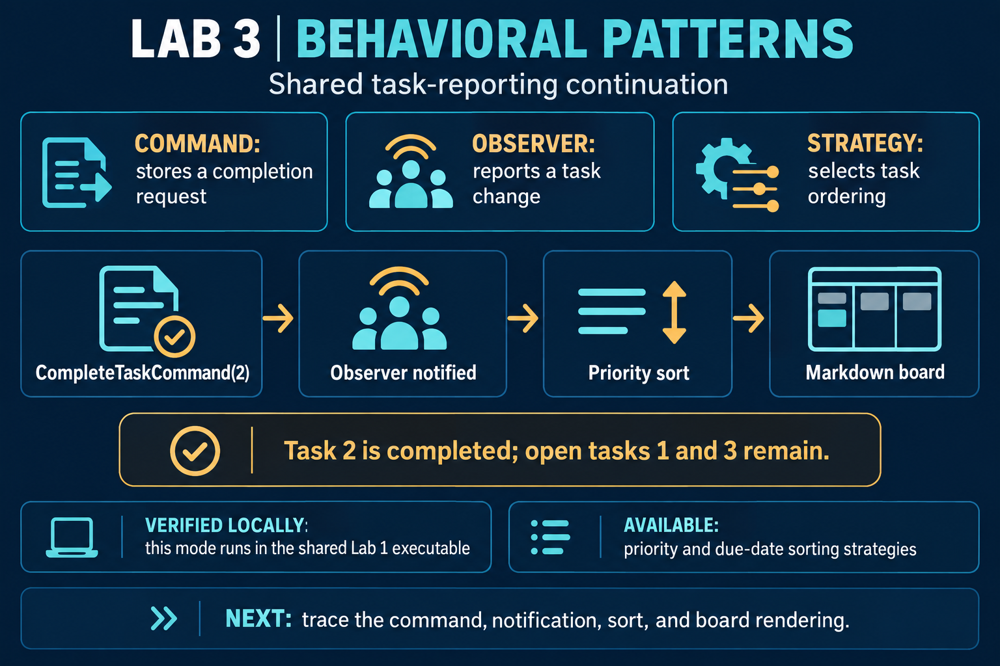
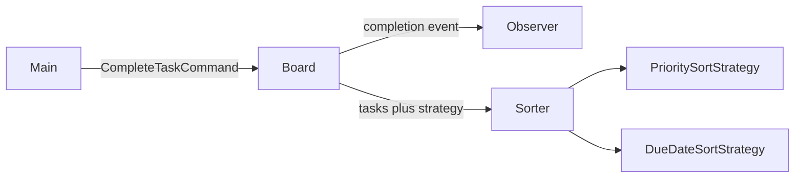

# Lab 3: Three behavioral patterns

## Local study report

[Open the formatted report (PDF)](study-report.pdf) or its [LaTeX source](report.tex). The report traces the behavioral mode and lists the shared client, model, and behavioral source files.



## Brief

The [ELSE brief](https://else.fcim.utm.md/mod/assign/view.php?id=27829) asks for three behavioral patterns selected from Chain of Responsibility, Command, Iterator, Mediator, Memento, Observer, State, Strategy, Template Method, and Visitor, plus familiarity with the others. Interpreter is listed as useful to know. This continuation uses Command, Observer, and Strategy in the shared task-reporting project.

The implementation selects Command, Observer, and Strategy. It continues the Lab 1 task-reporting project in the same executable: the client uses the shared `TaskItem` model, the Builder, the CSV Factory Method creator, and the Markdown Abstract Factory renderer.

The linked Lab 3 instructions require the continuation to remain in the Lab 1 repository, group files by responsibility, document the work in a separate Markdown report, and submit the repository URL on ELSE. This README provides the Markdown explanation and source trace; the LaTeX report provides a formatted companion.

## Build and run

Prerequisite: .NET 10. From this directory:

```powershell
$build = Join-Path $env:TEMP 'tmps-build'
dotnet build ..\lab-01\TMPSLab01.csproj -c Release --artifacts-path $build
dotnet (Join-Path $build 'bin\TMPSLab01\release\TMPSLab01.dll') lab-03
```

The CSV report appears first, followed by the observer message for task 2 and a Markdown board showing the remaining open tasks in priority order.

## Shared project structure

- [`../lab-01/Program.cs`](../lab-01/Program.cs) is the single client for both laboratory modes.
- [`../lab-01/TaskItem.cs`](../lab-01/TaskItem.cs) is the shared model.
- [`../lab-01/CreationalPatterns.cs`](../lab-01/CreationalPatterns.cs) provides the Builder, Factory Method, and Abstract Factory used by the Lab 3 mode.
- `BehavioralPatterns.cs` contains the Command, Observer, Strategy, and task board for this lab. The Lab 1 project compiles this file into the shared executable.

## Pattern flow



- **Command:** `CompleteTaskCommand` stores the task ID and asks the board to complete it.
- **Observer:** after the board changes a task, it notifies every subscribed observer.
- **Strategy:** the caller chooses priority order or due-date order through `ITaskSortStrategy`.

## Tiny trace

`Program.RunLab03` builds the shared report options, prints a CSV view, then executes `CompleteTaskCommand(2)`. The board marks task 2 complete and notifies the console observer. The priority strategy sorts the tasks; the client filters out the completed item and prints the remaining tasks through the Markdown board renderer.

## Know the remaining options

- **Chain of Responsibility:** pass a request through handlers until one handles it.
- **Iterator:** visit items one at a time without exposing the collection's internal structure.
- **Mediator:** coordinate communication through one central object.
- **Memento:** save state so an earlier state can be restored.
- **State:** change an object's behavior when its internal state changes.
- **Template Method:** define an algorithm's steps once and let subclasses fill selected steps.
- **Visitor:** add an operation over object types without moving that operation into each type.
- **Interpreter:** represent and evaluate a small grammar.

## Oral questions

1. **Why wrap completion in a Command?** The request becomes an object that can be queued, logged, or given undo behavior later.
2. **How does Observer reduce coupling?** The board reports a change through an interface without knowing what each observer does with it.
3. **How does Strategy change task ordering?** The caller supplies a sorting implementation while the board keeps the same task collection.
4. **How does State differ from Strategy?** Strategy is selected to vary an operation; State changes behavior in response to the object's current lifecycle state.
