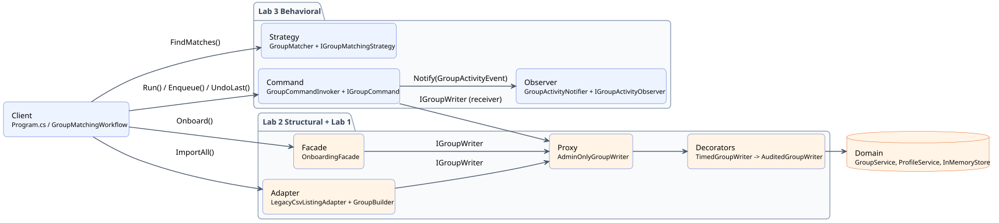
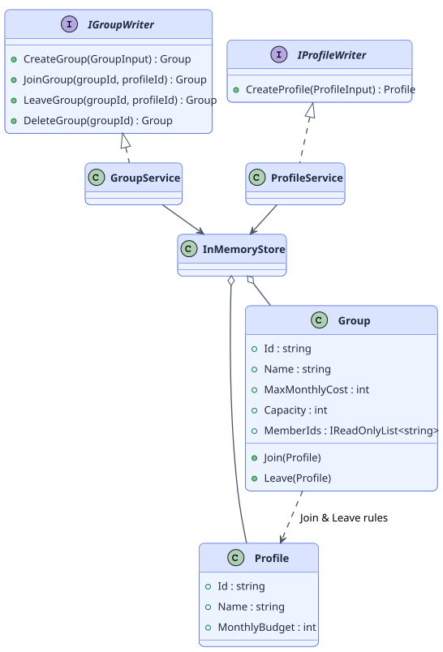
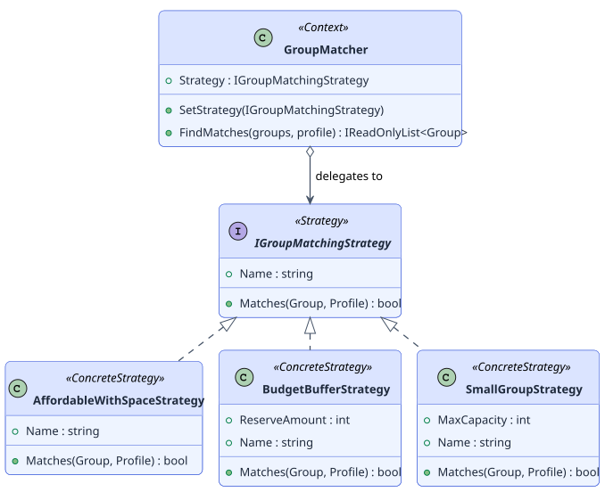
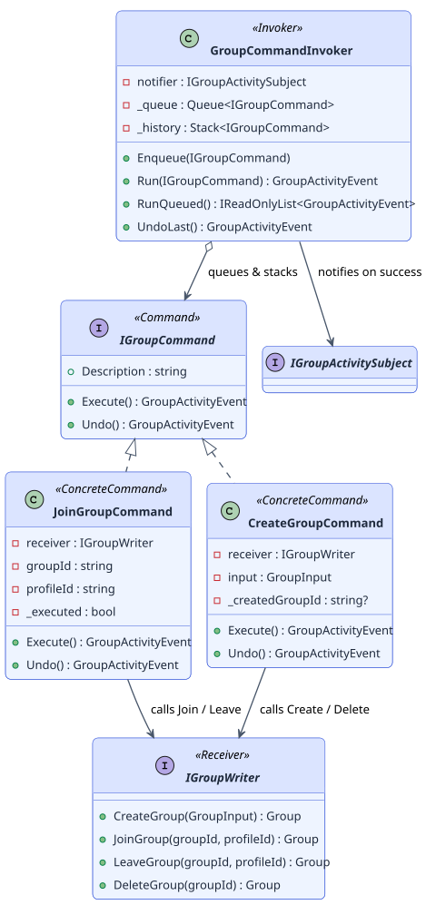
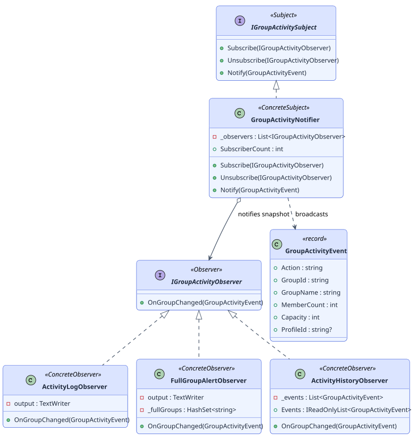
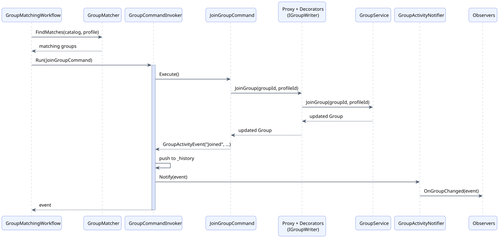

# Laboratory Work No. 3: Behavioral Design Patterns

**Course:** Software Design Techniques and Mechanisms (TMPS)<br>
**Project:** Domi, a service for forming shared-rent groups<br>
**Language:** C# (.NET 10)

## Contents

1. [Task and purpose](#1-task-and-purpose)
2. [Theory: why behavioral patterns exist](#2-theory-why-behavioral-patterns-exist)
3. [The Domi domain](#3-the-domi-domain)
4. [Strategy](#4-strategy)
5. [Command](#5-command)
6. [Observer](#6-observer)
7. [How the patterns interact and SOLID](#7-how-the-patterns-interact-and-solid)
8. [The remaining behavioral patterns](#8-the-remaining-behavioral-patterns)
9. [Results](#9-results)
10. [Conclusion](#10-conclusion)

---

## 1. Task and purpose

The task is to study the behavioral design patterns, implement at least three of them in a class-based object-oriented project, and understand the remaining ones (Chain of Responsibility, Iterator, Mediator, Memento, State, Template Method, Visitor, plus Interpreter). The handout requires that each implemented pattern uses its full structure, that patterns interact on one execution path, that client code depends on abstractions, that new variants can be added without editing existing classes, that the solution builds on Laboratory work No. 2, that behavior can change at runtime, and that at least two unit tests per pattern verify its key property.

Creational patterns in Laboratory work No. 1 decided how Domi objects are constructed. Structural patterns in Laboratory work No. 2 decided how finished objects are connected through Adapter, Decorator, Facade and Proxy. Behavioral patterns in this laboratory work decide how objects **choose algorithms, encapsulate requests, and notify collaborators** at runtime without coupling the core domain to any caller, workflow or notification channel.

Domi is a shared-rent roommate application where people create profiles with monthly budgets and join roommate groups with a per-person cost and capacity. In this lab, Domi gains three real behavioral capabilities: runtime-swappable group matching rules (**Strategy**), queueable and undoable group write operations (**Command**), and decoupled live notifications when groups change or fill up (**Observer**).

The code lives in clean folders under `lab-03/csharp`: `Domain` for models and services, `Creational` for the reused Lab 1 `GroupBuilder`, `Patterns/Adapter`, `Patterns/Decorator`, `Patterns/Facade` and `Patterns/Proxy` from Lab 2, `Patterns/Strategy`, `Patterns/Command` and `Patterns/Observer` for Lab 3, `Client` for the workflow and demo, and `tests/Domi.Behavioral.Tests` for the 25 xUnit tests. The repository is https://github.com/Lucian-Adrian/sem5-software-design/tree/main/lab-03/csharp.



*Figure 1. Architecture combining Lab 1 Builder, Lab 2 structural wrappers, and Lab 3 Strategy, Command and Observer.*

---

## 2. Theory: why behavioral patterns exist

### 2.1 Assigning responsibilities between objects

Behavioral design patterns assign responsibilities and communication between objects so that algorithms, requests and notifications can vary independently from the classes that use them. Instead of packing `if/else` chains or direct callbacks inside a service, each pattern introduces a small abstraction boundary:

| Pattern | Responsibility it isolates | Key mechanism |
| --- | --- | --- |
| Strategy | interchangeable selection or calculation rules | context delegates to a replaceable `IGroupMatchingStrategy` |
| Command | request invocation, queueing and undo history | request object implements `Execute()` and `Undo()` on a receiver |
| Observer | broadcasting state changes to unknown listeners | subject notifies `IGroupActivityObserver` subscribers at runtime |
| Chain of Responsibility | passing a request along a sequence of handlers | each handler handles or forwards to `next` |
| State | object behavior that changes with internal state | context delegates to the current state object |
| Template Method | fixed algorithm skeleton with variable steps | base class fixes order; subclasses override steps |
| Mediator | many-to-many object coordination | colleagues talk only to a central mediator |
| Memento | saving and restoring encapsulated state | originator produces an opaque snapshot |
| Iterator | sequential traversal over a collection | separate iterator object tracks cursor position |
| Visitor | adding operations to a fixed class hierarchy | double dispatch via `Accept(visitor)` / `VisitX(element)` |

### 2.2 Runtime flexibility without editing existing classes

Without behavioral patterns, changing a matching rule, adding an undoable action or attaching a new alert listener forces edits inside `GroupService` or `Program`. By depending on interfaces (`IGroupMatchingStrategy`, `IGroupCommand`, `IGroupActivityObserver`, `IGroupActivitySubject`, `IGroupWriter`), existing classes stay closed for modification while new behaviors are added as new classes or swapped at runtime.

---

## 3. The Domi domain

### 3.1 Profiles, groups and services

A `Profile` holds an identifier, a name and a `MonthlyBudget`. A `Group` holds an identifier, a name, a per-person `MaxMonthlyCost`, a `Capacity` (1 to 20), and `_memberIds`. Both constructors validate inputs and throw `DomainException` on invalid values.

To support real Command `Undo()` while keeping all business rules in the domain, `Group` exposes both `Join(Profile)` and `Leave(Profile)`, and `IGroupWriter` exposes `CreateGroup`, `JoinGroup`, `LeaveGroup` and `DeleteGroup`. `GroupService` implements `IGroupWriter` over `InMemoryStore`, while `ProfileService` implements `IProfileWriter`.

```csharp
public interface IGroupWriter
{
    Group CreateGroup(GroupInput input);
    Group JoinGroup(string groupId, string profileId);
    Group LeaveGroup(string groupId, string profileId);
    Group DeleteGroup(string groupId);
}
```



*Figure 2. The Domi domain classes extended with Leave and DeleteGroup for undo support.*

---

## 4. Strategy

### 4.1 Idea and problem

Roommates search for groups using different rules: basic affordability with open places, affordability that keeps a monthly savings reserve, or small-household groups with a capacity cap. Hard-coding `if/else` branches inside the matcher would violate the Open/Closed Principle every time a new rule is requested.

Strategy extracts each filtering rule into its own class behind `IGroupMatchingStrategy`, while the context `GroupMatcher` delegates matching to whichever strategy is currently active and allows swapping it at runtime via `SetStrategy`.

### 4.2 Structure in Domi

| Role | Class |
| --- | --- |
| Strategy | `IGroupMatchingStrategy` |
| ConcreteStrategy | `AffordableWithSpaceStrategy`, `BudgetBufferStrategy`, `SmallGroupStrategy` |
| Context | `GroupMatcher` |



*Figure 3. Strategy class diagram using Domi's real class names and pattern roles.*

### 4.3 Code snippet

Source: [Patterns/Strategy/GroupMatcher.cs](https://github.com/Lucian-Adrian/sem5-software-design/blob/main/lab-03/csharp/src/Domi.Behavioral/Patterns/Strategy/GroupMatcher.cs) and [Patterns/Strategy/IGroupMatchingStrategy.cs](https://github.com/Lucian-Adrian/sem5-software-design/blob/main/lab-03/csharp/src/Domi.Behavioral/Patterns/Strategy/IGroupMatchingStrategy.cs)

```csharp
public interface IGroupMatchingStrategy
{
    string Name { get; }
    bool Matches(Group group, Profile profile);
}

public sealed class BudgetBufferStrategy : IGroupMatchingStrategy
{
    public int ReserveAmount { get; }
    public BudgetBufferStrategy(int reserveAmount) => ReserveAmount = reserveAmount >= 0
        ? reserveAmount : throw new ArgumentOutOfRangeException(nameof(reserveAmount));
    public string Name => $"Budget buffer (>= {ReserveAmount} left)";
    public bool Matches(Group group, Profile profile) =>
        group.MaxMonthlyCost <= profile.MonthlyBudget - ReserveAmount &&
        group.MemberIds.Count < group.Capacity;
}

public sealed class GroupMatcher(IGroupMatchingStrategy initialStrategy)
{
    public IGroupMatchingStrategy Strategy { get; private set; } =
        initialStrategy ?? throw new ArgumentNullException(nameof(initialStrategy));
    public void SetStrategy(IGroupMatchingStrategy strategy) =>
        Strategy = strategy ?? throw new ArgumentNullException(nameof(strategy));
    public IReadOnlyList<Group> FindMatches(IEnumerable<Group> groups, Profile profile) =>
        groups.Where(group => Strategy.Matches(group, profile)).ToList();
}
```

`GroupMatcher` contains no conditional branches for selecting a rule; it calls `Strategy.Matches(group, profile)` through the `IGroupMatchingStrategy` interface. Calling `SetStrategy(...)` swaps the matching behavior immediately at runtime without recreating the matcher or editing any existing class.

### 4.4 Unit tests

| Test | What it checks |
| --- | --- |
| `AffordableWithSpaceStrategy_matches_only_affordable_groups_with_free_places` | matches affordable open groups and excludes full groups |
| `BudgetBufferStrategy_requires_extra_margin_above_group_cost` | requires `MonthlyBudget - ReserveAmount >= MaxMonthlyCost` |
| `SmallGroupStrategy_filters_by_maximum_capacity` | excludes groups larger than `MaxCapacity` |
| `GroupMatcher_changes_results_when_strategy_is_swapped_at_runtime` | proves `SetStrategy` changes output from 3 matches to 1 at runtime |

---

## 5. Command

### 5.1 Idea and problem

Joining or creating a group in Domi should support deferred batch execution (a queue), undo when a user changes their mind, and history tracking, without moving membership or access-control logic out of `Group` and `IGroupWriter`. Simply wrapping a method call with no history or undo would not justify Command.

Command turns each write request into an `IGroupCommand` object with `Execute()` and `Undo()` methods. Each concrete command holds only the receiver (`IGroupWriter`) and request parameters, while `GroupCommandInvoker` manages the FIFO queue, the LIFO undo stack, and error safety (failed commands never enter the undo stack).

### 5.2 Structure in Domi

| Role | Class |
| --- | --- |
| Command | `IGroupCommand` |
| ConcreteCommand | `JoinGroupCommand`, `CreateGroupCommand` |
| Invoker | `GroupCommandInvoker` |
| Receiver | `IGroupWriter` (`AdminOnlyGroupWriter` -> `TimedGroupWriter` -> `AuditedGroupWriter` -> `GroupService`) |



*Figure 4. Command class diagram with queue, undo stack, receiver abstraction and notification link.*

### 5.3 Code snippet

Source: [Patterns/Command/JoinGroupCommand.cs](https://github.com/Lucian-Adrian/sem5-software-design/blob/main/lab-03/csharp/src/Domi.Behavioral/Patterns/Command/JoinGroupCommand.cs) and [Patterns/Command/GroupCommandInvoker.cs](https://github.com/Lucian-Adrian/sem5-software-design/blob/main/lab-03/csharp/src/Domi.Behavioral/Patterns/Command/GroupCommandInvoker.cs)

```csharp
public sealed class JoinGroupCommand(IGroupWriter receiver, string groupId, string profileId) : IGroupCommand
{
    private bool _executed;
    public string Description => $"Join {profileId} -> {groupId}";

    public GroupActivityEvent Execute()
    {
        if (_executed) throw new InvalidOperationException("join command has already been executed");
        var group = receiver.JoinGroup(groupId, profileId);
        _executed = true;
        return new GroupActivityEvent("Joined", group.Id, group.Name, group.MemberIds.Count, group.Capacity, profileId);
    }

    public GroupActivityEvent Undo()
    {
        if (!_executed) throw new InvalidOperationException("cannot undo a join command that has not executed");
        var group = receiver.LeaveGroup(groupId, profileId);
        _executed = false;
        return new GroupActivityEvent("UndidJoin", group.Id, group.Name, group.MemberIds.Count, group.Capacity, profileId);
    }
}

public GroupActivityEvent Run(IGroupCommand command)
{
    ArgumentNullException.ThrowIfNull(command);
    var activity = command.Execute();
    _history.Push(command);
    notifier.Notify(activity);
    return activity;
}
```

`JoinGroupCommand` contains zero domain validation: it delegates `Execute()` to `receiver.JoinGroup` and `Undo()` to `receiver.LeaveGroup`. In `GroupCommandInvoker.Run`, if `command.Execute()` throws `DomainException` or `UnauthorizedAccessException`, execution stops before `_history.Push` and `notifier.Notify`, so failed requests never corrupt the undo history or trigger false notifications.

### 5.4 Unit tests

| Test | What it checks |
| --- | --- |
| `JoinGroupCommand_execute_and_undo_restores_original_membership` | executing adds the member; `UndoLast()` removes them and emits `UndidJoin` |
| `CreateGroupCommand_execute_and_undo_removes_created_group` | executing creates a group; `UndoLast()` deletes it from the store |
| `CommandInvoker_does_not_record_failed_command_in_undo_history` | a rejected join throws, leaves `HistoryCount == 0`, and emits zero events |
| `CommandInvoker_runs_queued_commands_in_fifo_order_and_undoes_in_lifo_order` | queued commands run FIFO (`Ana`, then `Vlad`) and undo LIFO (`Vlad` removed first) |

---

## 6. Observer

### 6.1 Idea and problem

When a group is created, joined, filled to capacity, or freed by an undo, multiple independent reactions may be needed: printing an activity log, raising a capacity alert, or recording events in an audit history. Hard-coding those reactions inside `GroupCommandInvoker` or `GroupService` would couple core execution to every display and alert format.

Observer defines `IGroupActivityObserver` and `IGroupActivitySubject`. `GroupActivityNotifier` maintains a subscriber list that accepts runtime `Subscribe` and `Unsubscribe` calls and broadcasts immutable `GroupActivityEvent` snapshots over a list copy so mid-notification changes cannot break iteration or cause update loops.

### 6.2 Structure in Domi

| Role | Class |
| --- | --- |
| Subject | `IGroupActivitySubject` |
| ConcreteSubject | `GroupActivityNotifier` |
| Observer | `IGroupActivityObserver` |
| ConcreteObserver | `ActivityLogObserver`, `FullGroupAlertObserver`, `ActivityHistoryObserver` |



*Figure 5. Observer class diagram showing runtime subscription management and three concrete observers.*

### 6.3 Code snippet

Source: [Patterns/Observer/GroupActivityNotifier.cs](https://github.com/Lucian-Adrian/sem5-software-design/blob/main/lab-03/csharp/src/Domi.Behavioral/Patterns/Observer/GroupActivityNotifier.cs) and [Patterns/Observer/ActivityObservers.cs](https://github.com/Lucian-Adrian/sem5-software-design/blob/main/lab-03/csharp/src/Domi.Behavioral/Patterns/Observer/ActivityObservers.cs)

```csharp
public sealed class GroupActivityNotifier : IGroupActivitySubject
{
    private readonly List<IGroupActivityObserver> _observers = [];
    public int SubscriberCount => _observers.Count;

    public void Subscribe(IGroupActivityObserver observer)
    {
        ArgumentNullException.ThrowIfNull(observer);
        if (!_observers.Contains(observer)) _observers.Add(observer);
    }

    public void Unsubscribe(IGroupActivityObserver observer)
    {
        if (observer is not null) _observers.Remove(observer);
    }

    public void Notify(GroupActivityEvent activity)
    {
        foreach (var observer in _observers.ToList())
            observer.OnGroupChanged(activity);
    }
}
```

`GroupActivityNotifier` knows only `IGroupActivityObserver`, prevents duplicate registration, supports runtime `Unsubscribe`, and iterates over `_observers.ToList()` so each subscriber receives the immutable `GroupActivityEvent` safely without coupling back to the subject.

### 6.4 Unit tests

| Test | What it checks |
| --- | --- |
| `All_subscribed_observers_receive_notifications_after_successful_command` | two subscribed observers both receive the exact `GroupActivityEvent` |
| `Unsubscribed_observer_receives_no_further_notifications` | after `Unsubscribe`, the detached observer stops receiving events while others continue |
| `FullGroupAlertObserver_announces_when_group_becomes_full_and_reopens_on_undo` | fires "is now FULL" at capacity and "has a free spot again" after `UndoLast()` |
| `Subscribing_same_observer_twice_does_not_duplicate_notifications` | duplicate `Subscribe` calls keep `SubscriberCount == 1` and deliver one event |

---

## 7. How the patterns interact and SOLID

### 7.1 Single execution path across Labs 1, 2 and 3

In `Client/Program.cs` and `Client/GroupMatchingWorkflow.cs`, the behavioral and structural patterns work together along one path rather than in isolated demos:

```text
ListingImporter -> LegacyCsvListingAdapter (Adapter + Lab 1 GroupBuilder)
OnboardingFacade (Facade)
  -> AdminOnlyGroupWriter (Proxy) -> TimedGroupWriter -> AuditedGroupWriter (Decorators) -> GroupService

GroupMatchingWorkflow
  -> GroupMatcher (Strategy) selects a matching Group
  -> GroupCommandInvoker runs JoinGroupCommand (Command)
  -> AdminOnlyGroupWriter (Proxy) -> TimedGroupWriter -> AuditedGroupWriter (Decorators) -> GroupService
  -> GroupActivityNotifier (Observer) -> ActivityLogObserver, FullGroupAlertObserver, ActivityHistoryObserver
```



*Figure 6. Sequence of one end-to-end match-and-join operation crossing Strategy, Command, Proxy, Decorators, Domain and Observer.*

### 7.2 Justification and SOLID principles

- **Single Responsibility:** `Group` enforces membership rules, `GroupMatcher` delegates filtering, `GroupCommandInvoker` manages queue/undo history, and `GroupActivityNotifier` handles subscriptions;
- **Open/Closed:** adding a new matching rule, command or observer is one new class implementing `IGroupMatchingStrategy`, `IGroupCommand` or `IGroupActivityObserver`, without modifying `GroupMatcher`, `GroupCommandInvoker`, `GroupActivityNotifier` or `GroupService`;
- **Liskov Substitution:** any `IGroupWriter` wrapper (proxy, decorators) and any `IGroupMatchingStrategy`, `IGroupCommand` or `IGroupActivityObserver` substitutes transparently;
- **Interface Segregation:** `IGroupMatchingStrategy`, `IGroupCommand`, `IGroupActivityObserver`, `IGroupActivitySubject`, `IGroupWriter` and `IProfileWriter` stay small and role-specific;
- **Dependency Inversion:** `GroupMatchingWorkflow`, `GroupMatcher`, `JoinGroupCommand`, `GroupCommandInvoker` and `GroupActivityNotifier` depend only on abstractions; concrete classes are instantiated only in `Program.cs`.

---

## 8. The remaining behavioral patterns

### 8.1 Chain of Responsibility

**Problem.** A join request may need sequential checks (authentication, rate limit, budget pre-check) where each check can either reject or pass to the next handler.

**Solution.** Define `IJoinHandler` with `SetNext(IJoinHandler)` and `Handle(JoinRequest)`. Each handler decides whether to stop with an error or delegate to `_next`.

### 8.2 State

**Problem.** A roommate group transitions between `Open`, `Full` and `Closed` states, and `Join` behaves differently in each state without a `switch` statement on an enum.

**Solution.** Give `Group` an `IGroupState` field (`OpenState`, `FullState`, `ClosedState`) and let `Group.Join` delegate to `_state.Join(this, profile)`, where state classes trigger valid transitions.

### 8.3 Memento

**Problem.** Saving and restoring a `Group`'s member list and cost before an experimental bulk edit without exposing internal private fields publicly.

**Solution.** `Group.SaveSnapshot()` returns an opaque `GroupMemento` (only `Group` reads its private members), and `Group.Restore(memento)` rolls back cleanly.

### 8.4 Mediator

**Problem.** Matching engine, notification feed, waitlist and chat room referencing each other directly would create tangled many-to-many dependencies.

**Solution.** Introduce `IDomiMediator` (`Notify(sender, eventName)`). Colleagues hold only the mediator reference and let it coordinate reactions.

### 8.5 Template Method

**Problem.** Importing listings from CSV, JSON or XML follows the same steps (read raw input, validate fields, convert cost, save groups) with only parsing differing.

**Solution.** An abstract `ListingImportTemplate` fixes the `Import()` algorithm order and lets subclasses override `ReadRecords()` and `MapRow()`.

### 8.6 Iterator

**Problem.** Navigating matching groups in custom orders (cheapest first, nearly full first) without exposing `InMemoryStore`'s internal dictionary.

**Solution.** Provide `IGroupIterator` (`HasNext()`, `Next()`) implemented by `BudgetOrderIterator` so callers traverse without knowing the backing structure.

### 8.7 Visitor

**Problem.** Generating new exports (monthly rent summary, PDF badge, occupancy stats) over a stable set of domain elements (`Profile`, `Group`) without bloating them.

**Solution.** Elements expose `Accept(IDomiVisitor v)` calling `v.VisitProfile(this)` or `v.VisitGroup(this)` (double dispatch), keeping each export in its own visitor class.

### 8.8 Interpreter (good to know)

**Problem.** Letting power users write filter expressions such as `cost <= 500 AND capacity <= 3`.

**Solution.** Model grammar nodes (`CostExpression`, `AndExpression`) implementing `bool Interpret(Group g)` to evaluate an expression tree.

---

## 9. Results

From `lab-03/csharp`, the solution builds, tests and runs with three commands:

```text
dotnet build
dotnet test                               # 25 xUnit tests
dotnet run --project src/Domi.Behavioral  # end-to-end demonstration
```

Recorded test summary in `evidence/test-output.txt` (20 November 2026, 0 warnings, 0 errors):

```text
Passed Domi.Behavioral.Tests.StrategyTests.AffordableWithSpaceStrategy_matches_only_affordable_groups_with_free_places
Passed Domi.Behavioral.Tests.StrategyTests.BudgetBufferStrategy_requires_extra_margin_above_group_cost
Passed Domi.Behavioral.Tests.StrategyTests.SmallGroupStrategy_filters_by_maximum_capacity
Passed Domi.Behavioral.Tests.StrategyTests.GroupMatcher_changes_results_when_strategy_is_swapped_at_runtime
Passed Domi.Behavioral.Tests.CommandTests.JoinGroupCommand_execute_and_undo_restores_original_membership
Passed Domi.Behavioral.Tests.CommandTests.CreateGroupCommand_execute_and_undo_removes_created_group
Passed Domi.Behavioral.Tests.CommandTests.CommandInvoker_does_not_record_failed_command_in_undo_history
Passed Domi.Behavioral.Tests.CommandTests.CommandInvoker_runs_queued_commands_in_fifo_order_and_undoes_in_lifo_order
Passed Domi.Behavioral.Tests.ObserverTests.All_subscribed_observers_receive_notifications_after_successful_command
Passed Domi.Behavioral.Tests.ObserverTests.Unsubscribed_observer_receives_no_further_notifications
Passed Domi.Behavioral.Tests.ObserverTests.FullGroupAlertObserver_announces_when_group_becomes_full_and_reopens_on_undo
Passed Domi.Behavioral.Tests.ObserverTests.Subscribing_same_observer_twice_does_not_duplicate_notifications
Passed Domi.Behavioral.Tests.InteractionTests.End_to_end_path_crosses_structural_and_behavioral_patterns
(+ 12 reused Lab 2 Adapter, Decorator, Facade and Proxy tests)
Total tests: 25, Passed: 25
```

The demo log in `evidence/demo-output.txt` confirms: Lab 1 `GroupBuilder` and Lab 2 `Adapter` + `Facade` seed the catalog through `AdminOnlyGroupWriter` and the decorators; `GroupMatcher` switches between `AffordableWithSpaceStrategy`, `BudgetBufferStrategy(50)` and `SmallGroupStrategy(2)` at runtime; `GroupMatchingWorkflow` executes `JoinGroupCommand` and queued `CreateGroupCommand`/`JoinGroupCommand` through `IGroupWriter`, triggering `ActivityLogObserver` and `FullGroupAlertObserver`; a failing join does not touch undo history or notify observers; and after runtime `Unsubscribe(logObserver)`, `UndoLast()` removes the member and notifies only the remaining observers.

---

## 10. Conclusion

This laboratory work extended Domi with three behavioral patterns—Strategy, Command and Observer—on top of the Lab 1 Builder and Lab 2 Adapter, Decorator, Facade and Proxy wrappers. `GroupMatcher` swaps filtering strategies at runtime with zero conditionals inside the context; `JoinGroupCommand`, `CreateGroupCommand` and `GroupCommandInvoker` provide FIFO queueing and LIFO undo while keeping domain rules inside `Group` and `GroupService`; and `GroupActivityNotifier` broadcasts changes to runtime-managed observers. All 25 xUnit tests pass.

**What was harder than expected.** Designing `Undo()` cleanly required deciding where undo validation and state changes live. Putting `Leave` logic inside `JoinGroupCommand` would have violated the rule against placing business logic in commands, so `Leave` was added to `Group` and `LeaveGroup`/`DeleteGroup` to `IGroupWriter`, allowing undo calls to pass through the Lab 2 Proxy and Decorators just like forward calls. It also mattered to ensure failed commands never enter `_history` and never notify observers.

**What I would design differently.** First, `CreateGroupCommand.Undo()` currently refuses deletion if other members joined after creation; a richer system would either support composite undo commands or soft-archive groups. Second, `GroupActivityNotifier` notifies synchronously on the calling thread; a production version could catch per-observer exceptions or dispatch via an async queue so one failing observer cannot block others.
