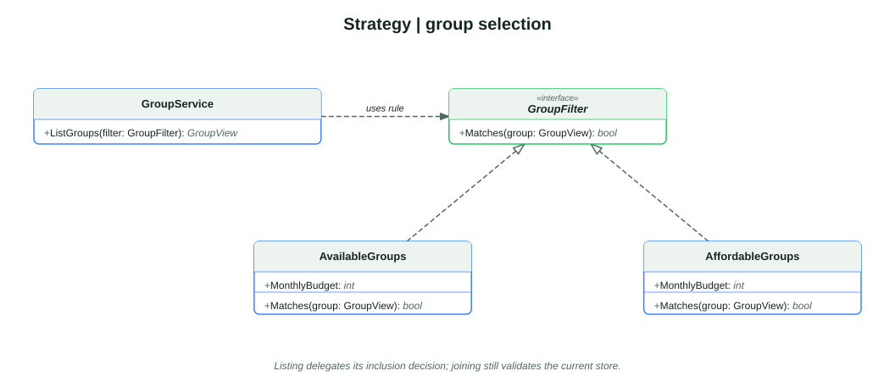
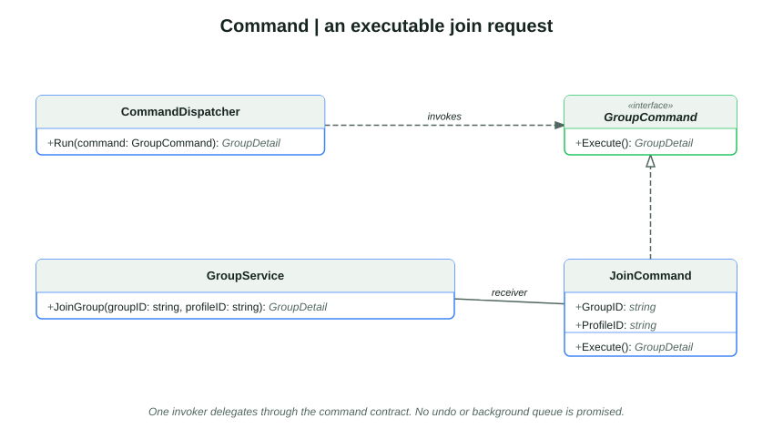
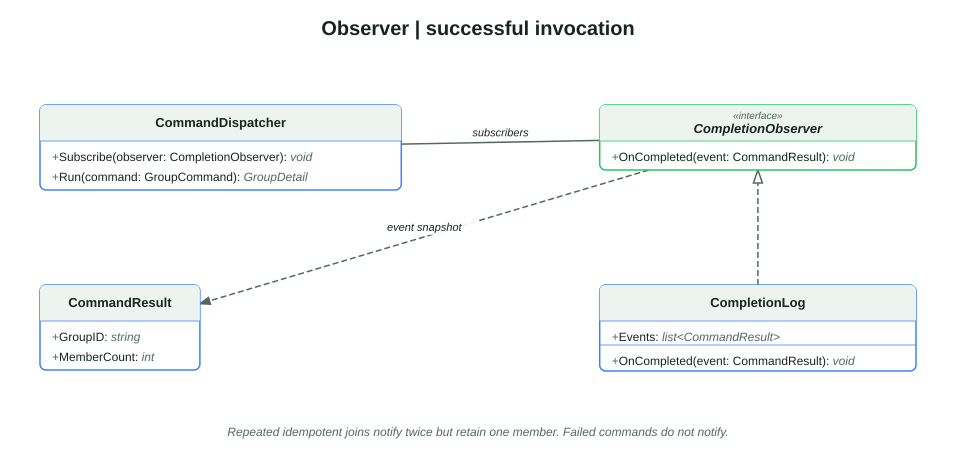
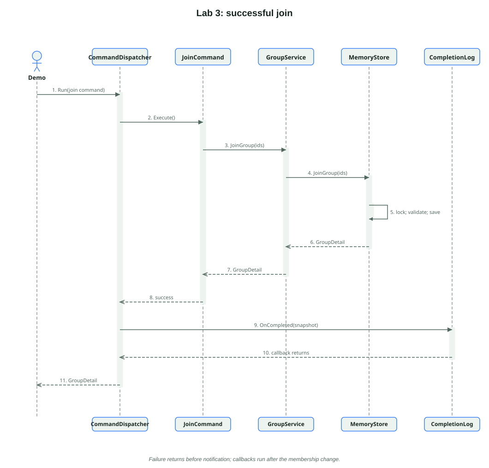

# Lab 3: Behavioral Design Patterns

**Author:** Lucian-Adrian Gavril, FAF-241. **Language:** Go. **Prepared revision:** 7 October 2026.

## Aim and requirements

Domi's earlier checkpoints create roommate profiles and groups, apply budget rules and join members. This checkpoint adds a selectable availability rule, an executable join request and a way for listeners to observe successful requests. The aim is to separate decisions, requests and reactions so each can vary without embedding all three in the storage code.

The [ELSE Lab 3 brief](https://else.fcim.utm.md/mod/assign/view.php?id=27829) requires three behavioral patterns and knowledge of the remaining listed patterns. This checkpoint implements Strategy, Command and Observer.

The source remains a self-contained checkpoint within the existing software-design repository. `main.go` is the single executable client and selects the old and new demonstrations with flags. Files separate domain rules, storage, service contracts, transport, patterns and the demo. No pattern library implements the patterns.

Class diagrams use UML-style type names and omit Go pointer markers and extra error returns for readability; the linked source retains full signatures. A realization arrow denotes Go interface satisfaction rather than class inheritance. `list<CommandResult>` denotes the Go slice of event values.

The code files separate reusable behavior from sample setup and checks. [behavioral.go](behavioral.go) defines the filter, command and observer types. [behavioral_demo.go](behavioral_demo.go) creates fresh records, connects those types and prints JSON. [behavioral_test.go](behavioral_test.go) checks boundary behavior without producing presentation output.

## Strategy: change a selection rule

`GroupService.ListGroups` in [service.go](service.go) already accepts the `GroupFilter` interface. The new `AvailableGroups` in [behavioral.go](behavioral.go) supplies a rule combining affordability with an available place. The service's selection loop stays unchanged. `AllGroups` and `AffordableGroups` remain valid alternatives.

Pseudocode: keep a group when its cost is within the search budget and it still has a free place.

```go
// Matches returns true when the group fits the budget and has a free place.
// The store checks capacity again when someone tries to join.
func (filter AvailableGroups) Matches(group GroupView) bool {
    return group.MaxMonthlyCost <= filter.MonthlyBudget &&
        group.MemberCount < group.Capacity
}
```

At budget 550, cost 500 and capacity 1, an empty group matches. After one member joins, it remains affordable but is no longer available. The two strategies answer different questions. Listing is a snapshot; a later join must still check the rules while the store holds its lock. A selection result is not a reservation.



[Editable Isomorph source](assets/strategy.isx).

## Command: make a request a value

`JoinCommand` stores the receiving `GroupService` and the two IDs. Its `Execute` method delegates the join through the existing service. `CommandDispatcher.Run` uses only the `GroupCommand` contract; it does not need to inspect IDs or implement membership rules. A different request can supply the same result contract without changing that invoker.

The command is an ordinary in-process value. It is not a shell command, worker process or durable queue item. Encapsulation permits later queuing, but this lab implements synchronous execution. It provides no undo operation because the domain has no leave operation. The store remains responsible for budget, missing-record and capacity checks. An unconfigured `JoinCommand` returns `ErrInvalidInput`.

Pseudocode: store the receiver and IDs in a request value; when the dispatcher runs it, pass those IDs to the existing group service.

```go
// Execute sends this request to the configured group service.
// A missing service returns an input error before the request is attempted.
func (command JoinCommand) Execute() (GroupDetail, error) {
    if command.Groups == nil {
        return GroupDetail{}, fmt.Errorf("%w: join command needs a group service", ErrInvalidInput)
    }
    return command.Groups.JoinGroup(command.GroupID, command.ProfileID)
}
```



[Editable Isomorph source](assets/command.isx).

## Observer: react to successful invocation

`CommandDispatcher` also acts as the subject. Listeners implement `CompletionObserver` and subscribe before execution. After `Execute` succeeds, the dispatcher sends a `CommandResult` value containing group ID and member count to each listener. `CompletionLog` collects these snapshots. It receives no private budget or member names.

The event means **successful invocation**, not **new membership**. Repeating a join for the same profile succeeds idempotently in the store: one member remains, while two successful invocations produce two notifications. A rejected request produces no success event. Naming this distinction prevents an observer from treating retries as two people joining.



[Editable Isomorph source](assets/observer.isx).

Callbacks run synchronously in registration order. Setup and dispatch are single-threaded; the dispatcher and log are not concurrent collections. Notifications are not durable or transactional. A callback must not panic: a panic interrupts subsequent callbacks after the store mutation has already completed. Recovery, retries, unsubscribe, delivery guarantees and an outbox are possible extensions, not implemented capabilities. Go interface callers must also supply usable implementations rather than a typed nil pointer.

Pseudocode: run the command first; return its error without notifying anyone; otherwise make a public result and send it to every registered observer.

```go
// Run executes one command and returns its error without notifying observers.
// After success, it sends the public result to every observer.
func (dispatcher *CommandDispatcher) Run(command GroupCommand) (GroupDetail, error) {
    if command == nil {
        return GroupDetail{}, fmt.Errorf("%w: command is required", ErrInvalidInput)
    }
    result, err := command.Execute()
    if err != nil {
        return result, err
    }
    event := CommandResult{GroupID: result.Group.ID, MemberCount: result.Group.MemberCount}
    for _, observer := range dispatcher.observers {
        observer.OnCompleted(event)
    }
    return result, nil
}
```

## Demonstrated sequence and results



[Editable Isomorph source](assets/sequence.isx).

Run `go run . --behavioral`. The fixed example creates Alex with budget 550, Pat with budget 400 and Shared flat costing 500 with one place. It lists the group as available, rejects Pat, joins Alex, repeats Alex's join, then lists again. The result contains one initial available group, one member, no available groups afterwards, `rejectedBudget: true` and two successful-invocation events. These are local deterministic demonstration values, not deployed-service observations.

The focused behavioral tests and JSON demonstration were run on 17 October 2026. They check budget equality, a full group's availability and rejection behavior, suppression of notifications after failure, delivery to multiple observers and repeated joins that leave one member in storage. [Saved evidence](evidence/verification.json) records the fresh commands and source hashes. These checks do not establish production reliability, teacher acceptance, quiz completion or the student's ability to explain the design unaided.

## Conclusion

The same Domi operation now distinguishes a configurable listing decision, an encapsulated request and reactions to its successful execution. Interfaces keep these responsibilities replaceable. The boundary cases reveal why eligibility is not reservation, repeated success is not repeated membership, and successful storage is not guaranteed notification delivery.
